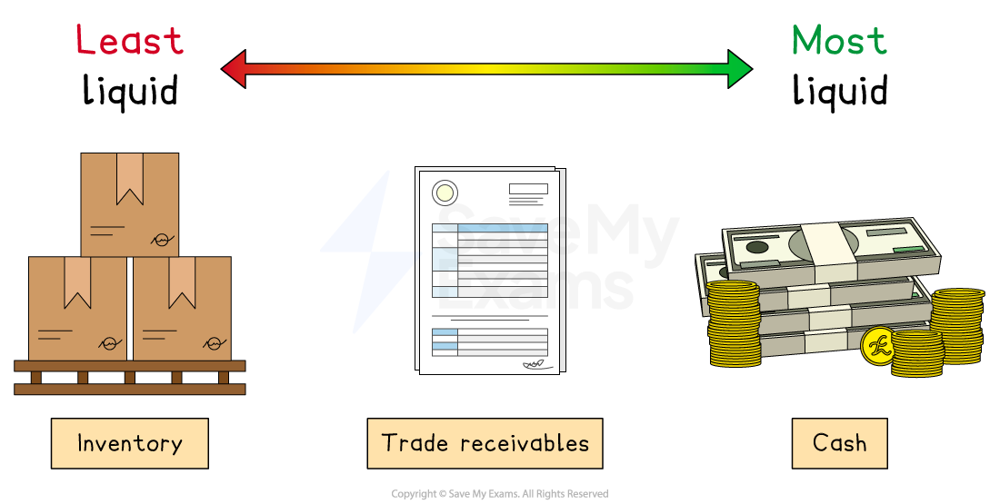
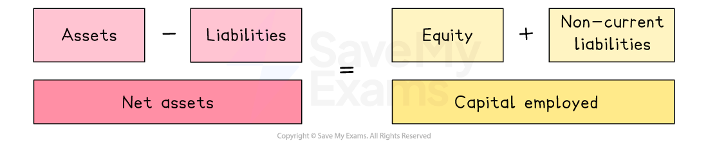

# Understanding the Statement of Financial Position

## Introduction to the statement of financial position

> **Spec point** — `spcpt_jK3YWMV3FkHj9YDs` · Note: candidates will not be assessed on constructing statements of financial position.

## What is the statement of financial position?

- **The statement of financial position shows the financial structure of a business at a specific point in time**

  - It identifies a business's ***assets***** **and ***liabilities*** and specifies the **capital **(equity)** **used to fund the business operations
- The statement of financial position is also known as the **balance sheet**

  - It is called the balance sheet, as **net assets **are **equal **to the** total equity – **the net assets and equity balance

#### A statement of financial position

*The statement of financial position shows assets and liabilities of a business and how the business is funded*

## Assets

> **Spec point** — `spcpt_KmWkFWpN8vhcg8h3` · "non-current assets, e.g. property (land and buildings), machinery
current assets, e.g. inventory, trade receivables, cash"

## Assets

- Assets are items **owned by a business**

  - There two type, namely, non-current assets and current assets

### Non-current assets

- **Non-current assets are owned by a business in the long-term, usually a period more than 12 months**

  - Examples include ***tangible*** assets such as buildings, land, machinery and vehicles
  - Non-current assets may be ***intangible***, such as patents, goodwill or  brand value

### Current assets

- **Current assets include cash and items that can be turned into cash relatively quickly, usually within 12 months**

  - The three main types of current assets are **cash**, ***trade receivables*** and ***inventory***

*Cash is the most liquid current asset, while inventory is the least liquid*

- Cash is the most *liquid* form of current asset, as it can be used immediately as a method of payment
- Inventory is the least liquid form of current asset, as, before it can be used for payment, it must be sold

## Liabilities

> **Spec point** — `spcpt_2kbCSh5CDDsTSSG3` · "non-current liabilities, e.g. bank loans
current liabilities, e.g. trade payables, overdraft"

## Liabilities

- **Liabilities are amounts of money owed by a business (debts) **

  - **Non-current liabilities** are amounts owed that do not need to be paid back for at least 12 months
  
    - For example, long-term loans such as ***mortgages***
  - **Current liabilities** are amounts owed that must be repaid within 12 months
  
    - For example, ***creditors*** (trade payables) and bank ***overdrafts***

## Capital employed

> **Spec point** — `spcpt_Dm9jSJjfXK7r5BTt`

## Capital employed

- **Capital employed is the total amount of money that a business uses to operate and grow **
- It usually includes:

  - **Equity**
  
    - Money invested by the owners or shareholders.
  - **Non-current liabilities**
  
    - Long-term loans or borrowings
- In the statement of financial position, capital employed is **equal to net assets**

* Capital employed is equal to net assets*

## Calculations based on the statement of financial position

> **Spec point** — `spcpt_zzQHTBdxqxc3Hbmn` · "make simple calculations based on statements of financial position: total assets, total liabilities,
working capital"

## Calculations based on the statement of financial position

**Statement of financial position**

**Chagny Rentals Ltd at 31st December 2024**

*Chagny Rentals Ltd's statement of financial position at 31st December 2024*

### 1. Calculating total assets

- Total assets are the **sum of non-current assets and current assets**
- This figure represents **everything a business owns** at a specific point in time

> **Worked Example**
> In this case, Chagny Rentals Ltd has total assets of
> 
> `equals space $ 490 comma 000 space plus space $ 64 comma 000
> 
> equals space $ 554 comma 000`

### 2. Calculating total liabilities

- Total liabilities are the **sum of current liabilities and non-current liabilities**
- This figure represents **everything a business owes **at a specific point in time

> **Worked Example**
> In this case, Chagny Rentals Ltd has total liabilities of
> 
> `equals space $ 22 comma 700 plus space $ 146 comma 000
> 
> equals space $ 168 comma 700`

### 3. Calculating working capital

- Working capital is the **money a business has available for day-to-day activities**, such as paying bills, buying stock and covering wages
- It is calculated using the formula

$\mathrm{Working} \mathrm{capital}-\mathrm{Current} \mathrm{assets}-\mathrm{Current} \mathrm{liabilities}$

> **Worked Example**
> In this case, Chagny Rentals Ltd has working capital of
> 
> `equals space $ 64 comma 000 space minus space $ 22 comma 700
> 
> equals space $ 41 comma 300`
> 
> It is likely to be able to meet its financial obligations because it has** more current assets than current liabilities**

## Decisions based on the statement of financial position

> **Spec point** — `spcpt_jgXJ3F2CH9sfVHn4`

## Decisions based on the statement of financial position

- The statement of financial position can be used to answer important questions that may support business decisions

| Question | Based on | Explanation |
|---|---|---|
| **Can the business pay short-term debts?** | - Working capital | - **If working capital is too low**, the business may struggle with day-to-day payments |
| **Should the business invest in new equipment?** | - Non-current assets and capital employed | - Helps assess if the business has enough long-term funds for investment |
| **Is the business taking on too much debt?** | - Total liabilities | - **High debt can increase risk** and interest costs |
| **Is the business growing?** | - Compare with previous statements | - Increases in** assets and capital **may show growth |

> **Exam Hint**
> Remember, a statement of financial position is a **snapshot** of assets and liabilities at one point in time, unlike a profit and loss statement which shows performance over a period of time, usually a year
