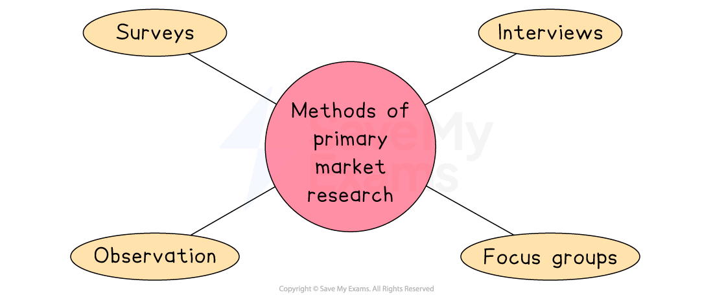
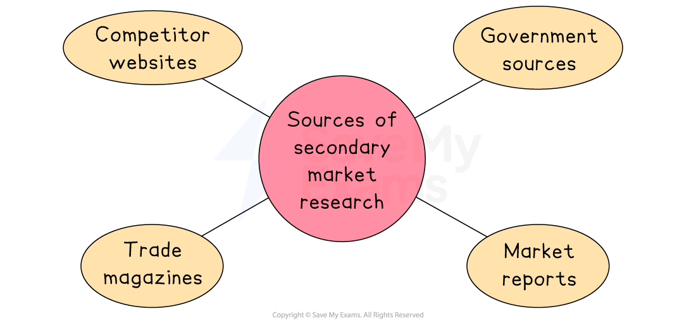

# Methods of Market Research

## Why businesses use market research

> **Spec point** — `spcpt_m8w9TPXQtwf2Q5Ns`

## Why do businesses use market research?

- **Market research is the collection, compilation and analysis of information about a market**
- Effective market research helps a business

  - **Reduce risk** when launching new products or entering new markets
  - Identify and understand the **future needs and wants of customers**
  - Understand **consumer behaviour **
  - Identify how much consumers are **prepared to pay**
  - Identify potential ***gaps**** ****in the market*** which can be exploited to increase sales
  - **Identify competitors** and gauge their potential strengths and weaknesses
- With effective market research businesses are well-placed to **make informed decisions** about the **most effective way** to use their valuable resources and **develop a suitable** ***marketing mix***
- **On-going market research** helps businesses to update their **marketing *****strategy*** in line with customers' changing needs and preferences

## Primary market research

> **Spec point** — `spcpt_gZTcGJnGJryWfGxD` · "primary research methods, e.g. questionnaires or surveys, interviews, focus groups, observation
advantages and disadvantages of primary market research methods"

## Primary market research

- **Primary market research is the process of gathering information directly from consumers in the target market **

  - This process gathers **information that **does not already exist and is specific to the needs of the business collecting it
- **Surveys**,** interviews **and** focus groups **are common primary market research methods

  - These methods make use of ***questionnaires*** to **organise research questions and responses**

*Primary market research methods include surveys, interviews, observation and focus groups*

### Primary market research methods

#### Surveys

- A series of questions are posed to a defined number of people using a questionnaire
- Surveys can be conducted face-to-face, online, by phone or by post

| **Advantages** | **Disadvantages** |
|---|---|
| - Can reach a wide audience quickly - Data is easy to compare and analyse | - Responses may be rushed or dishonest - Limited opportunity for follow-up or clarification |

#### Interviews

- A formal meeting between a researcher and a customer using structured or semi-structured questions
- Interviews allow detailed responses and observation of body language

| **Advantages** | **Disadvantages** |
|---|---|
| - In-depth and detailed responses - Can explore topics further through follow-up questions | - Time-consuming and expensive - Results may be harder to compare due to open-ended answers |

#### Observation

- A market researcher watches consumer behaviour in real time, such as shopping patterns, product placement, or packaging influence

| **Advantages** | **Disadvantages** |
|---|---|
| - Shows actual behaviour rather than reported behaviour - Useful for identifying trends or problems | - Cannot always understand reasons behind actions - Can be intrusive or affect natural behaviour |

#### Focus groups

- Small group discussions led by a specialist to gather detailed feedback from target customers on products, services, or marketing strategies

| **Advantages** | **Disadvantages** |
|---|---|
| - Provides deep insights and opinions - Can test ideas before wider launch | - A small sample size may not represent wider market - Dominant voices may skew the discussion |

## Sampling

> **Spec point** — `spcpt_DKsRnqX7RXPvxNRv` · the concept of sampling and why it is useful to businesses

## Sampling

- Primary market research is conducted with a **small representative** **sample** of the market as a whole

  - Market researchers use carefully designed sampling methods from which accurate **conclusions can be drawn **about likely customer preferences and behaviour
  - In general,** the larger the sample size, the more likely it is that results of market research activities will reflect the market as a whole**

### Why is sampling useful?

- **It saves time and money**

  - It is usually too expensive and time-consuming to collect data from every potential customer
  - Sampling allows the business to get useful information quickly and at a lower cost
- **It can provides reliable insights**

  - If the sample is chosen carefully, it can represent the larger market
  - This means the business can still learn about customer preferences, buying habits, or opinions without needing to ask everyone
- **It helps a business make better decisions**

  - Sampling allows a business to test ideas, such as new products or adverts, before launching on a larger scale
  - This helps reduce risk
- **It is useful for identifying trends**

  - By asking a smaller group of people from different segments, a business can spot patterns in customer behaviour or preferences

## Secondary market research

> **Spec point** — `spcpt_5DBTqxYRfh5GqDHz` · "secondary research methods, e.g. competitor websites, government sources, market reports,
trade magazines
advantages and disadvantages of secondary market research methods"

## Secondary market research

- **Secondary research involves the collection, compilation, and analysis of data that already exists**

  - It helps businesses make informed decisions without carrying out their own primary market research
- Businesses must weigh up the **reliability** of secondary market research and aspects such as **cost, relevance **and **availability** of data when making a decision on which secondary data to use

*Secondary market research can be sources from competitor websites, government data, trade magazines and market reports*

### Sources of secondary market research

#### Competitor websites

- Businesses can visit the websites of their competitors to gather useful information about their products, pricing, promotions, customer service and branding

**Why are they useful?**

- Comparing prices and features
- Identifying current marketing strategies
- Understanding how competitors position themselves in the market

#### Government sources

- Governments publish a wide range of free and reliable data, including statistics on population, employment, income, business activity and *economic growth*

**Why are they useful?**

- Spotting *demographic* trends (e.g. ageing population)
- Analysing the economic climate (e.g. *inflation*, *interest rates*)
- Understanding changes in consumer spending or regional business conditions

#### Market reports

- Market research companies, such as Mintel or Euromonitor, produce in-depth reports on industries, consumer trends and market performance
- These are usually detailed and may be expensive to access

**Why are they useful?**

- Assessing *market size* and growth
- Understanding consumer behaviour and preferences
- Identifying future opportunities or threats in a market

#### Trade magazines

- Magazines focused on a specific industry, often published by trade associations or business groups
- They include news, expert opinions and case studies

**Why are they useful?**

- Staying up-to-date on trends, new products, and *innovations*
- Monitoring competitor activity within the industry
- Gaining insight into best practices and future developments

### Evaluating secondary market research

| **Advantages** | **Disadvantages** |
|---|---|
| - **Cost-effective**    - Secondary research is often cheaper than conducting primary research since the data already exists - **Time-saving**    - Information can be accessed quickly without needing to collect new data - **Wide range of data**    - It covers many topics and often has large sample sizes, offering valuable insights | - **It may be outdated**    - Information might not reflect current market trends or customer preferences - **Lack of relevance**    - Data might not be specific enough for the business’s needs, so primary market research may also be needed - **Unknown accuracy**    - The reliability of the data can be uncertain if the original source is unclear or *biased* |

> **Exam Hint**
> Be careful not to confuse **primary** and **secondary** research – primary gathers new data (e.g. surveys), while secondary uses existing data (e.g. reports). Mixing these up is a common exam mistake

## Factors influencing the accuracy of market research data

> **Spec point** — `spcpt_mV3HM2M5MdBv9Fg3`

## Factors influencing the accuracy of market research data

- The **reliability **and **accuracy **of market research depends upon a large number of factors, including:

### 1. Question phrasing

- How **questions are phrased **in** questionnaires **or other tools used to conduct surveys

  - Questions should be written in such a way that they do not encourage a *predetermined* response

### 2. Sample selection

- How **carefully the sample is selected**

  - Including its **size**,** types of respondent** chosen and how closely these reflect the intended ***target market***

#### 3. Skills of interviewer

- **Who conducts the research **including their **experience**, research **skills** and **source** (primary or secondary?)
- Potential for ***bias*** when conducting research or analysing results

  - The research and its analysis should be as *objective* as possible

### 4. Time and place of research

- **When and where **the research is conducted

  - Customer tastes, fashions, economic conditions and technology change, giving data a relatively short period of usefulness
  - Customers in different geographic areas can have very different opinions
