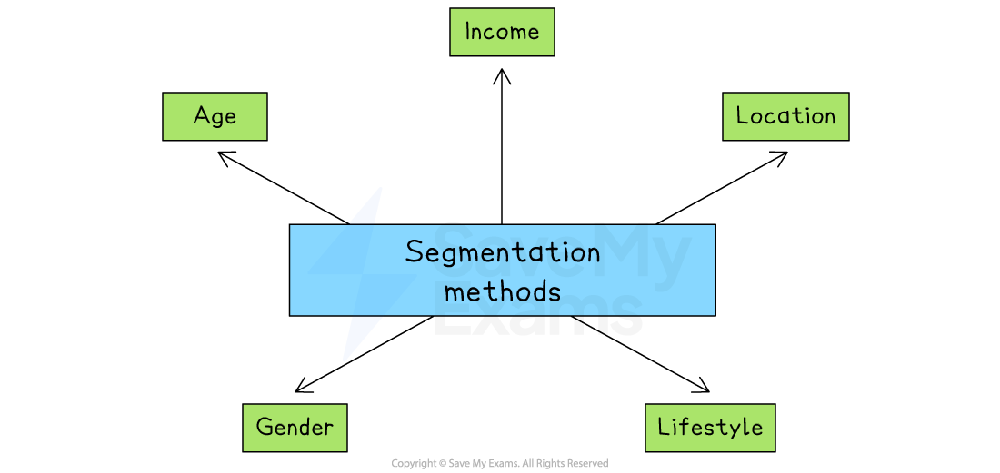

# Market Segmentation

## Why businesses segment the market

> **Spec point** — `spcpt_pTnP8HBQ8tnMXndt`

## Why businesses segment the market

- **Market segmentation** is where a single market is **divided into submarkets**, or **'segments**'

  - Each segment represents a slightly different set of **customer characteristics**
  - This allows businesses to** tailor products **to suit specific groups, making customers more likely to buy
  
    - For example, a skincare company can offer different products for teenagers and older adults, who have different skin concerns
- Marketing messages can be designed to appeal directly to each segment, making *advertising* clearer and persuasive

  - For example, a fitness brand may use social media to target young adults, but email newsletters for older gym-goers
- Focusing on specific segments helps businesses avoid wasting time and money advertising to people who are unlikely to be interested

  - For example,** **a luxury brand avoids promoting its products to low-income customers who are unlikely to buy

## How markets can be segmented

> **Spec point** — `spcpt_bGhkZBBrTk6XzH3M` · age, income, location, gender, lifestyle

## How markets can be segmented

#### Ways to segment a market

*Markets can be segmented by age, income, location, gender and lifestyle*

**1. Age**

- Businesses group customers by age, as different age groups tend to have different interests, needs, and spending habits

  - For example, a toy retailer targets products like Lego at children aged 6–12, while mobile phone brands may market to teens using social media platforms like TikTok

**2. Income**

- Customers are grouped based on how much money they earn. Some products are aimed at budget-conscious buyers, while others target higher-income customers willing to pay more

  - For example,  Primark sells low-cost clothing for price-sensitive shoppers, while brands like Gucci or Rolex target high-income luxury buyers

**3. Location**

- This involves targeting customers based on where they live. Products and promotions may change depending on local tastes, climate, or culture

  - For example,  a surfwear brand might advertise more heavily in coastal areas, while supermarkets in colder regions may stock more winter foods during certain months

**4. Gender**

- Some products are marketed differently to men and women based on preferences or roles in society, though this is now approached more carefully to avoid stereotypes

  - For example,  razor brands often sell separate product ranges for men and women, with different colours, packaging and advertising styles

**5. Lifestyle**

- Lifestyle segmentation focuses on people's interests, hobbies, values, or how they spend their time

  - For example, a supermarkt may target protein shakes at people who are fitness-focused, while promoting eco-friendly cleaning products to environmentally conscious consumers

> **Case Study**
> **Segmentation in the crisps market**
> 
> 
> 
> - The crisp market is not one single market
> 
>   - It is **divided into distinct market segments**, based on customer needs, preferences, income levels, and lifestyles
> - Different crisp brands target different segments
> 
> | **Segment** | **Description** | **Example brands** |
> |---|---|---|
> | **Health-conscious consumers** | - Targeted at people looking for low-fat, low-calorie, or baked alternatives as part of a healthier lifestyle | - Walkers Baked - Popchips - Eat Real - Snack a Jacks |
> | **Premium buyers** | - Targeted at higher-income or more brand-conscious consumers - They want a premium product with unique flavours or *artisanal* packaging | - Kettle Chips - Tyrrells - Walkers Sensations - Burts |
> | **Value-seeking families** | - Aimed at the mass market, especially families buying in bulk for packed lunches or general snacking at an affordable price | - Walkers multipacks - Hula Hoops - Space Raiders - Pom Bear |
> | **Youth and casual snackers** | - Designed to appeal to children, teens, and younger adults through bold flavours, fun shapes or *branding* | - Monster Munch - Quavers - Wotsits |
> | **Event and sharing occasions** | - Larger packs or stackable tubs intended for social situations such as parties or movie nights | - Pringles - Walkers Max Share Bags |

## Advantages and disadvantages of market segmentation

> **Spec point** — `spcpt_wPGD44fFvDcqHzNj`

## Advantages and disadvantages of market segmentation

| **Advantages** | **Disadvantages** |
|---|---|
| - Recognises that **consumers **are **not all identical;** consumer groups do not all share the same tastes and preferences - **Products** and marketing activities can be altered to **meet different needs of different groups of consumers** and targeted more precisely - **Less expensive and wasteful** than marketing products at wide market segments - It may increase** loyalty **if the consumer feels that their **needs are being met, **which** can lead to repeat purchases ** | - Not everyone within a segment will behave in the same way - It may be** difficult to identify a segment **and** **consumers can belong to multiple segments at the same time - Segmentation requires **more detailed  *****market research*****,** which can prove costly but beneficial to the business - A segment may be** **identified but it may be too **small **and **unprofitable** to cater to |

> **Exam Hint**
> Don’t just list ways to segment a market – examiners reward answers that **explain why segmentation helps a business target customers more effectively**
