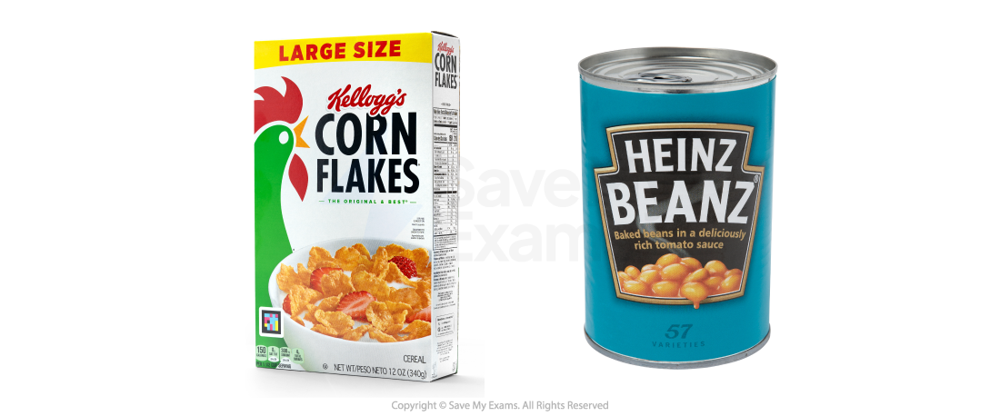

# Mass Markets & Niche Markets

## Mass markets

> **Spec point** — `spcpt_sK3gCqMCx7djNm7B` · "concepts of mass markets and niche markets
advantages and disadvantages of mass markets and niche markets"

## Mass markets

- In** mass markets, **products are aimed at broad  ***market segments***

  - **Mass marketing** occurs when businesses sell their products to most of the available market
  - Production usually happens on a **large scale**
  - Products are generally **standardised **with** little *****differentiation***

#### Examples of mass market brands

*Mass market products are aimed at large groups of customers with similar needs*

#### Evaluating mass markets

| **Advantages** | **Disadvantages** |
|---|---|
| - Mass production allows the business to benefit from ***economies of scale***, reducing average costs - **Lower prices** make products more affordable, leading to **higher sales volumes** - The business can target a **large customer base**, increasing the chance of strong demand - **Mass marketing methods** (e.g. TV, social media) allow efficient promotion to a wide audience | - Products are often **less unique**, as they are designed to appeal to a wide audience - **High levels of competition** can make it difficult to stand out and often force prices down - ***Profit margins***** are lower**, as prices are often kept low to attract mass market buyers |

## Niche markets

> **Spec point** — `spcpt_tgY7YRvzMnqjPMV6`

## Niche markets

- In **niche markets, **products are aimed at a small subset of the larger market, e.g. *gluten-free* products

  - **Niche marketing **occurs when businesses identify and satisfy the demands of a **small group of consumers** within the wider market
  - Production usually happens on a **small scale**
  - Products may be **made to order** or produced with **very specific customer needs** in mind

#### Examples of niche market brands

*Niche product include specialist haircare, adapted technology such as phones and gluten-free food*

- Some **niche markets become mass markets** as large businesses start to realise the potential for growth

  - For example, energy drinks started out as ‘niche products’ aimed at fitness enthusiasts, but as prices have fallen and more choices are available, they have become mass-market products

#### Evaluating niche markets

| **Advantages** | **Disadvantages** |
|---|---|
| - Products are **highly specialised and unique**, meeting the specific needs of a smaller customer group - The business can develop **expert knowledge **and a** strong reputation** within its chosen market - Customers are often willing to pay ***premium prices***, leading to **higher profit margins** - Less direct competition means it's easier to **build customer loyalty **and **brand recognition** | - **Higher production costs** due to smaller scale and limited demand - Businesses **do not benefit from economies of scale**, which can make pricing less competitive - **Sales volumes are lower**, as products may be less affordable and appeal to fewer people - The business may become **too dependent on one product or market**, increasing risk |

> **Exam Hint**
> Avoid vague definitions – show understanding by linking each to **advantages and disadvantages**, e.g. mass markets spread risk but face intense competition, while niche markets face less competition but limited demand
