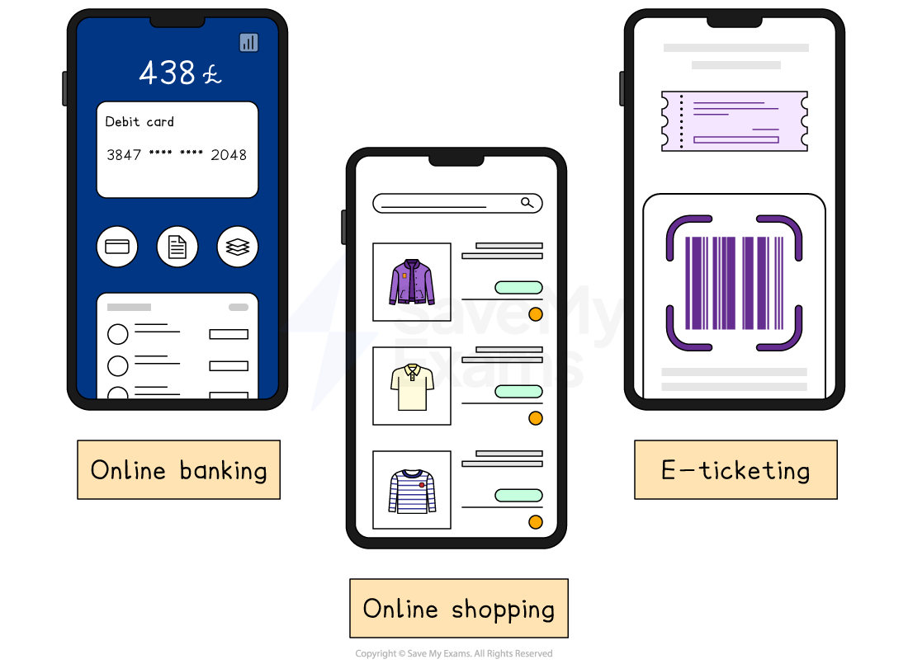

# Ecommerce

## The nature of ecommerce

> **Spec point** — `spcpt_Mkx8WxCyW83PzdXJ` · examples of ecommerce, e.g. mobile phone/internet banking, online shopping, online ticketing

## The nature of ecommerce

- **E-commerce is the trade of goods and services over the internet**

  - The rise of e-commerce means customers **increasingly pay online **using payment systems such as Apple Pay and PayPal

### Examples of ecommerce

*Online banking, shopping and ticketing are examples of ecommerce*

- Businesses can sell goods through their **own websites **or via **selling platforms** such as Amazon, Ebay and Etsy
- Financial institutions, such as banks, can provide their service via **mobile apps**

  - Customers can manage their bank accounts, transfer money, manage lending and pay bills online
- **E-ticketing** facilities provide paper-free access to events and transport

## Evaluation of ecommerce

> **Spec point** — `spcpt_vtsXZ9nsqw6bFKzH` · "advantages and disadvantages of ecommerce for businesses
advantages and disadvantages of ecommerce for customers"

## Evaluating the use of ecommerce

- E-commerce can make life **more convenient for customers** and is a source of ***competitive advantage ***for businesses

  - It also provides the **potential **for small businesses to **reach large audiences**
- However, **setting up an webstore or app can be costly**

  - Some consumers may also be concerned about **security risks** of purchasing online

### Advantages and disadvantages of ecommerce for businesses and consumers

| ** ** | **Advantages** | **Disadvantages** |
|---|---|---|
| **Businesses** | - Websites provide a **cheap and direct way** to promote products - Businesses can **easily order supplies** and materials online - A clear and user-friendly website can **increase customer purchases**    - For example, automation can suggest related items - *Dynamic pricing* allows higher profits during busy periods | - Businesses face **global competition**, making it easy for customers to switch brands - Large warehouses and **efficient stock systems** are needed to meet demand - E-commerce does **not work well for personal services **like beauty treatments or home repairs - The lack of face-to-face contact **limits fast and useful customer feedback** |
| **Consumers** | - Online competition helps **lower prices** and allows easy comparison - Paying by *credit card* or *debit card* is quick and simple    - For example, services like Apple Pay allow one-click purchases - Shopping online is **convenient** from any place, at any time and on any device - Customers have a **wider choice** from global *retailers* such as Shein and Temu | - Poor internet or **technical problems** can stop customers from buying online - Customers in low-income areas may struggle to access products due to poor *infrastructure* - Many people worry about **credit card fraud** or *identity theft* - Products **cannot be tested** before buying, so returns are more common |

> **Exam Hint**
> Avoid assuming ecommerce suits every business – in exams, stronger answers recognise its limits, such as products that customers prefer to **see or try before buying**
