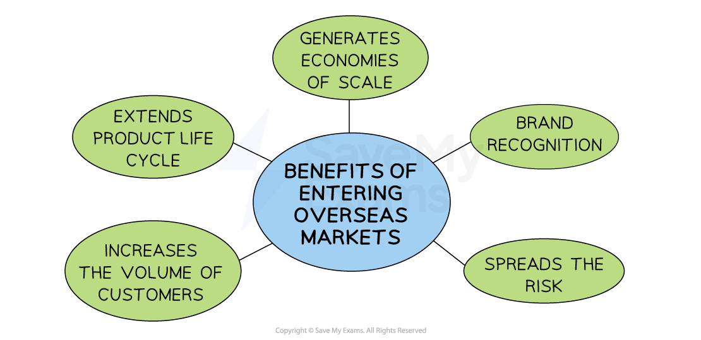

# Entering Overseas Markets

## Why businesses enter new markets overseas

> **Spec point** — `spcpt_rMMytmrhnXk82Zsc` · e.g. increase sales, spread risk

## Why businesses enter new markets overseas

- Entering new international markets has proved **attractive to many businesses**

  - The** internet** makes it easier than ever to enter international markets
  - **Financial systems** are much more joined up, making it much easier for money to flow between countries
  - This is a natural part of growth once a successful business has saturated their market share for a particular product

*Entering and operating successfully in international markets can generate higher levels of profit*

### Reasons for entering international markets

#### 1. Economies of scale

- By operating on a larger, international scale, a business can lower its unit costs through bulk buying, more efficient production and spreading fixed costs across a higher output
- This can lead to **higher profit margins** or allow the business to reduce prices to attract more customers and gain market share

  - For example, **IKEA **expanded into countries beyond Sweden to reduce production and distribution costs, sourcing and manufacturing in bulk for a global customer base

#### 2. Brand recognition

- Expanding internationally can increase the visibility of a business's brand, including its name, logo, and packaging
- This is especially important for businesses that use the same branding and sell the same products globally
- Greater brand awareness can lead to **stronger customer loyalty** and more repeat purchases

  - For example, **Apple **uses consistent branding worldwide, which has helped it build a loyal global customer base and a premium image

#### 3. Spreading risk

- Entering overseas markets reduces a business’s dependence on just one country
- This makes the business less vulnerable to **economic or political problems** in its domestic market and allows it to spread its risks

  - For example, **McDonalds **operates in over 100 countries, which helps protect it if sales drop in one region due to economic issues or changing consumer trends

#### 4. Increased sales revenue

- Selling in international markets allows a business to reach more customers and increase total revenue
- It can also help the business benefit from **distribution economies of scale**, such as cheaper transport costs per unit when selling larger quantities globally

  - For example,  **Amazon **entered markets like India and Brazil to access large customer bases and grow its overall revenue

#### 5. Extending the product life cycle

- When demand for a product begins to fall in the domestic market due to saturation or changing trends, selling it in overseas markets can **extend its life cycle**
- This can reduce the need for immediate investment in new product development

  - For example, **Coca-Cola **continues to sell mature soft drink flavours in emerging markets even after demand has declined in some developed countries

> **Exam Hint**
> Avoid assuming all products can be sold the same way abroad – examiners credit answers that recognise the need to **adapt marketing mix elements** (like promotion or packaging) to suit local markets

## Disadvantages of entering new markets overseas

> **Spec point** — `spcpt_NP5b6xJPpxcnzyP7` · "e.g. cultural differences, lack of
knowledge, legal requirements"

## Disadvantages of entering new markets overseas

- Businesses also face several challenges when entering a new country
- These problems can lead to high costs, legal issues or failure to attract local customers if not managed carefully

#### 1. Cultural differences

- Different countries often have unique *customs*, values, languages and expectations
- If a business does not understand these differences, its marketing or products may offend customers or simply fail to appeal

  - Advertising that works in one country may be seen as inappropriate in another
  - Words, symbols or images used in one country might carry completely different or even offensive meanings in another
  - Product flavours, features or *aesthetics *that are popular in one country may not appeal to consumers in another
- Businesses must adapt their products and messages to fit the local culture to avoid misunderstandings and lost sales.

#### 2. Lack of local knowledge

- Businesses entering a new market may not fully understand the local competition, customer needs or buying habits

  - This can lead to poor decisions about pricing, promotion or product design
- Without local knowledge, a business might choose the wrong location or struggle to connect with the right *target market*
- Partnering with local firms or conducting thorough *market research* can help reduce this risk

#### 3. Legal requirements

- Each country has its own laws and regulations that businesses must follow
- These may include rules about advertising, product safety, employment and taxes
- Failing to follow local laws can lead to *fines*, legal action, or being excluded from the market

  - For example, food products may need specific labels, or online platforms may have to follow *data protection* laws
- Businesses must study legal requirements carefully before entering a new country.
