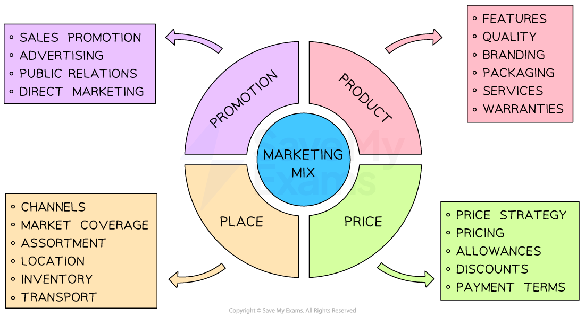

# Introduction to the Marketing Mix

## The 4 Ps

> **Spec point** — `spcpt_SMJQhPQwqXjxX5dT`

## The 4 Ps

- The **marketing mix **provides a framework for businesses to create and implement** successful marketing strategies**

  - Sometimes known as the '**Four P's',** it represents the key elements of a marketing strategy:
  
    - **Product**
    - **Price**
    - **Place**
    - **Promotion**
  - These four components work together to satisfy the **needs and wants of a target market **while achieving the company's objectives
- By understanding and manipulating the marketing mix, businesses can **differentiate **themselves from competitors, maximise **marketing impact **and achieve **long-term success**

#### The four P's of the marketing mix

*Businesses combine the 4 P's of the marketing mix in appropriate and unique ways to maximise their chances of success*

> **Exam Hint**
> Avoid assuming all 4Ps are equally important – in exams, stronger answers **identify which element is most critical in the given case study** and explain why

## Integrating the 4 P's

> **Spec point** — `spcpt_5JtzrnWxfqfbZgrZ`

## Integrating the 4 P's

- **An integrated marketing mix is one which combines each element in the best possible way**
- A **change in one element **can have a significant **impact on the others**
- An integrated marketing mix can help build a ***competitive advantage***
- By** creating a cohesive marketing strategy** that resonates with customers, the business is **set apart **from its competitors

#### How changes to one element can change the entire mix

| **Changes to the product** | **Changes to price** |
|---|---|
| - The product/service is at the **heart of the marketing mix,** as it is what the customer is buying    - The product determines the price, the target audience, and the promotion strategy - If the product changes, then all other elements of the mix will likely **need to change**    - For example, if a business decides to launch a **premium version of its product**, it may need to increase the price, target a different audience and use a **different promotion strategy** to reflect the new product's value | - The price of a product is closely linked to its **perceived brand value**    - If a product is priced too high, it may be perceived as too expensive by the target audience, leading to lower sales   - If a product is priced too low, it may be **perceived as low quality**, leading to lower sales - Increasing the price may require changes to the promotion strategy, which are aimed at convincing consumers of the **product's value** |
| **Changes to promotion** | **Changes to place** |
| - The chosen promotion strategy can affect price and distribution channels    - For example, if a business decides to launch a **high-end promotion strategy**, it may need to increase the price to reflect the product's value | - The chosen *distribution channels* can affect the price and promotion strategy    - For example, if a business decides to use **exclusive distribution channels,** it may need to increase the price to reflect the exclusivity of the product |

#### Nike's integrated marketing mix

| **Product** | **Price** |
|---|---|
| - The company's products are known for their **high quality** and *innovative* design - This has helped to create a perception of exclusivity and quality | - Nike's pricing strategy is focused on **premium prices** that reflect the value of the product - This reinforces the **brand's *****premium positioning*** |
| **Promotion** | **Place** |
| - Nike's promotion strategy is focused on **creating a unique brand image** and messaging that resonates with its target audience - An integrated marketing mix can help build a ***competitive advantage*** - By** creating a cohesive marketing strategy** that resonates with customers, the business is **set apart **from its competitors. The company's "Just Do It" campaign focuses on **celebrating athleticism and determination**    - This aligns with the brand's reputation for being a leader in sports apparel | - Nike's distribution strategy is focused on creating a **seamless online and offline shopping experience**    - This makes it easy for customers to purchase the brand's products |
