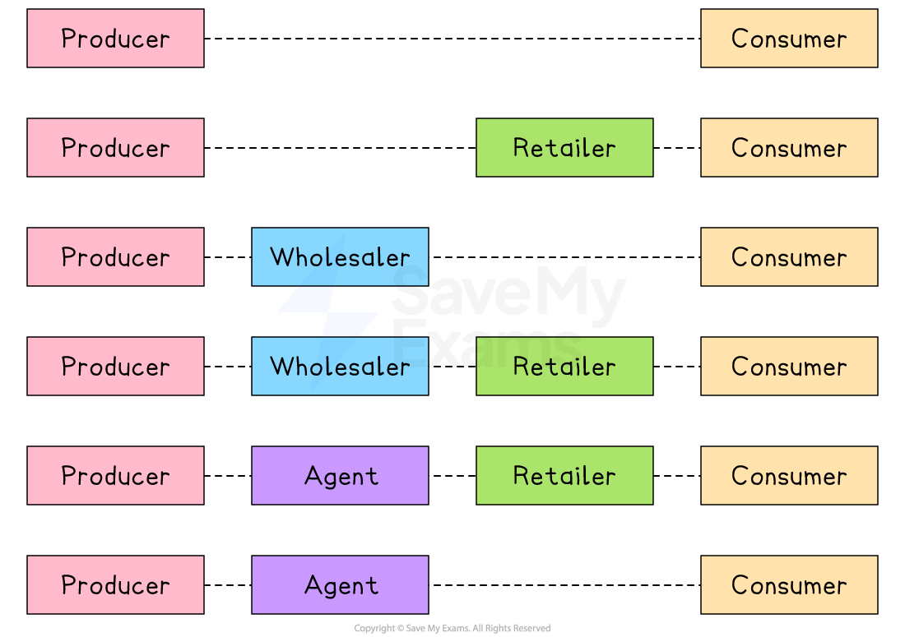
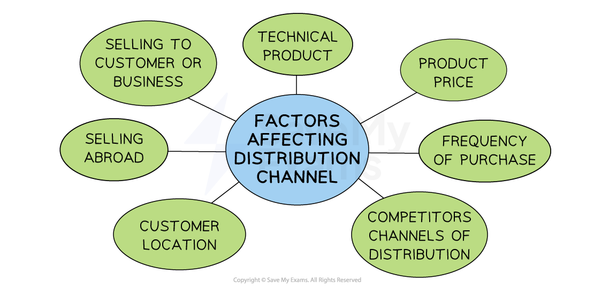

# Place

## Introduction to Place

> **Spec point** — `spcpt_Xg4wMzbRhJ3tBKBj`

## Introduction to place

- **Place in the marketing mix refers to where customers purchase a business's products and the *****distribution channels***** used to move the product from producer to consumer**
- In a competitive environment, location and distribution decisions can give a company a ***competitive advantage***

  - Businesses could locate themselves in areas with** high foot traffic** to achieve high sales volumes
  - They may use **online channels** to reach customers who prefer to shop from the comfort of their own home
- **Changing consumer needs can impact the way businesses distribute their products**

  - **E-commerce** makes it easier for consumers to **shop online** and have products delivered to their doorstep
  
    - Many businesses have therefore invested in their online presence, offering **convenience and fast delivery **to meet customer needs

## Distribution channels

> **Spec point** — `spcpt_Cq6XjKczsgfZhBgF` · "advantages and disadvantages of different distribution channels: direct to customers, through
retailers, wholesalers, agents"

## Distribution channels

- **Distribution channels refer to the *****intermediaries***** through which products move from the business to the end customer **

*Distribution channels could involve retailers, wholesalers and agents*

### 1. Direct to customers

- The business sells its products **straight to the customer** without using any intermediaries

  - For example, a bakery sells bread directly to customers at a local market or in its own store

| Advantages | Disadvantages |
|---|---|
| - The business has full control over the customer experience and pricing - Higher *profit margins* as there is no middlemen with whom the producer has to share profits | - It can be expensive and time-consuming to manage sales and delivery - It is hard to reach a wide audience without extra investment |

### Through retailers

- The business sells its products to a retailer, who then sells them to final customers.

  - For example, a clothing brand like Levi’s sells its jeans through department stores like Farmers in New Zealand

| Advantages | Disadvantages |
|---|---|
| - Retailers already have access to lots of customers - It saves the producer time and resources on selling and distribution | - Retailers take a share of the profits - The producer has less control over pricing, display and customer service |

### Through wholesalers

- The business sells large quantities to a wholesaler, who then sells smaller amounts to retailers or customers

  - For example,  soft drinks businesses like PepsiCo sell to wholesalers who supply small convenience stores

| Advantages | Disadvantages |
|---|---|
| - Wholesalers buy in bulk, so the producer sells high volumes quickly - It reduces storage and transport responsibilities for the producer | - Lower profit margins are achieved due to *bulk discounts* - The producer has less control over how the product is promoted or sold to retailers |

### Through agents

- An agent acts as a specialist *middleman *who helps sell the product, often in another country or market, earning a commission
- Agents can negotiate with retailers or individual customers

  - For example, a wine producer in South Africa using an export agent to sell wines in Europe

| Advantages | Disadvantages |
|---|---|
| - Agents are useful for entering foreign or unfamiliar markets - It reduces the need for in-house sales teams | - Agents take a *commission*, reducing profits - The producer has less direct contact with customers, so it may be harder to build brand loyalty |

## Recommending a suitable distribution channel

> **Spec point** — `spcpt_nkDVDJTTTMjKJB7t` · recommend and justify an appropriate distribution channel for a given situation

## Recommending a suitable distribution channel

- The **choice of distribution channel chosen by a business** depends on a variety of factors
- The following questions are worth considering when **establishing** a distribution channel

  - Do consumers want to speak to a *salesperson*?
  - Will customers want to handle the product before they make a purchase?
  - Would they prefer to purchase it online?
  - Does the product require special handling, such as protective packaging or quick delivery?

*Getting the distribution channel right will increase sales revenue and profit*

### Factors affecting the choice of channel

#### 1. Type of product

- If sold to producers of other goods, distribution is likely to be direct or via a specialist wholesaler

  - For example, **JCB** sells excavators directly to construction companies
  - Specialist wholesalers such as France's **Bricoman** sell consumable building supplies such as nuts, bolts and cement to builders

#### 2. Frequency of purchase

- If the product is bought on a daily basis, retail stores provide convenience for consumers

  - For example, **Milka** chocolate is sold in most EU-based supermarkets

#### 3. The price of the product

- If the products is an expensive luxury good, it would be best sold through a few specialist outlets

  - For example, **Rolex** watches are sold in high-end jewellery stores

#### 4. The durability of the product

- *Perishable *product like fruit and vegetables are distributed through retailers, sometimes via wholesalers, to be sold quickly

#### 5. Proximity of customers

- If customers are located over the world, e-commerce is likely to be a suitable distribution channel

#### 6. Competitors distribution channels

- Products need to be sold where competitors are selling so that a business can compete effectively

  - For example, **Nestlé** cereals are sold alongside **Kelloggs** cereals in a wide range of retail outlets

#### 7. Technical specifications

- If technical information needs to be passed to the customer, direct selling or a retailer is usually preferred

  - For example, **Apple Store** staff provide focused advice to customers purchasing its range of phones, computers and entertainment devices

> **Exam Hint**
> Don’t just name distribution channels – in exams, you must **explain why a channel is suitable** for the product, considering factors like cost, speed, and customer reach. The case study below demonstrates this.

> **Case Study**
> **Choosing the Right Distribution Channel for PureFlame**
> 
> PureFlame is a small business that makes high-quality, eco-friendly candles using natural ingredients
> 
> 
> 
> So far, it has sold products at local events and to friends and family, but now the owner, Priya, wants to expand and reach more customers in other regions
> 
> Priya is considering three main distribution channels
> 
> | **Channel** | **Advantages** | **Disadvantages** |
> |---|---|---|
> | **Selling through the PureFlame website** | - Gives Priya full control over pricing, product presentation and customer service | - Requires time and money to manage orders, shipping and customer support |
> | **Using an online marketplace like Etsy or Amazon** | - Reaches large numbers of customers that can help PureFlame grow quickly | - Charges fees and includes many similar products, making it harder to stand out |
> | **Supplying gift shops and eco-friendly retailers** | - Helps introduce the brand to new customers and builds trust through established retailers | - Retailers take a share of profits and PureFlame has less control over product display and pricing |
> 
> **Recommendation**
> 
> - Priya should start with an **online marketplace like Etsy**
> 
>   - It offers a wide customer base without the upfront costs of creating a website or the need to negotiate with retailers
> - Once PureFlame becomes more established, she can build her own website and explore retail partnerships to grow further
