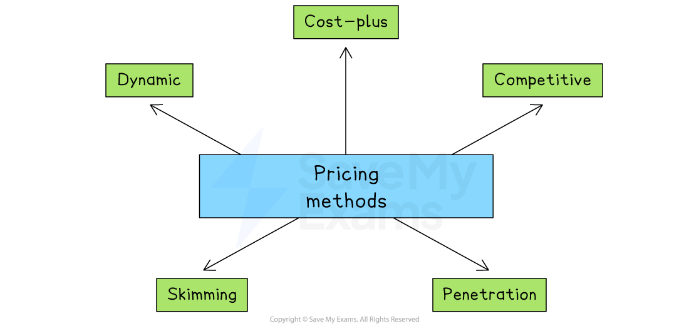

# Price

## Introduction to pricing methods

> **Spec point** — `spcpt_PggwK4GcVTjRXjY6`

## Introduction to pricing methods

- Choosing the right **pricing method **is essential for a business to be profitable, competitive, and successful in the long run
- By understanding their customers, competitors and costs, businesses can set prices that **maximise sales revenue** and **profits**
- Pricing can play a significant role in the ***market positioning***** **of the brand and help a firm to **compete with rivals**

#### Pricing methods

*Common pricing methods include cost-plus, penetration and skimming*

## Cost-plus pricing

> **Spec point** — `spcpt_j9pg7bkpv65RRxQ8` · "pricing methods: cost-plus, competitive, penetration, skimming, dynamic
advantages and disadvantages of different pricing methods"

## Cost-plus pricing

- The business calculates the **cost of production** and then adds a markup to determine the final price
- The markup covers the cost of production **plus the business's desired *****profit margin***
- This pricing strategy is simple and is commonly **used by manufacturers** that produce standardised goods, e.g., washing machines

| **Advantages** | **Disadvantages** |
|---|---|
| - A simple and quick method of calculating a price for a product - It ensures that a profit is made on each item sold | - It does not consider the needs of the market - Pricing methods of competitors are ignored |

## Competitive pricing

> **Spec point** — `spcpt_ZsNYSksHBPMh8M2P`

## Competitive pricing

- Competitive pricing is when a business sets its prices based on what its competitors are charging
- It is common in markets where there are many similar products, and customers can easily compare prices
- The goal is to attract or keep customers by offering prices that match or beat rivals

| **Advantages** | **Disadvantages** |
|---|---|
| - Helps the business stay competitive and protect its market share - Can attract price-sensitive customers who compare options before buying | - Requires regular monitoring of competitors’ prices, which can be time-consuming - It doesn’t always reflect the quality or value of the product |

> **Exam Hint**
> Watch out for confusing **cost-plus pricing** with **competitive pricing** – cost-plus is based on adding a mark-up to costs, while competitive depends on rivals’ prices

## Penetration pricing

> **Spec point** — `spcpt_s52s8wFCTNYgXGgy`

## Penetration pricing

- The business sets a** low price for a new product or service** when it is first introduced
- This is effective when a business wants to quickly **capture market share** and attract price-sensitive customers, e.g., many new perfumes launch using penetration pricing
- Once they have enough customers, the business will start to **raise the price**

| **Advantages** | **Disadvantages** |
|---|---|
| - Customers are attracted to buy the product at a low price, leading to high sales volume and market share - Competitors unable to match or beat the low price are forced out the market, leading to less competition | - Customers may perceive that the product is of low quality if the product is sold at a low price - Selling at a low price limits the amount of profit made |

## Skimming

> **Spec point** — `spcpt_Vbp9szRVNYBpGgTY`

## Skimming

- Setting a **high price** for a new product or service when it is **first introduced to the market**
- The price is gradually lowered to **ensure sales continue**

| **Advantages** | **Disadvantages** |
|---|---|
| - Works well for strong brands launching new, in-demand products (e.g. Apple) - High prices at launch help quickly recover research and marketing costs | - It is only suitable for well-known brands with loyal customers - Customers may get tired of high prices and switch to cheaper competitors |

## Dynamic pricing

> **Spec point** — `spcpt_5XWzR6GWMBgwPZZ5`

## Dynamic pricing

- Continuously adjusting prices in real time to reflect ***demand***, ***supply*** and other conditions
- Uses ***algorithms*** and data, such as time of day, inventory levels and competitor prices

  - For example, **Uber** raises fares during times of peak demand and lowers them when demand falls

| **Advantages** | **Disadvantages** |
|---|---|
| - Prices go up when demand is high and fall when demand is low, helping to keep income steady - Businesses like airlines or ride-sharing apps can charge more during busy times to make sure seats or cars go to people who really want them | - Customers may feel upset if prices rise suddenly, which can damage brand trust - It relies on advanced technology and constant monitoring, which can be costly and hard to manage. |

## Recommending a suitable pricing method

> **Spec point** — `spcpt_YK6gBTyHCGZXvynb` · recommend and justify an appropriate pricing method for a given situation

## Recommending a suitable pricing method

- A business should carefully consider a range of factors when deciding on an appropriate pricing method

#### Factors to consider when choosing a pricing method

| **Factor** | **Explanation** | **Example** |
|---|---|---|
| **USPs and differentiation** | - Products with more unique features can often be **sold at higher prices** | - Dyson vacuum cleaners have special features that allow premium pricing |
| **Technology** | - Online platforms have enabled new pricing models, like offering a free product with paid upgrades | - Farmville is free to play but users pay for extra features, creating high profit margins |
| **Level of competition** | - In very competitive markets, businesses may have to set **lower prices to attract **customers | - Budget airlines keep prices low to compete for demand in a crowded market |
| **Strength of the brand** | - Well-known brands with loyal customers can usually charge more for their products | - Nike can charge **premium prices **because of its strong global brand |
| **Stage in the product life cycle** | - Prices often change as the product moves through its life cycle - It may be lower at launch, higher during growth and lower again at maturity | - Samsung often reduces the price of its older Galaxy phone models once newer versions are released |
| **Costs and the need to make a profit** | - Prices should cover all costs and allow the business to make a profit | - The Ivy sets menu prices to cover high-quality ingredients, experienced chefs, elegant décor and central city rent |

> **Case Study**
> **Pricing Methods for the Launch of Fyool**
> 
> FyooL is a New Zealand-based start-up preparing to launch a range of** healthy, ready-to-drink protein shakes** aimed at active young adults
> 
> 
> 
> The health drinks market is highly competitive, and FyooL's team is considering different pricing methods
> 
> Each key member of the business has their own view
> 
> | **Pricing method** | **Supported by** | **Reason** |
> |---|---|---|
> | **Penetration pricing** | Marketing Manager | - She wants to create strong interest early on, helping FyooL stand out - She is convinced it will encourage customers to try the shakes even if they already buy other brands |
> | **Cost-plus pricing** | Finance Manager | - He wants to ensure each unit covers its costs and earns a profit - As FyooL is a new business, he prefers a simple, low-risk approach |
> | **Skimming** | Product Development Lead | - She believes FyooL’s premium ingredients justify a high price at launch - She feels this method matches FyooL's image as a high-quality, health-focused product |
> 
> ### Recommendation:
> 
> - FyooL should choose **penetration pricing** for its product launch
> - As a new brand entering a competitive market, it needs to attract attention quickly
> - The Marketing Manager’s view is the most realistic for building awareness and gaining loyal customers early on
> - Once demand grows and the brand becomes known, FyooL can review its pricing and possibly increase it
