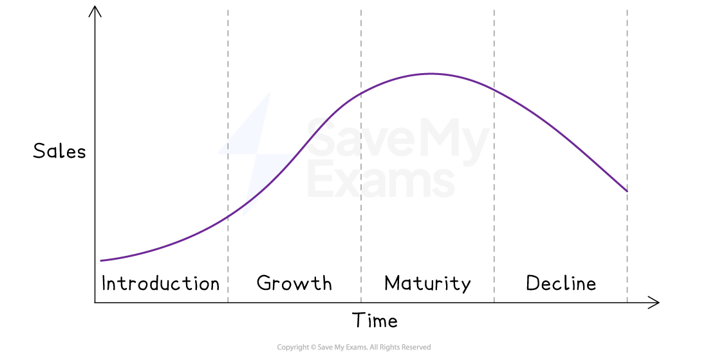
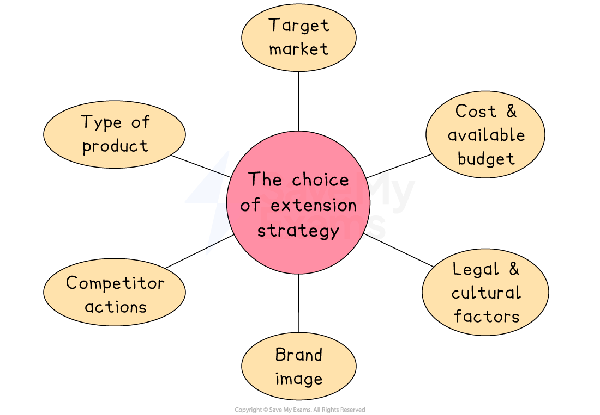

# Product Life Cycle

## Stages of the product life cycle

> **Spec point** — `spcpt_Zy64s7kdcChyQhdm` · introduction, growth, maturity, decline

## Stages of the product life cycle

- **The product life cycle describes the different stages a product goes through from its conception to its eventual decline in sales**
- There are typically **four stages in the product life cycle:** introduction, growth, maturity, and decline

#### The product life cycle diagram

*The four stages of the product life cycle: introduction, growth, maturity and decline*

## Interpreting product life cycle diagrams

> **Spec point** — `spcpt_Zt8ckZYkdjWT7YRq`

## Interpreting product life cycle diagrams

- Each stage of the product life cycles affects a business in different ways, such as changes in sales, profit, *cash flow* and how the product is marketed
- By recognising which stage a product is in, businesses can make better decisions to stay competitive and profitable

#### Introduction

- This stage begins when the **product is launched**
- Sales grow slowly as the product is still new and not widely known
- Cash flow is usually negative due to high promotion, *advertising* and distribution costs
- Marketing focuses on building awareness and interest

#### Growth

- Sales rise quickly as the **product gains popularity**
- The business works to increase *market share* and boost production to meet demand
- Cash flow often turns positive as *revenue* grows and costs are spread over more units
- Marketing aims to stand out from competitors and build *brand loyalty*

#### Maturity

- **Sales remain high** but **growth slows** due to *market saturation*
- Cash flow is usually strong as sales continue and costs fall through *efficiency* and *economies of scale*
- Marketing focuses on keeping market share and improving profits through cost-cutting or expanding into new markets

#### Decline

- **Sales fall** as the product becomes outdated or replaced by newer alternatives
- The business shifts to controlling the decline and cutting costs
- Cash flow may turn negative due to falling sales and higher related costs
- Marketing may involve *discounting*, clearing stock or finding new uses for the product

> **Exam Hint**
> Be careful not to assume all products follow the life cycle perfectly – in exams, show awareness that some products skip stages or decline quickly, which demonstrates deeper understanding

## Extension strategies

> **Spec point** — `spcpt_dp9Zb3n4gbgCVDQ3` · "new markets, new uses for a product, adapting the
product or packaging, increased advertising/ sales promotion
advantages and disadvantages of different extension strategies"

## Extension strategies

- **Extension strategies refer to the techniques used by businesses to extend the life of a product beyond its natural life cycle**
- These strategies are **designed to boost sales **and maintain profitability for a product that has** **reached the** late maturity or decline stage** of its life cycle

### Types of extension strategies

#### Enter new markets

- Selling the product in a new geographic area or to a new customer group

| ** Advantages** | **Disadvantages** |
|---|---|
| - Increases potential sales and revenue - Reduces dependence on one market | - May face legal or *cultural challenges* - Expensive to enter unfamiliar markets |

#### Find new uses for a product

- Promoting different ways the product can be used

| ** Advantages** | **Disadvantages** |
|---|---|
| - Attracts new customer *segments* - Extends product life without major changes | - May require extra research and marketing - Customers may not accept new use |

#### Adapt the product or packaging

- Changing design, features, size or packaging to attract new interest

| ** Advantages** | **Disadvantages** |
|---|---|
| - Keeps the product looking fresh - Can target specific customer needs | - Increases production costs - Risk of confusing loyal customers |

#### Increase advertising

- Launching a new advertising campaign to remind or attract customers

| ** Advantages** | **Disadvantages** |
|---|---|
| - Boosts brand awareness - Can bring back interest in the product | - Advertising can be expensive - Might not lead to more sales |

#### Increase sales promotion

- Offering discounts, *loyalty rewards* or competitions to increase short-term sales

| ** Advantages** | **Disadvantages** |
|---|---|
| - Encourages quick purchases - Helps clear old stock | - Reduces *profit margins* - May not build long-term customer loyalty |

## Recommending a suitable extension strategy

> **Spec point** — `spcpt_GQwyR4gcb38Wx9rK` · recommend and justify an extension strategy to use in a given situation

## Recommending a suitable extension strategy

- A business must carefully choose the right extension strategy based on its **product, market **and **resources**

#### Factors affecting the choice of extension strategy

*The choice of extension strategy depends on factors such as the cost, the intended target market and a product's brand image*

1. **Type of product**

  - Some products are easier to adapt than others
  
    - For example, a smartphone can be upgraded regularly, while bottled water has fewer options for change
  - *Perishable* goods or fashion items may need quicker updates to stay relevant
2. **Target market**

  - The business must consider who its customers are and what they want
  - If the target market is young and trend-sensitive, advertising or new packaging may work well
  - If the market is *price-sensitive*, sales promotions could be more effective
3. **Cost and budget**

  - Some strategies are cheaper than others
  
    - For example, increasing advertising or offering promotions can be done quickly but may be costly
  - Adapting the product or entering new markets often requires more time and money
4. **Competitor actions**

  - If competitors release new versions or lower prices, a business may need to respond with an extension strategy
  - This helps maintain market share and keeps the product competitive
5. **Brand image**

  - A well-known brand must protect its reputation
  - Some strategies, like discounts, may hurt a *premium brand*’s image
6. **Legal or cultural factors**

  - When entering new markets, the business must consider different laws and customer preferences
  - Packaging, promotion, or even the product itself may need to change to suit the local culture or rules

> **Case Study**
> **Choco Luxe Extension Strategies**
> 
> ChocoLuxe is a French luxury chocolate brand. Its *Dark Caramel Crunch* bar is now in the **decline stage**, with falling sales due to changing consumer habits
> 
> 
> 
> - The company is considering three **extension strategies**
> 
> **Adapting the product**
> 
> - Create a low-sugar version to appeal to health-conscious customers
> 
> | **Advantages** | **Disadvantages** |
> |---|---|
> | - Attracts a new audience  Keeps the brand up-to-date | - Development costs - May lose original customers |
> 
> **Entering new markets**
> 
> - Sell in new regions such as Asia or the Middle East
> 
> | **Advantages** | **Disadvantages** |
> |---|---|
> | - Expands customer base - Less reliance on the French market | - High entry costs - Cultural tastes may differ |
> 
> **Increased advertising**
> 
> - Launch a campaign highlighting ethical sourcing and premium quality
> 
> | **Advantages** | **Disadvantages** |
> |---|---|
> | - Builds brand awareness - Reminds customers of quality | - Expensive - May not boost sales if product feels outdated |
> 
> **Recommendation**
> 
> - ChocoLuxe should **adapt the product** by launching a **low-sugar version**, supported by fresh advertising
> 
>   - This approach targets current trends and builds on the brand’s strengths
> - **Entering new markets** could be explored later but is not urgent
> - **Advertising **is high cost and may not be enough to persuade customers to buy the dated product
