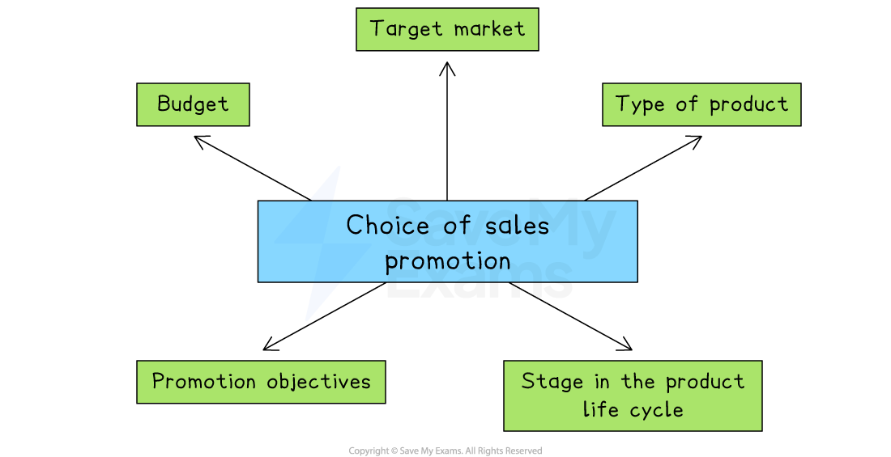

# Promotion

## Reasons for promotion

> **Spec point** — `spcpt_T42SgzF7kp7rWvjs`

## Reasons for promotion

- **Promotion refers to all the activities a business uses to inform, persuade, and remind customers about its products or services, with the aim of increasing sales and building brand loyalty**

  - Promotion  communicates a business's** *****value proposition*** to potential customers and helps to differentiate the product or business from competitors
  - Promotion plays a crucial role in **generating customer awareness**, interest and desire for a product

#### The main aims of promotion

*Promotion aims to support sales of new and existing products, inform customers and improve brand and business image*

1. **Enhance brand and business image**

  - Promotion helps build a strong, positive image of the business. It can show the brand as trustworthy, high-quality, ethical, or innovative
  - For example, Apple uses sleek advertising to reinforce its image as a premium, cutting-edge brand
2. **Compete with rivals**

  - In competitive markets, promotion helps a business stand out. Special offers, adverts or sponsorships can attract customers away from competitors
  - For example, Burger King and McDonald's use adverts and discounts to compete for customers
3. **Support new products**

  - When launching a new product, promotion creates awareness and interest. It helps customers learn what the product is and why they should try it
  - For example, a soft drinks company might offer free samples in supermarkets when introducing a new flavour
4. **Increase sales revenue**

  - Well-planned promotion can boost sales by encouraging more people to buy, or to buy more often
  - For example, limited-time discounts or “Buy 1, Get 1 Free” deals increase customer purchases
5. **Provide information**

  - Promotion can be used to inform customers about product features, prices, store locations, or changes to the business
  - For example, a bank may use advertising to explain new mobile banking features to its customers

## Methods of sales promotion

> **Spec point** — `spcpt_2tMtGJMB7c5drpts` · "promotion, e.g. vouchers, reward schemes, competitions, special
offers /discounts"

## Methods of sales promotion

- **Sales promotion** is a short-term marketing strategy used to encourage customers to buy a product
- It often includes special deals or *incentives *and is designed to boost sales quickly or support a new product launch

### Methods of sales promotion

#### Vouchers

- Customers are given a coupon or code offering money off a future purchase

| **Advantages** | **Disadvantages** |
|---|---|
| - Vouchers encourage customers to return and make another purchase - They attract customers who are looking for lower prices | - Profit margins are reduced when discounts are used - Some customers may wait for vouchers instead of paying full price |

#### Reward schemes

- Customers earn points or rewards for regular purchases

| **Advantages** | **Disadvantages** |
|---|---|
| - Reward schemes build loyalty by encouraging repeat purchases - They help the business keep existing customers over time | - They can be expensive to set up and maintain - They may not attract many new customers |

#### Competitions

- Customers enter to win a prize, often by buying a product or taking part in an activity

| **Advantages** | **Disadvantages** |
|---|---|
| - Competitions increase interest in the brand and can be shared on social media - They can encourage people to buy in order to enter | - Not all participants become regular buyers. - Prizes and promotions add extra costs for the business |

#### Special offers and discounts

- Temporary price reductions like 20% off or Buy One, Get One Free

| **Advantages** | **Disadvantages** |
|---|---|
| - These offers can quickly increase sales and attract attention - They can help clear old or excess stock | - Frequent discounts may damage the brand’s image - Lower prices can reduce profits |

> **Exam Hint**
> Avoid treating promotion as only advertising – examiners expect you to distinguish between **advertising methods** and **sales promotions**, and to justify which is most effective in the case study

## Recommending a suitable sales promotion

> **Spec point** — `spcpt_kS249WfGTwFf43xj`

## Recommending a suitable sales promotion

- A business must carefully choose the right type of sales promotion to suit its product, customers and objectives

#### Factors affecting the choice of sales promotion

*Sales promotions must be suitable for the target market and type of product, as well as being within budget*

#### Target market

- The type of customers the business wants to reach will influence the promotion

  - For example, young customers might respond well to competitions or online discounts, while regular shoppers may prefer reward schemes

#### Type of product

- Some promotions work better for certain products

  - For example, Buy One, Get One Free is effective for fast-moving items like snacks, but not for expensive goods like electronics

#### Stage in the product life cycle

- Sales promotions are often used during product launch or maturity stages

  - For example, a new product might use vouchers to attract first-time buyers, while a mature product might offer discounts to boost slowing sales

#### Promotion objectives

- The business must be clear on what it wants to achieve

  - For example, if the objective is to build loyalty, a reward scheme may be best, but if the objective is to quickly increase sales, a discount might be more suitable

#### Budget available

- The business must consider how much money it has to spend

  - For example, competitions with prizes or large discount campaigns can be costly, so may not be suitable for small businesses

> **Case Study**
> **Selecting a Suitable Sales Promotion for GLOH Skincare**
> 
> GLOH is a small business that produces luxury skincare products. It is about to launch a new moisturising face cream and wants to attract new customers while encouraging them to buy again in the future
> 
> 
> 
> **Actions**
> 
> The marketing team is considering two sales promotions
> 
> - **Vouchers**
> 
>   - Customers receive a 20% off voucher with their first purchase to use on their next order
>   - The team believes this will encourage customers to return, helping to build long-term loyalty
> - **Launch competition**
> 
>   - Customers who buy the face cream during the first month are entered into a draw to win a year’s supply of GLOH products
>   - The team thinks this will create buzz around the launch and boost interest on social media
> 
> **Recommendation**
> 
> - GLOH should offer **vouchers** as its main sales promotion
> - The business wants to **encourage repeat purchases** and build a base of loyal customers
> - While competitions may attract attention, they are more likely to bring in one-time buyers who may not return

## Methods of advertising

> **Spec point** — `spcpt_7BMTTN3Whjmh3R2s` · e.g. social media, direct/targeted emails, leaflets, billboards

## Methods of advertising

- Advertising is a form of paid promotion used by businesses to inform, persuade or remind customers about their products or services
- It aims to increase sales, build brand awareness and attract new customers through different media such as TV, social media, billboards or print

### Social media

- Using platforms like Instagram, TikTok or Facebook to promote products and interact with customers

| **Advantages** | **Disadvantages** |
|---|---|
| - Social media allows businesses to reach a large audience quickly at low cost - It also helps build relationships through comments and messages | - It can be time-consuming to manage accounts and reply to customers - Negative feedback can spread quickly and harm the brand |

### Targeted emails

- Sending promotional emails to specific customers based on their interests or past purchases

| **Advantages** | **Disadvantages** |
|---|---|
| - Emails are low-cost and can be personalised to suit the customer - They are useful for reaching existing or interested customers directly | - Customers may ignore emails or delete them without reading - If used too often, it can annoy customers or be seen as spam |

### Leaflets

- Printed materials handed out or delivered to promote a product, service or event

| **Advantages** | **Disadvantages** |
|---|---|
| - Leaflets are cheap to print and are useful for local promotions - They can be delivered directly to potential customers | - Many people throw away leaflets without reading them - Printing large amounts can be wasteful and harm the environment |

### Billboards

- Large outdoor posters placed in high-traffic areas to catch public attention

| **Advantages** | **Disadvantages** |
|---|---|
| - Billboards are seen by thousands of people every day - They are effective for raising awareness of a brand or product | - Renting billboard space in busy areas can be expensive - They have limited space, so detailed information can't be included |

## Recommending a suitable method of advertising

> **Spec point** — `spcpt_R89w6SHdbDGCbrjX`

## Recommending a suitable method of advertising

- Businesses must choose the right type of advertising based on several important factors

  - **Target market**
  
    - The advertising method should match the age, interests and habits of the target customer
    - For example, social media is good for reaching young people
  - **Cost and budget**
  
    - Some methods like billboards or TV adverts are expensive, while others like social media or leaflets are more affordable
  - **Type of product**
  
    - Products with visual appeal, like fashion items or food, may benefit from image-based adverts on platforms like Instagram or billboards
  - **Message content**
  
    - If the advert needs to give detailed information, methods like emails or leaflets may be more suitable than a billboard
  - **Reach**
  
    - Businesses may choose national advertising for large markets or local advertising, using posters or flyers, for smaller areas

> **Case Study**
> **Choosing a Suitable Advertising Approach for Kahawa**
> 
> Kahawa is a small business in South Africa that sells organic, fair-trade coffee beans. The business is planning to launch a new product: cold brew coffee in eco-friendly bottles
> 
> Kahawa wants to raise awareness and attract new customers, especially young adults in cities.
> 
> 
> 
> **Actions**
> 
> The marketing team is considering three advertising options
> 
> | **Option** | **Description** | **Why it’s being considered** |
> |---|---|---|
> | **Social media** | - Promote the cold brew on Instagram and TikTok using short videos showing how it’s made and sourced | - Social media is popular with young adults and allows for low-cost, creative marketing |
> | **Leaflets** | - Hand out leaflets near gyms, universities and cafés, offering a discount on the first purchase | - This is a cheap way to advertise locally and reach health-conscious customers in person |
> | **Billboards** | - Place a large billboard in a busy part of Cape Town to grab attention | - It would reach a wide audience and increase brand visibility |
> 
> **Recommendation**
> 
> - Kahawa should use **social media** as its main advertising method
> 
>   - This option fits the target market, is affordable and allows the business to tell its story using visuals and video
> - Leaflets are useful for local promotion but may be ignored
> - Billboards are likely to be too expensive for a small business at this stage
