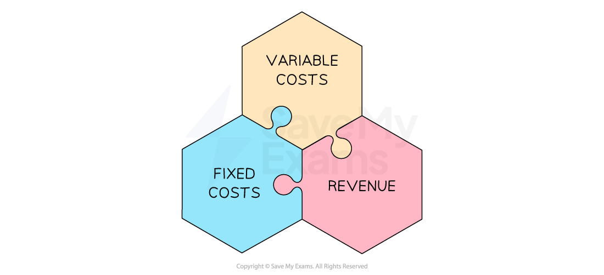

# Break-Even Analysis

## The concept of break-even

> **Spec point** — `spcpt_8SMdgQryHzjJqv24`

## The concept of break-even

- **The break-even point is the number of units that need to be sold for total costs to equal the sales *****revenue***

  - It helps businesses understand the **minimum level of sales or output they need to achieve in order to cover all costs**
  - This helps business managers to make **informed decisions about pricing and production volumes**

#### Elements of a break-even analysis

*Variable costs, fixed costs and sales revenue are all used in calculating the break-even point*

- **Fixed costs** do not change, regardless of the level of production or sales

  - E.g. rent, salaries and insurance
- **Variable costs **vary with the level of production or sales

  - E.g. raw materials, direct labour costs, packaging and shipping costs
- **Sales revenue** is money gained from selling products, calculated using the formula

$\mathrm{Sales} \mathrm{revenue}=\mathrm{Number} \mathrm{of} \mathrm{items} \mathrm{sold}\times\mathrm{Selling} \mathrm{price}$

## The break-even chart

> **Spec point** — `spcpt_bVmQpPzT72Z4ZwTv` · "complete or amend a simple break-even chart
interpret a break-even chart"

## The break-even chart

- **Break-even charts show the number of units a business must sell in order to break-even**
- In order to **construct a break-even chart, **the business needs to know the estimated fixed costs, variable costs and sales revenue

> **Worked Example**
> #### Steps to construct a break-even chart
> 
> **Step 1: Identify fixed costs, variable costs and sales revenue at different levels of output**
> 
> - Tee Crazy Ltd has the following cost and revenue data:
> 
>   - Fixed costs are \$8,800 per year
>   - The variable costs of each t-shirt is \$4
>   - Each t-shirt is sold for a price of \$10
>   - Its factory can produce a maximum output of 3000 t-shirts per year** **
> 
> **Costs and revenue summary for Tee-Crazy Ltd.**
> 
> |   | ** 0 units** | **500 units** | **3000 units** |
> |---|---|---|---|
> | **Fixed Costs** | 8,800 | 8,800 | 8,800 |
> | **Variable Costs** | 0 | 2,000 | 12,000 |
> | **Total Costs** | 8,800 | 10,800 | 20,800 |
> | **Total Revenue** | 0 | 5,000 | 30,000 |
> 
> **Step 2: Draw the axes and plot the fixed costs line**
> 
> - The** x-axis** should extend to the maximum output level
> 
>   - In this case it extends to 3,000 units
> - The y-axis should extend to the highest value in the table
> 
>   - In this case the highest value is \$30,000
> 
> 
> 
> - The fixed cost line is a horizontal line at \$8,800, as fixed costs remain constant at all levels of output
> 
> **Step 3: Plot the total costs line**
> 
> 
> 
> - The total cost line slopes upwards, starting at \$8,800 at 0 units of output, rising to \$20,800 at 3,000 units of output
> 
> **Step 4: Plot the revenue line**
> 
> 
> 
> - The revenue line slopes upwards, starting at \$0 at 0 units of output, rising to \$30,000 at 3,000 units of output
> 
> **Step 5: Identify the break-even point**
> 
> 
> 
> - The break-even point is where the revenue line crosses the total costs line
> 
>   - Read the break-even output on the x-axis
>   - In this case, the break-even point is 1,467 units

> **Exam Hint**
> When drawing break-even charts, label all key elements clearly – fixed costs, total costs, total revenue, and break-even point – as missing labels often loses easy marks

## Calculating break-even output

> **Spec point** — `spcpt_Rv7mKyctznxm6Qtc`

## Calculating break-even output

- The break-even point can be **calculated using the formula**

$\text{Breakeven} \text{point} = \frac{Fixed costs}{( \text{Selling} \text{price} - \text{Variable} \text{cost} \text{per} \text{unit} )}$

> **Worked Example**
> Mięsisty Burgers has the following financial information for the month of May
> 
> |   | **€ May** |
> |---|---|
> | Raw materials for each burger | 2.10 |
> | Packaging for each burger | 0.20 |
> | Fixed costs | 1730 |
> | Selling price of each burger | 4.95 |
> 
> Using the information in the table, **calculate **the level of output required to break even in May. You are advised to show your workings.
> 
> (3)
> 
> **Step 1: Calculate the variable costs per burger**
> 
> $Variable \text{cost} \text{per} \text{burger} = Raw \text{materials} + Packaging > > = \text{€} 2.10 + \text{€} 0.20 > > = \text{€} 2.30$**      **** (1)**
> 
> **Step 2: Substitute the values into the break-even formula**
> 
> $\mathrm{Break} \mathrm{even} \mathrm{point} \mathrm{in} \mathrm{units}=\frac{\mathrm{Fixed} \mathrm{Cost}}{(\mathrm{Selling} \mathrm{price}-\mathrm{Variable} \mathrm{cost})}\,\,=\frac{1,730}{(4.95-2.30)}\,\,=\frac{1,730}{(2.65)}\,\,=652.83$     **    **** (1)**
> 
> **  **
> 
> **Step 3: Round to the nearest unit**
> 
> - 653 burgers need to be sold to break even in May  **    **** (1)**

> **Exam Hint**
> Always **round up** the break-even point to the nearest whole unit

## The margin of safety

> **Spec point** — `spcpt_xgvR46fv54ggk5XY` · define, calculate and interpret the margin of safety

## The margin of safety

- **The margin of safety is the amount by which the number of units sold is greater than the break-even point**

  - The margin of safety provides useful information to a firm on how many sales they could lose **before they start making a loss**
- The margin of safety can be calculated using the following formula:

$\mathrm{Margin} \mathrm{of} \mathrm{safety}=\mathrm{Quantity} \mathrm{of} \mathrm{sales}-\mathrm{Break}-\mathrm{even} \mathrm{level} \mathrm{of} \mathrm{sales}$** **

- Businesses want their margin of safety to be as **large as possible**

  - This means that if demand for their products drops unexpectedly, the business will continue to make a profit

> **Worked Example**
> The diagram shows the weekly break-even diagram for the Yorkshire Rare Breed Sausage Company. On average, the business sells 3,200 units each week.
> 
> 
> 
> *Output, costs and revenues of the Yorkshire Rare Breed Sausage Company*
> 
> Using the diagram, **calculate **the weekly margin of safety. Show your workings and the formula used.
> 
> (2)
> 
> **Step 1: Identify the break-even output from the graph**
> 
> = 2,500 units    **(1)**
> 
> **Step 2: Subtract the break-even output from the actual output**
> 
> **   **$\mathrm{Margin} \mathrm{of} \mathrm{safety}=\mathrm{Quantity} \mathrm{of} \mathrm{sales}-\mathrm{Break}-\mathrm{even} \mathrm{level} \mathrm{of} \mathrm{sales}\,=3,200-2,500\,=700\mathrm{units}\,$    **(1)**

> **Exam Hint**
> Use a ruler to help you to read break-even charts accurately.
