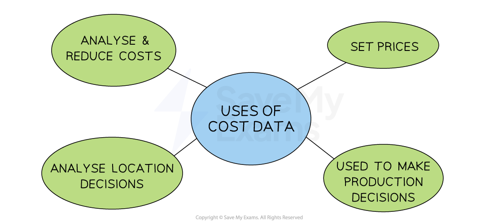

# Identifying & Classifying Costs

## Introduction to costs

> **Spec point** — `spcpt_bz7p63Nq6WjkqX2j`

## Introduction to costs

- Businesses** incur a range of costs **

  - Examples include purchasing raw materials, paying staff *salaries* and wages and paying *utility *bills such as electricity

- These costs can be classified as follows:

  - Fixed costs
  - Variable costs
  - Total costs
  - Average costs

## Fixed costs

> **Spec point** — `spcpt_RgPqDyJyG9TDM9BZ` · classify and calculate costs using examples, e.g. fixed, variable, average and total

## Fixed costs

- **Fixed costs (FC) are costs that do not change as the level of output changes**

  - These have to be paid whether the output is zero or 5000 units
  - Examples include rent, management salaries, *insurance *and bank loan repayments

- Fixed costs can be plotted on a graph as a horizontal line
- The fixed costs for this firm are \$4,000 at all levels of output

## Variable costs

> **Spec point** — `spcpt_yBycVFM6x7wvQJzY`

## Variable costs

- **Variable costs (VC) are costs that are directly linked to output**

  - They increase as output increases and vice versa
  - Examples include raw material costs and wages of workers directly involved in production

*Graphical representation of total variable costs*

- Variable costs are plotted on a graph as an upwards sloping line, starting at 0

## Total costs

> **Spec point** — `spcpt_zbzCk9VgMmZxhVH7`

## Total costs

- **The total cost is the sum of the variable and fixed costs**
- Total costs are calculated using the formula

$\mathrm{Total} \mathrm{costs}(\mathrm{TC})=\mathrm{Total} \mathrm{fixed} \mathrm{costs}(\mathrm{TFC})+\mathrm{Total} \mathrm{variable} \mathrm{costs}(\mathrm{TVC})$

*Graphical representation of total costs*

- The total costs **cannot be 0**, as all firms have some level of fixed costs
- Total costs are plotted on a graph as an upwards sloping line, parallel to the variable costs, starting at the level of fixed costs

## Average costs

> **Spec point** — `spcpt_NnSdXDvk6RjqyHXx`

## Average costs

- **The average cost is the typical cost of producing one unit of output**

  - It is sometimes called the **unit cost**
- As a firm grows, it is able to increase its **scale of output **generating efficiencies that lower its **average total costs (AC)** of production

  - These efficiencies are called ***economies of scale***

*Graphical representation of average costs*

- As a firm continues increasing its **scale of output**, it will reach a point where its **average total costs (AC)** start to **increase**

  - These inefficiencies are called *dis****economies of scale**** *

> **Exam Hint**
> Always set out each step when calculating fixed, variable, total and average costs. Even if your final figure is wrong, clear working can earn method marks

## Using cost data to make decisions

> **Spec point** — `spcpt_tTsKGYQRZGMXSxW4`

## Using cost data to make decisions

- Businesses can use cost data to make **data-driven business decisions**

*Accurate cost data can help a firm to be more precise in its price setting and production decisions*

### 1. To reduce costs

- Accurate cost data helps a business see if costs are too high
- Reducing costs is a key way to increase profit

  - **Fixed costs** can be reduced by moving to cheaper premises, lowering staff salaries, cutting promotional spending or using cheaper utility suppliers
  - **Variable costs** can be lowered by buying cheaper or bulk raw materials, or *outsourcing *delivery
- Businesses must consider how cost-cutting affects customer service, product quality and delivery speed

  - Paying lower wages may lead to less experienced or skilled staff
  - Cheaper materials might reduce product quality

### 2. To set prices

- Costs are important when deciding the selling price.
- They directly affect how much *profit *a business makes.

  - For example, if a cake costs \$3 to make and the business wants to make a \$1 profit on each cake, it must sell them for \$4

### 3. To make production decisions

- If production costs are higher than revenue, the business will make a *loss*

  - The business must decide whether to keep or stop making it
- This depends on factors including

  - Whether it’s a new product, with sales likely to rise
  - Whether fixed costs will need to be paid, even if production stops

### 4. To make location decisions

- Renting or buying premises is a major cost
- Some areas are cheaper than others
- Businesses must compare these savings to other factors like transport, closeness to customers and available workers
