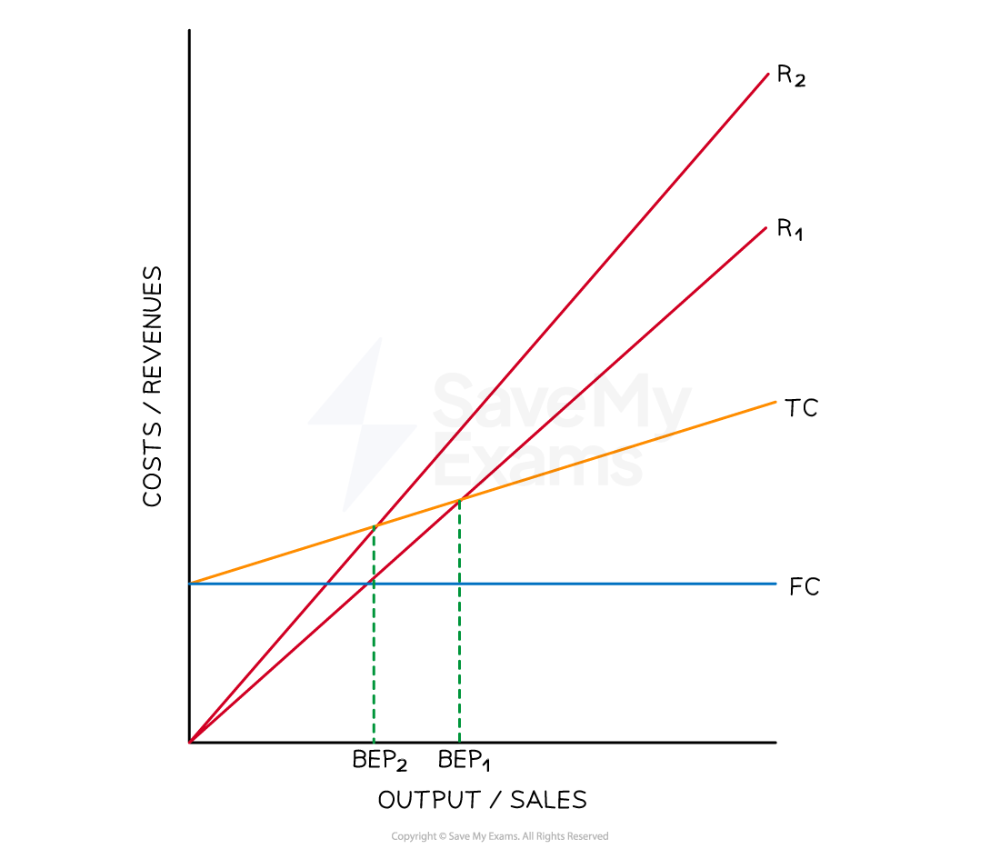
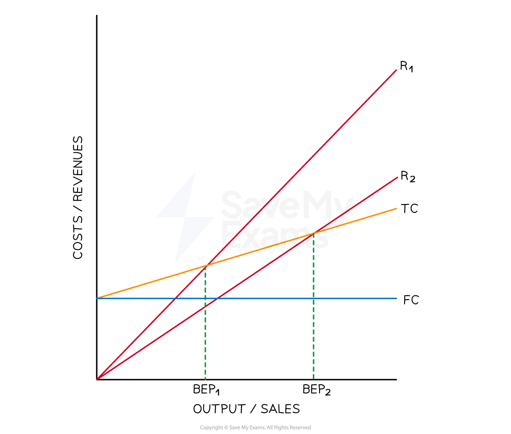
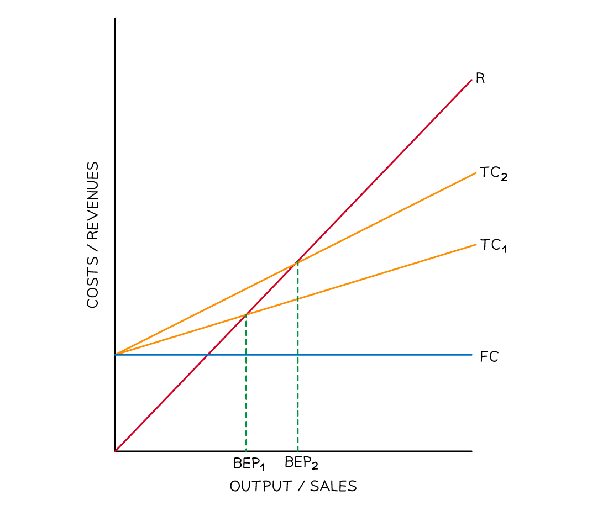
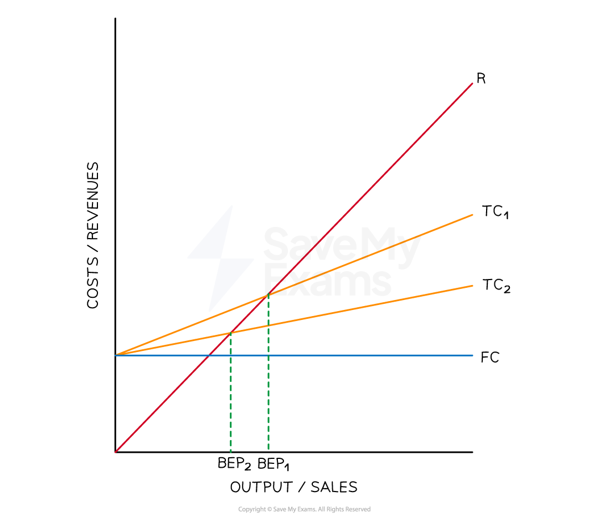
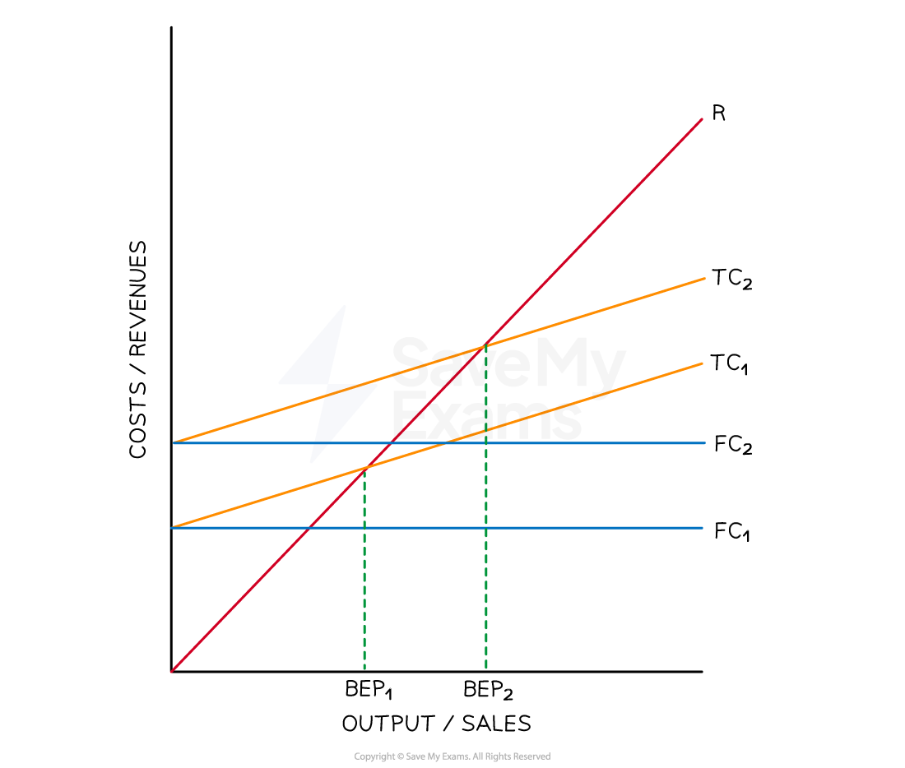
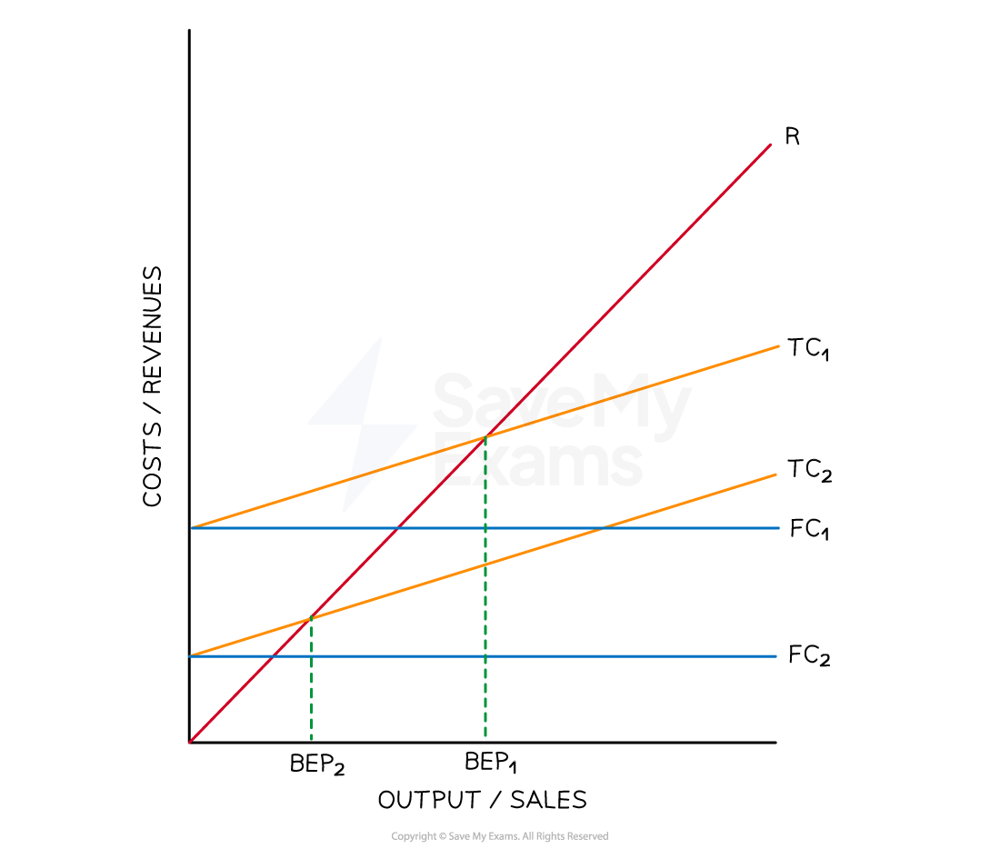
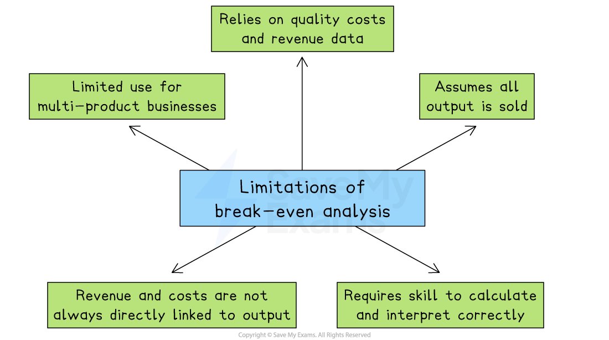

# Using Break-Even Analysis to Make Decisions

## Break-even analysis and decision-making

> **Spec point** — `spcpt_yyV7Hbht7B8hJHdh` · "use break-even analysis to help make decisions: effect of changes in price, changes in fixed
costs, changes in variable cost per unit"

## Break-even analysis and decision-making

- Break-even calculations are a useful tool for a business to use in deciding **how much to produce** and calculating estimated levels of profit
- It is particularly useful for **communicating with *****stakeholders***, including investors or lenders

  - Knowing when the business will break-even or how much profit it is expected to make **may attract or deter *****shareholders**** *from investing in the business
- Break-even analysis provides **a basis for informed decision-making**

  - It helps the business to assess the costs and expected *returns* of new projects and expansion plans
  
    - By considering the break-even point, businesses can **assess the potential risks and rewards** associated with different decisions

### Ways break-even is used in decision-making

| **Use** | **How break-even analysis helps** |
|---|---|
| **Assessing profit or loss** | - Shows the minimum sales needed to cover all costs and avoid losses - This helps the business set realistic profit targets |
| **Managing costs** | - Helps identify fixed and variable costs clearly - This allows the business to understand spending and cut unnecessary expenses |
| **Pricing decisions** | - Supports pricing by calculating the minimum price required to cover costs and achieve the desired profit |
| **Financial planning** | - Acts as a guide for setting realistic *sales targets* and planning future spending |
| **Redrawing the graph with changes** | - Demonstrates how changes in costs, prices, or sales volume affect the break-even point - This helps assess risks such as price increases or new competition |
| **Performance monitoring** | - Provides a *benchmark* to compare actual sales and costs - This helps the business measure progress and financial health |

## Changes to break-even variables

> **Spec point** — `spcpt_4q4vjkMz3J6grSRF` · "use break-even analysis to help make decisions: effect of changes in price, changes in fixed
costs, changes in variable cost per unit"

## Changes to break-even variables

- Changing any of the variables of break-even (selling price, variable cost per unit or total fixed costs) changes** the break-even point and level of profit** it can expect to achieve

### Increased selling price

- An increase in the selling price **reduces** the break-even point

- An increase in the selling price increases revenue at each level of output from R1 to R2
- The break-even point falls from BEP1 to BEP2
- Profit on each unit of output greater than the break-even point is increased

### Decreased selling price

- A decrease in the selling price **increases** the break-even point

- A decrease in the selling price reduces revenue at each level of output from R1 to R2
- The break-even point rises from BEP1 to BEP2
- Profit on each unit of output greater than the break-even point is decreased

### Increased variable costs

- An increase in variable costs** increases** the break-even point

- An increase in variable costs increases total costs at each level of output from TC1 to TC2
- The break-even point increases from BEP1 to BEP2
- Profit on each unit of output greater than the break-even point is decreased

### Decreased variable costs

- A decrease in variable costs **decreases** the break-even point

- A decrease in variable costs decreases total costs at each level of output from TC1 to TC2
- The break-even point falls from BEP1 to BEP2
- Profit on each unit of output greater than the break-even point is increased

### Increased fixed costs

- An increase in fixed costs** increases **the break-even point

- An increase in fixed costs increases total costs at each level of output from TC1 to TC2
- The break-even point increases from BEP1 to BEP2
- Profit on each unit of output greater than the break-even point is decreased

### Decreased fixed costs

- A decrease in fixed costs **decreases **the break-even point

- A decrease in fixed costs reduces total costs at each level of output from TC1 to TC2
- The break-even point falls from BEP1 to BEP2
- Profit on each unit of output greater than the break-even point is increased

> **Exam Hint**
> Strengthen your answers by linking changes in **price, costs **or **sales volume** to shifts in the break-even point and margin of safety – this application gains higher marks

## Limitations of break-even analysis

> **Spec point** — `spcpt_DjBXPZ9fHhFXptzh`

## Limitations of break-even analysis

- Break-even analysis provides valuable insights into the **financial viability and performance of a business**
- The sooner a business can reach **break-even point**, the more likely it is to survive and make a profit
- However, there are several limitations to the use of break-even analysis

*Limitations of break-even analysis include the assumption that all output is sold and its limited usefulness for multi-product businesses*

**1. Limited use for multi-product businesses**

- Break-even analysis works best for businesses that sell one product
- If a business sells many products with different prices and *profit margins*, it is difficult to calculate a single break-even point that applies to all of them

**2. Relies on quality costs and revenue data**

- The results are only accurate if the data used is correct
- If the business uses outdated or incorrect cost or revenue figures, the break-even point will be misleading

**3. Assumes all output is sold**

- Break-even analysis assumes that everything produced is sold with no leftover *stock*
- In reality, some products may not sell, which can make the analysis too optimistic

**4. Revenue and costs are not always directly linked to output**

- The model assumes that costs and revenue change in a straight line as output increases
- However, in real life, discounts, *bulk purchasing* or changing raw material costs can affect this relationship.

**5. Requires skill to calculate and interpret correctly**

- To get useful results, the business must understand how to calculate and read break-even charts and data
- If the analysis is done poorly, it can lead to wrong decisions
