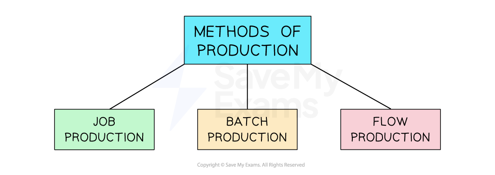
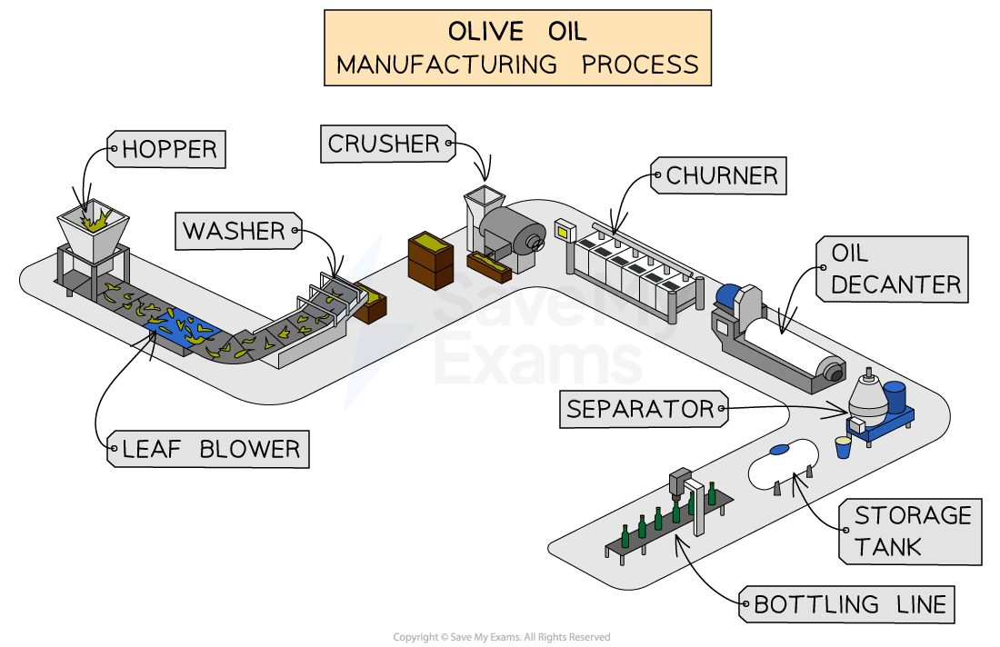

# Methods of Production

## Introduction to methods of production

> **Spec point** — `spcpt_8CKjJV3mTWvx8QGF`

## Introduction to methods of production

- Businesses can **organise their production** processes in a variety of ways
- The method of production used by a business will depend upon a number of factors

  - The **level of output **required to be produced
  - The **nature** of the product
  - Whether the product is **standardised or customised**
  - The level of ***automation*** used in production

*The main methods of production*

## Job production

> **Spec point** — `spcpt_8zxKNDwZP5mG6V2W` · "job, batch and flow production
advantages and disadvantages of job, batch and flow production"

## Job production

- Job production is where products are made to meet the **specific requirements** **of individual customers**

  - Each item is **produced separately**, and the production process is **tailored** to the unique specifications of the customer's order
  - It often requires skilled labour, such as *craftspeople* or technicians, as the manufacturing process may involve specialised techniques

### Examples of job production

| **Furniture made to order**  Where customers can choose the design, dimensions, materials and finishes | **Tailored clothing**  Such as wedding suits, where each garment is made to fit the specific preferences of the individual customer | **High-end jewellery**  Especially those with unique designs or personalised engravings |
|---|---|---|
|  |  |  |

#### Advantages and disadvantages of job production

| **Advantages** | **Disadvantages** |
|---|---|
| - Products can be customised to match each customer's needs - The process is flexible and can adapt to changes in demand - High attention to detail often leads to better quality and higher prices - Customers are often involved in the design, giving them a personal experience - A personalised service can build strong customer loyalty | - Job production is more expensive due to personalised work - *Lead times* are usually longer, which may not suit customers needing fast delivery - It can be harder to manage and needs careful planning - Close communication with the customer is required throughout - Small output means the business cannot benefit from *economies of scale* |

## Batch production

> **Spec point** — `spcpt_rxtFJSHqZytVT74N`

## Batch production

- Batch production is when products are **produced in groups** or batches

  - A certain quantity of products is produced together before moving on to the next batch
  - Each batch goes through the **entire production process**, from raw materials to the finished product, before the next batch begins
  - Batches are usually of a **standardised size** and ***composition**** *and follow a certain sequence of operations

### Goods made using batch production

*Commonly used in industries such as pharmaceuticals, beauty products and food processing*

- Batch production strikes a **balance between customisation and cost-effectiveness**
- This makes it a suitable production method for industries that deal with** diverse product ranges** and varying customer needs

#### Advantages and disadvantages of batch production

| **Advantages** | **Disadvantages** |
|---|---|
| - Businesses can switch between batches to meet different customer demands - It is more cost-effective than flow production for smaller quantities - Some *purchasing economies* can be gained by buying materials in larger amounts than in job production - *Defects* can be spotted and corrected within a batch before moving on | - Setting up equipment for each batch takes time and may cause delays - Batches often create extra *inventory*, which needs storage and careful control - It is less flexible than flow production when dealing with changes in demand - Frequent stopping and starting can wear out machines and increase maintenance needs |

## Flow production

> **Spec point** — `spcpt_8TCzwrRnTTtbqrmr`

## Flow production

- Flow production involves the manufacture of a product in a **continuous sequence of operations on a production line**

  - Materials or components move **through a series of workstations** or machines
  
    - Each workstation performs a specific task or operation
  - As a product moves along the **production line,** it undergoes assembly, testing, packaging or quality control until it is completed

*Large olive oil producers use flow production to manufacture standardised products*

- This method is commonly used in industries that produce **high volumes of standardised products,** such as vehicles and consumer electronics

### Advantages and disadvantages of flow production

| **Advantages** | **Disadvantages** |
|---|---|
| - Continuous production **avoids frequent machine start-ups**, saving energy and reducing waste - **Unit costs are low **due to *automation* and the use of unskilled labour - **Costs are also spread** across high output, making each unit cheaper to produce - **Defects can often be detected** and fixed early in the process - Fast production leads to **short lead times**, helping businesses meet customer demand quickly | - Setting up a flow production line requires a large *capital investment* - The system **depends on reliable machines**, as any breakdown can stop the entire line - If a fault is found, the whole line may need to stop, causing **delays** - The process relies on a **constant supply of raw materials** or components - Supply chain problems can seriously disrupt production |

> **Exam Hint**
> Be careful not to mix up **batch** and **flow** production – batch makes groups of items before switching, while flow is a continuous process with no interruptions

## Recommending a suitable method of production

> **Spec point** — `spcpt_72bcQ4R4kZC7NQ6s` · recommend and justify an appropriate production method for a given situation

## Recommending a suitable method of production

- The choice of production method depends on a range of factors, including the type of product, customer demand, available resources and the skills of the workforce
- Choosing the right production method helps a business produce *efficiently* and meet customer needs

#### Factors affecting the choice of production method

| **Factor** | **Explanation** |
|---|---|
| **Type of product** | - If the product is **highly customised** or made to customer specifications, **job production** is often the best choice - **Standardised product**s made in large quantities are better suited to **flow production** |
| **Level of demand** | - Businesses with **high and steady demand **are more likely to use **batch or flow production** to produce goods efficiently - If **demand is low** or changes often, **job or batch production** may be more suitable |
| **Availability of capital and equipment** | - Flow production requires expensive machinery and technology, so only businesses with enough *capital* can afford it - Smaller firms may choose job or batch production due to lower setup costs |
| **Skilled labour availability** | - **Job production often requires skilled workers** to produce high-quality, custom items - If skilled labour is limited or too costly, a business may prefer batch or flow production, which relies more on machines or unskilled workers |

> **Case Study**
> **Choosing a Suitable Production Method for Sweet Style Shirts**
> 
> Sweet Style Shirts is a small, fast-growing clothing business that designs and sells printed T-shirts. The business has started receiving both individual custom orders and larger *bulk orders* from local retailers. Its owner is trying to decide whether to use **job production**, **batch production** or **flow production** to meet increasing demand
> 
> 
> 
> **Key considerations**
> 
> - SweetStyle offers **custom T-shirts for individuals**, including names, colours or special designs
> - The business has received **large *****repeat orders*** from shops that want popular designs in multiple sizes
> - The owner has **limited capital**, so cannot invest in machines right now
> - A small team of workers has some experience in T-shirt printing, but not all are highly skilled
> - Orders sometimes arrive at short notice, so the production method must be **reasonably flexible**
> 
> **Recommendation**
> 
> - SweetStyle should use **batch production**, as it offers a good balance between customisation, efficiency and cost
> 
>   - Batch production allows the business to **switch between different designs**, which is helpful for handling both custom orders and bulk orders
>   - It is **more cost-effective** than job production for medium-sized orders, helping reduce *unit costs*
>   - SweetStyle can still offer some **product variety**, but without needing the high investment that flow production requires
>   - The business can **train staff** to work in small teams, printing one batch at a time, which suits their current skill level
>   - Over time, if the business grows further, it can consider investing in more *automation* or switching to flow production for its most popular designs
