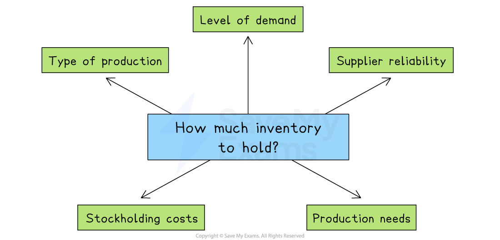

# Production processes: Inventory

## Why businesses hold inventory

> **Spec point** — `spcpt_Fvk5WhSFyFF4tCMf`

## Why do businesses hold inventory?

- Businesses hold *inventories* to support smooth operations and avoid disruptions

### Main types of inventories

| Raw materials | Components |
|---|---|
| - The basic natural or unprocessed items used to make a product, like wood, metal or oil | - Individual parts or pieces that are put together to make a finished product |
| Work-in-progress | Finished goods |
| - Partially completed goods between stages of production | - Items ready to be sold to meet customer demand promptly |

- Reasons for holding inventories include:

  - To **prevent *****stockouts*** and lost sales
  - To take advantage of *bulk purchasing discounts*
  - To **buffer against supply chain delays**
  - To ensure **continuous production** even when delivery of materials is uncertain
- However, holding too much inventory can increase **storage costs** and **risk of damage or ***obsolescence*, which is why inventory levels must be carefully managed

## Factors affecting how much inventory businesses hold

> **Spec point** — `spcpt_r8CcjXNGmg7H5hTK`

## Factors affecting how much inventory a business holds

- Choosing the right level of inventory is important to avoid waste, reduce costs and ensure smooth operations

*The amount of inventory held will depend on factors such as the type of product, the level of demand and production needs*

1. **Type of product**

  - *Perishable* goods like fresh food must be kept in smaller amounts to avoid spoilage
  - *Durable* goods such as electronics can be stored for longer

2. **Nature of demand**

  - Businesses with fast-selling products need more inventory to avoid running out, especially during busy periods
  
    - For example, a toy shop holds extra stock of popular toys before Christmas
  - On the other hand, low-selling items need less stock to prevent *wastage*

3. **Supplier reliability**

  - If suppliers are unreliable or located far away, businesses may keep more stock as a backup in case of delays or poor-quality deliveries
  
    - For example, a  car manufacturer may keep extra spare parts if overseas suppliers take weeks to deliver

4. **Cost of holding inventory**

  - High storage costs may encourage businesses to reduce the amount of inventory they keep
  - If *warehousing* is cheap or in-house, businesses might hold more stock

5. **Production needs**

  - Manufacturers need enough raw materials or components to avoid stopping production
  - If production is continuous, a steady supply of inputs is essential
  
    - For example, a bread factory must always have enough flour to avoid delays on the production line

> **Exam Hint**
> Don’t assume holding more inventory is always a good thing– examiners expect you to weigh the **advantages of meeting demand** against the **costs of storage and risk of waste**
