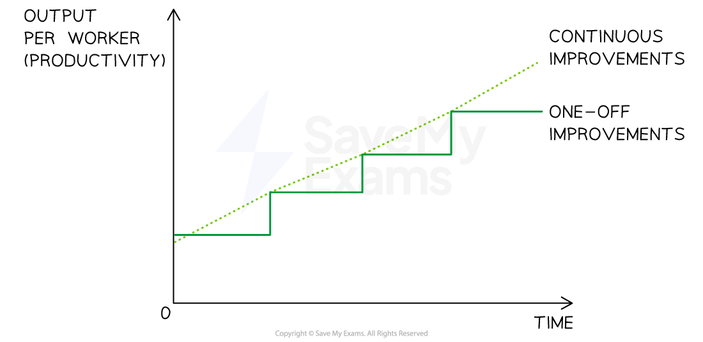
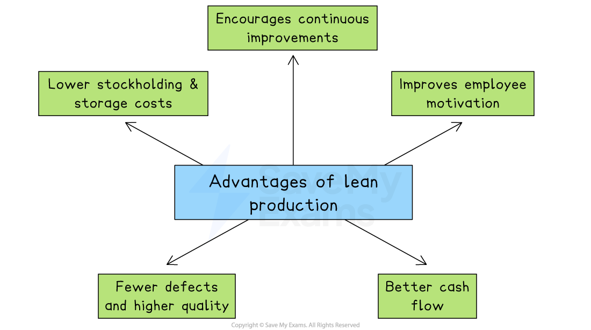
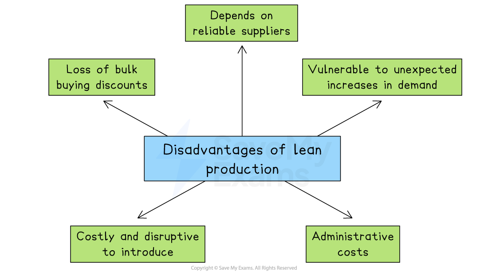

# Production Processes: Lean Production

## Lean production techniques

> **Spec point** — `spcpt_dzWWpsFdvvq77Qqk` · just-in-time (JIT) inventory control and Kaizen

## Lean production techniques

- **Lean production involves the minimisation of the resources used in production**

  - **Less time** is required as the production process is organised in the most efficient way
  - **Fewer materials** are used, as there is a focus on waste reduction
  - **Less labour** is used, as lean production is typically capital intensive
  - The **space required for production is reduced **as a result of just-in-time inventory management
  - A **small number of trusted suppliers** work closely with the business
- The use of lean production is likely to lead to a *competitive advantage*

  - Lower  ***unit costs*** ** **are achieved due to minimal wastage so **prices may be lower **than those offered by competitors
  - **Better quality **of output is likely as a result of supplier reliability and carefully managed production processes

### 1. Just-in-time inventory control

- **Just-in-time (JIT)** is a lean production technique where raw materials are **not stored on-site** but ordered as required and delivered by suppliers at the moment they are required for production

  - **Close relationships with suppliers** need to be developed to ensure reliable delivery and communication
  - Locating the business close to suppliers can reduce transport time and costs

### 2. Continuous improvement (Kaizen)

- Kaizen involves taking **continuous steps to improve productivity** through the **elimination of all types of waste** in the production process

  - **Changes are small and ongoing** rather than significant one-off’s
  - They are **constantly reviewed** to ensure that they achieve the desired positive impact on productivity
  - Kaizen requires a **long-term management commitment **to change

#### Kaizen (continuous improvement)

*Kaizen Versus One-off Improvements*

- Elements of Kaizen commonly include

  - ***Zero defects*** in manufacturing
  - High levels of **automation**
  - High levels of **cooperation** between workers and management

- Staff training and **computer inventory management systems** may also reduce wastage, as fewer errors are likely to be made

## Evaluation of lean production

> **Spec point** — `spcpt_phW8qZj8cyd8MVMV`

## Evaluating the use of lean production

- Lean production has several advantages for businesses aiming to reduce waste and improve efficiency
- However, the initial implementation and ongoing monitoring of lean production has some significant drawbacks

*Lean production incurs low costs, improves employee motivation and should lead to higher quality*

### Advantages of lean production

- **Lean production helps to lower stockholding and storage costs**

  - Just-in-Time (JIT) systems reduce the need to keep large amounts of inventory
  - Storage space can be used for more productive activities, such as extra work areas or machinery
- **It encourages continuous improvement**

  - Employees regularly suggest small changes that help reduce waste and improve quality
  - This process allows problems to be identified and solved early
- **Employee motivation is likely to improve under lean production**

  - Workers are encouraged to work in teams and take responsibility for improvements
  - Being involved in decision-making can make staff feel valued and more committed
- **Lean production improves cash flow**

  - Because less money is tied up in stock, more cash is available for other business needs
  - This can help the business invest in areas like marketing, training, or technology
- **It can lead to fewer defects and higher product quality**

  - Lean methods focus on doing things correctly the first time to avoid waste
  - This results in more efficient production and greater customer satisfaction

### Disadvantages of lean production

*Lean production depends on reliable suppliers and makes the business vulnerable to sudden increases in demand*

- **Lean production makes it harder to gain bulk buying discounts**

  - Since businesses place smaller orders more often, they may pay more for components and raw materials, increasing unit costs
- **It reduces the ability to respond quickly to unexpected increases in demand**

  - With little or no stock kept in reserve, businesses may miss sales opportunities
  - This can lead to dissatisfied customers or a damaged reputation
- **The system depends heavily on reliable suppliers**

  - If a delivery is late or poor in quality, production may come to a complete stop
  - Businesses must develop strong and dependable supplier relationships
- **Introducing lean production can be costly and disruptive**

  - It often requires big changes to the organisational structure and workflow
  - Employees may need extra training, which takes time and money
- **There are increased administrative costs due to frequent ordering**

  - Managing more orders creates extra paperwork and workload for staff
  - This can raise overall office and back-office expenses

> **Exam Hint**
> A common misconception is that lean production is always positive – strong answers recognise possible **drawbacks**, such as supply delays with Just-in-Time or employee resistance to continuous improvement
