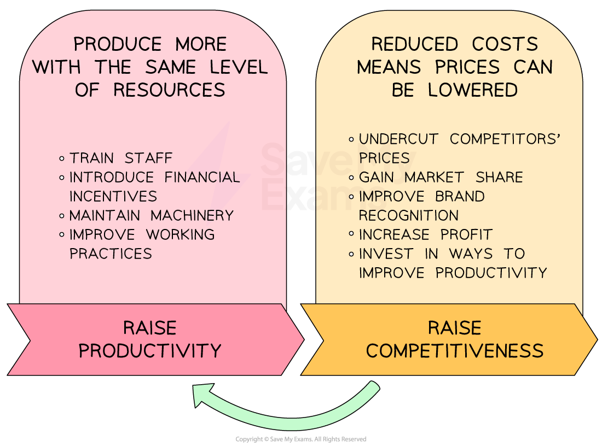

# Production Processes: Productivity & Efficiency

## Labour productivity

> **Spec point** — `spcpt_8mkCkZ4gZs5nzTKw`

## Labour productivity

- **Production is the act of *****adding value***** to the factors of production to create goods and services** e.g. using tomatoes and basil to create a soup

  - It is the process of converting the ***factors of production***** **into goods/services
  - It is a **measure of output** e.g. 3 cans of soup
- **Productivity is a measure of efficiency that calculates the amount of outputs produced per unit of input**

  - It calculates **how efficiently **resources are being used in the creation of goods/services and aids comparison of performance e.g. after training, workers proved to be 27% more efficient in their productivity
- **Labour productivity** is calculated using the formula

$\mathrm{Labour} \mathrm{productivity}=\frac{\mathrm{Output}}{\mathrm{Number} \mathrm{of}w\mathrm{orkers}}$

> **Worked Example**
> The table shows the number of pairs of luxury wool socks produced by *Sokkemani Ltd* in 2021 and 2022.
> 
> | **Year** | **Units Produced** |
> |---|---|
> | 2021 | 46,000 |
> | 2022 | 69,000 |
> 
> In 2021 *Sokkemani Ltd *employed 50 staff. In 2022 the number of staff employed by the business increased by 20%.
> 
> Calculate the percentage change in productivity between 2021 and 2022.
> 
> [4]
> 
> **Step 1: Calculate productivity for 2021**
> 
> $=\frac{46,000\mathrm{units}}{50\mathrm{workers}}\,\,=920\mathrm{units} \mathrm{per} \mathrm{worker}$**         **** (1)**
> 
> **Step 2: Calculate productivity for 2022**
> 
> $\frac{=69,000\mathrm{units}}{60\mathrm{workers}}\,\,=1,150\mathrm{units} \mathrm{per} \mathrm{worker}$**          **** (1)**
> 
> **Step 3: Calculate the percentage difference between the two years ((new-old) / old)**
> 
> `equals space fraction numerator space 1 comma 150 space minus space 920 space units over denominator 920 space units end fraction space space space cross times space space space space space 100 space space space
> 
> equals space 25 space percent sign space space space space`**         **** (1)**
> 
> **Step 4: Identify whether the percentage difference is an increase or decrease**
> 
> - Labour productivity has increased from 920 to 1,150 units so it is a 25% percentage** increase ****(1)**

> **Exam Hint**
> In calculation questions, always show your working. Even if the final answer is wrong, method marks can still be awarded

## The importance of efficiency

> **Spec point** — `spcpt_XktJ8xBt64Z4sC4n`

## The importance of efficiency

- **Efficiency refers to the ability of a business to use its production resources as cost-effectively as possible**

  - Efficiency is often measured in terms of the **average cost per unit**
  - The average cost per unit is calculated using the formula

$\mathrm{Average} \mathrm{cost} \mathrm{per} \mathrm{unit}=\frac{\mathrm{Total} \mathrm{costs}}{\mathrm{Number} \mathrm{of} \mathrm{units}}$

- **Maximum efficiency **is achieved when the cost per unit is at its lowest
- Businesses that increase their level of productivity (e.g of workers or capital equipment) are likely to be** more competitive**

#### The benefits of improved efficiency

*The link between productivity and competitiveness*

- Businesses that are competitive usually generate more profit
- This provides the **financial resources** to continue investing in improvements to their productivity

## How to increase efficiency

> **Spec point** — `spcpt_SkB7GgNNk6G7q3Zh` · e.g. increasing automation and technology, improving labour skills

## How to increase efficiency

- Increasing efficiency helps a business reduce costs, save time and improve productivity

### Common ways to improve efficiency

#### 1. Increasing automation

- Automation uses machines or *robots *to carry out tasks that would normally be done by humans.

  - Production is likely to be faster and safer, with fewer errors and lower long-term labour costs
  - For example, car manufacturers use robotic arms for welding and assembling.

#### 2. Introducing technology

- Using new technology, such as computers or specialist software, can improve both manufacturing and service operations.

  - Technology often speeds up processes, reduces paperwork and improves communication and accuracy
  - For example, retailers using *barcode scanners* and stock management software to track *inventory*

#### 3. Improving labour skills

- Training employees helps them work more efficiently and safely

  - They produce better quality work, with fewer mistakes and more quickly
  - For example, a café training staff to use a coffee machine correctly to avoid waste.

#### 4. Lean production methods

- Lean production aims to reduce waste while keeping quality high.

  - Techniques include
  
    - **Just-in-time (JIT)**, which involves holding less inventory to reduce storage costs
    - **Kaizen** is continuous small improvements made by employees that have an ongoing impact on operational performance

#### 5. Better organisation of resources

- Changing the layout of a factory or office can improve *workflow*

  - This can save time moving between tasks or departments
  - For example, placing tools close to workers to avoid delays
