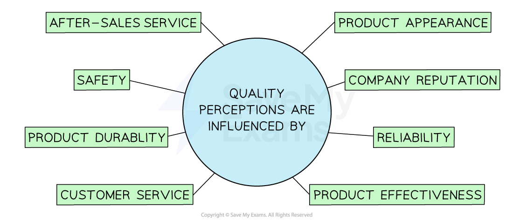
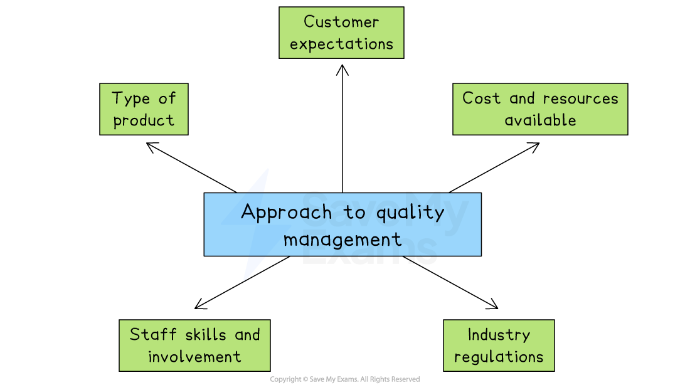

# The Importance of Quality

## The nature and importance of quality

> **Spec point** — `spcpt_qMzGrsmmt6wDfw9H`

## The nature and importance of quality

- **Quality considers the characteristics and features of a product that satisfy the needs of customers**

  - Businesses need to **maintain a level of quality **for several reasons
  
    - **Attract** and **retain** loyal customers
    - Build the **reputation** of the business or brand
    - Reduce **wastage and returns** from unsatisfied customers
- The **quality of a business's products **can provide a  ***competitive advantage***

  - High quality and minimal defects lowers business costs, allowing **lower selling prices** to better compete with rivals
  - High quality can be **used in promotional activity** and provide a **unique selling point** for businesses in competitive markets
  - Successfully developing a ***USP*** for quality can improve business reputation and** ease expansion into new markets**
- If quality is **not maintained **then businesses may be at **risk** of

  - Losing their competitive advantage and customers to other brands that offer better quality goods/services
  - Experiencing **higher costs **due to having to replace faulty or defected goods
  - Gaining a **poor reputation** as customers spread poor reviews about the business to others
- Customer **perceptions of quality** are influenced by numerous factors

#### Factors that influence quality perception

*The perception of quality is influenced by the brand, the product and the customer service*

- Customers may consider products or services to be of **good quality** if they

  - **Look good** and are sold by a **reputable** business or brand
  - Are** reliable** and *durable*
  - Are **safe** and ***fit for purpose***
  - Receive good customer service, including ***after-sales service***
- In some countries **laws protect consumers **so businesses need to ensure that the products they sell  are free of faults or defects to **avoid harming customers or their reputation**

## Quality control

> **Spec point** — `spcpt_WhyFwBc99WSsQRZF` · advantages and disadvantages of quality control and quality assurance

## Quality control

- **Quality control involves checking quality at the end of the production process using *****quality inspectors***** to find faults**
- It** is not possible to achieve perfection** in every production process

  - EFor example, there will always be some variation in terms of materials used, production skills applied and reliability of the finished product

#### Evaluating the use of quality control

| **Advantages** | **Disadvantages** |
|---|---|
| - **Specialists in quality control **check standards - Output is very likely to be fit for purpose before the customer receives it - **Little staff training** is needed as inspectors check quality rather than the employees themselves | - Rejecting finished goods is a significant **waste of resources** - The **cause of defects** is ignored so problems may continue - **High costs** of scrapping or reworking products |

## Quality assurance

> **Spec point** — `spcpt_FVbj8c5CfXVP74ph`

## Quality assurance

- **Quality assurance involves employees checking quality standards throughout the production process**

  - It aims to achieve quality by organising every process to get the product '**right first time'** and prevent mistakes happening
  
    - There is an emphasis on '**self-checking'** rather than checking by inspectors at the end of the process
- **Total quality management (TQM) **is a specific approach to quality assurance that aims to develop a quality culture throughout the firm

  - TQM is the **continuous improvement **of products and processes by focusing on quality at** every stage of production**
  - It tries to get it right first time and achieve *zero defects*

#### Evaluating the use of quality assurance

| **Advantages** | **Disadvantages** |
|---|---|
| - Quality issues are **identified** **early**, allowing ***reworking ***rather than rejection of substandard products - The **cause of defects** is identified so **future quality issues** are prevented - **Fewer customer complaints** maintain business reputation - **Improved worker motivation** as workers have more ownership and recognition for their work | - Staff **training** and a **skilled workforce** are required, which  increases labour costs - Reworking may **lengthen the time period of production** - All workers must be **fully** **committed** to maintaining quality standards - Focus on quality may reduce **labour output** |

## Recommending an appropriate approach to quality management

> **Spec point** — `spcpt_B9FwSDTbXncTqxDy`

## Recommending an appropriate approach to quality management

- The approach to quality management chosen depends on several factors

*The type of product, resources available and industry regulations can affect the approach a business takes to quality management*

**1. Type of product or service**

- Products that affect health or safety, such as food or medicine, usually require quality assurance to prevent serious mistakes
- For simpler products with low risk, quality control may be enough

**2. Customer expectations**

- If customers expect high and consistent quality, such as luxury goods or food, the business is more likely to use quality assurance
- For less sensitive markets, quality control may be acceptable

**3. Cost and resources available**

- Quality assurance often needs training, time and more staff, which can be expensive
- Quality control is cheaper and faster to set up but may result in more waste

**4. Staff skills and involvement**

- If workers are well-trained and motivated, quality assurance is easier to apply
- In businesses with low-skilled or temporary workers, quality control might be more practical

**5. Industry regulations**

- Some industries are required by law to meet high quality standards

  - Examples include healthcare, food and aerospace
- These businesses may have no choice but to adopt quality assurance systems

> **Exam Hint**
> A common misconception is that higher quality always means higher costs. In fact, good quality can **reduce costs** in the long run by lowering waste, defects, and customer complaints

> **Case Study**
> **Quality Management at Lunch Solutions Limited**
> 
> Lunch Solutions Limited is a small but growing business that prepares fresh sandwiches for delivery to schools, offices and local cafés. Recently, the business has received complaints about missing ingredients, uneven portion sizes and sandwiches not being properly sealed
> 
> 
> 
> To solve these issues and maintain customer satisfaction, the manager is deciding how best to manage quality
> 
> | Option 1: Quality control | Option 2: Quality assurance |
> |---|---|
> | - This would involve employing a quality inspector to check a sample of each batch of completed sandwiches at the end of the production line - Any batches with problems would be removed before packaging and delivery | - This would involve checking quality throughout the sandwich-making process - Staff would be trained to monitor ingredient preparation, portion control, hygiene and packaging at every step to prevent mistakes from happening |
> 
> **Recommendation**
> 
> - **Quality assurance is the most suitable option for Lunch Solutions Limited**
> 
>   - The business can prevent mistakes such as missing ingredients or poor packaging before they reach the customer
> - It will reduce waste and improve customer satisfaction
> 
>   - In contrast, quality control only spots problems at the end, which could mean wasted materials and delayed deliveries
> 
> While quality assurance needs staff training and better procedures, it is more effective for a food business where freshness, accuracy and hygiene are essential. It also supports the business’s aim to grow and keep long-term *contracts* with schools and offices
