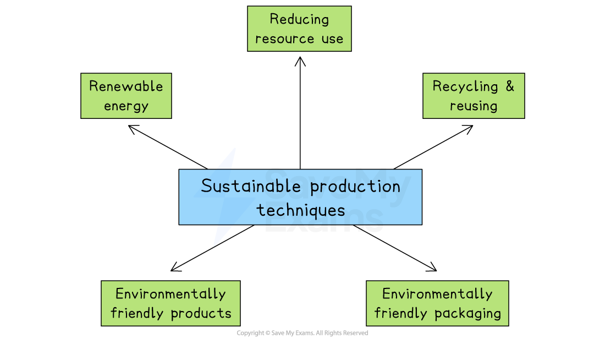

# Methods of Sustainable Production

## Introduction to sustainable production

> **Spec point** — `spcpt_4ND2XyWT4gHdv2T3`

## Introduction to sustainable production

- **Sustainable production occurs when a business produces goods and services in ways that do not harm the environment, society or future generations**

  - It focuses on meeting current needs without using up natural resources or causing long-term damage

#### What sustainable production may involve

*Sustainable production may involve using renewable energy, reducing resource use, recycling and reusing resources and developing environmentally friendly products or packaging*

- These practices help **protect the environment**, improve a business’s **reputation **and may also **reduce costs **in the long term

## Renewable energy

> **Spec point** — `spcpt_X23n663JJ6Ydm7yc`

## Renewable energy

- Renewable energy comes from natural sources that will not run out, like the **sun, wind, water **and ***geothermal *****heat**
- These sources are constantly being renewed by nature

### How businesses use renewable energy

- **Solar panels** on buildings to generate electricity
- **Wind turbines** to produce power, especially for factories or large offices
- **Hydroelectric power,** if the business is located near rivers or dams
- **Geothermal heating** for buildings in suitable areas
- **Buying green energy** from suppliers who use renewable sources

> **Case Study**
> **Renewable Energy Usage at IKEA**
> 
> Global furniture retailer IKEA has invested heavily in renewable energy
> 
> - Installed **solar panels** on many store rooftops
> - Built **wind farms** in countries including Germany and the USA
> - Committed to producing more energy than they use by 2025
> 
> 
> 
> **Benefits**
> 
> - **Lower energy costs** for stores and warehouses
> - Improved **brand reputation** as a sustainable company
> - Attracted **environmentally conscious customers**
> - Helped IKEA reach its goal of being *climate positive*

## Reducing resource use

> **Spec point** — `spcpt_mDzSgDxrW9fW3C8T`

## Reducing resource use

- Reducing resource use means using **fewer materials, water **and** energy** when making goods or providing services
- It helps businesses **cut waste**, **lower costs** and **protect the environment**
- **Businesses can reduce resource use in the following ways:**

  - **Designing products** that use fewer materials
  - **Reusing materials** in production instead of using new ones
  - **Improving efficiency**, like using machines that need less electricity
  - **Reducing packaging**, or switching to recycled or recyclable packaging
  - **Saving water**, for example by using water-efficient systems

## Reusing and recycling

> **Spec point** — `spcpt_cZ5t8csvwT7n36Dg`

## Reusing and recycling

- **Reusing** means using items or materials again instead of throwing them away
- **Recycling** is turning waste materials (like paper, plastic or metal) into new products
- Businesses reuse and recycle in the following ways:

  - **Reuse packaging**, containers, or leftover materials in production
  - **Recycle waste**, like paper, plastic, glass, or metal, either in-house or through recycling companies
  - **Encourage customers** to return used products (e.g. refillable bottles or old electronics)
  - **Buy recycled materials** to make new products

> **Case Study**
> **Reusing and Recycling at Patagonia**
> 
> Patagonia, a clothing company, is well-known for its strong environmental focus
> 
> - **Repairing clothes** for customers instead of encouraging new purchases
> - Using **recycled materials** like plastic bottles and old clothes to make new jackets
> - Running its **Worn Wear** programme, where customers return used clothes for reuse or resale
> 
> 
> 
> **Benefits**
> 
> - **Less waste** is sent to *landfill*
> - The business has **lower material costs** by using recycled inputs
> - It has a strong **brand image** for caring about the environment
> - It has developed strong **customer loyalty**, especially from environmentally conscious buyers

## Developing environmentally friendly products

> **Spec point** — `spcpt_hJ6R9Sb2H8Qc4dN6`

## Developing environmentally friendly products

- Environmentally friendly products are designed to **have less harm on the planet**

  - They use **natural **or **recycled materials**
  - They are **energy efficient**
  - They create **less waste **or **pollution**
  - They are ***biodegradable ***or **reusable**
- These products help reduce environmental impact during use and after disposal
- Businesses develop environmentally friendly products in the following ways:

  - Use **sustainable materials**, like organic cotton or recycled plastic
  - Design products that **last longer** or are **easy to repair**
  - Replace harmful chemicals with **natural alternatives**
  - Offer **refillable** or **reusable** versions of existing products

> **Case Study**
> **Lego's Environmentally Friendly Products**
> 
> Toy company LEGO has replaced replacing oil-based plastic with **plant-based plastic** made from sugarcane
> 
> - Launched eco-friendly **LEGO plant pieces** (like trees and bushes)
> - Invested in research to develop **fully sustainable building bricks**
> 
> 
> 
> **Benefits**
> 
> - Helped reduce use of **fossil fuels**
> - Improved LEGO’s **brand image** as an eco-conscious company
> - Gained **positive media coverage** and support from parents and schools
> - Helped LEGO work towards its goal of making all products sustainable by 2030

## Using environmentally friendly packaging

> **Spec point** — `spcpt_tZ2fVTVypbXNpGdM`

## Using environmentally friendly packaging

- Environmentally friendly packaging is made from materials that are **recycled, recyclable, biodegradable, compostable** or **reusable**
- It is designed to **reduce waste** and **lower harm to the environment**
- **B**usinesses develop environmentally friendly packaging in the following ways:

  - Use **paper or cardboard** instead of plastic
  - Choose **biodegradable **or ***compostable *****bags**
  - Offer **refillable packaging** or reusable containers
  - Use **minimal packaging** to avoid waste
  - Print with **eco-friendly inks** or labels

> **Case Study**
> **Environmentally Friendly Packaging at McDonalds**
> 
> McDonald’s has made major changes to its packaging in many countries in recent years
> 
> - Replaced **plastic straws** with paper ones
> - Switched to **recyclable paper wrappers and cups**
> - Stopped using **foam packaging**
> - Started using **certified sustainable materials** in paper products
> 
> 
> 
> **Benefits**
> 
> - **Less plastic waste**, especially in oceans
> - **Improved reputation**, especially with younger customers
> - Helped meet government rules on reducing plastic
> - Improved McDonald’s **competitiveness **with other eco food brands

> **Exam Hint**
> Use precise examples when explaining sustainability, such as recycling materials or switching to renewable energy. Concrete methods show stronger understanding than vague statements

## Advantages and disadvantages of sustainable production

> **Spec point** — `spcpt_j4GcttH5fyHSCvc6`

## Advantages and disadvantages of sustainable production

- In 2024, 91% of new renewable energy projects were cheaper than fossil fuels

  - Solar was 41% cheaper and onshore wind 53% cheaper on average
  - These savings helped global businesses save up to **\$467 billion in fuel costs**
- However, sustainable businesses often have a lot of extra work, like checking records and collecting data to make sure they pass regular *audits*

#### Evaluation of sustainable production

| **Advantages** | **Disadvantages** |
|---|---|
| - Sustainable production improves the business **image **and attracts more customers - It can** reduce long-term costs **by using less energy and fewer materials - It helps the business** meet environmental laws **and **avoid *****fines*** - It encourages ***innovation ***and can make the business more efficient | - Sustainable production can be **expensive **to start using new equipment or processes - Some environmentally friendly materials may be more expensive than traditional ones - Staff may need **training **to understand and follow new sustainable methods - Changing how products are made can** take time** and cause short-term delays |

### Greenwashing

- Greenwashing is when a business **pretends to be environmentally friendly**, but its actions do not match what it claims

  - For example, a company might advertise its products as eco-friendly when, in reality, they are not
- It is a way for businesses to **attract customers** who care about the environment, **without making real changes** to how they work

#### Problems of greenwashing

- **Loss of trust**

  - If customers find out the business lied, they may stop buying from it
  - Eco-conscious customers may share negative reviews or avoid the brand entirely
  - It can lead to bad publicity and complaints
- **Legal trouble**

  - In some countries, making false environmental claims can lead to fines or court action
