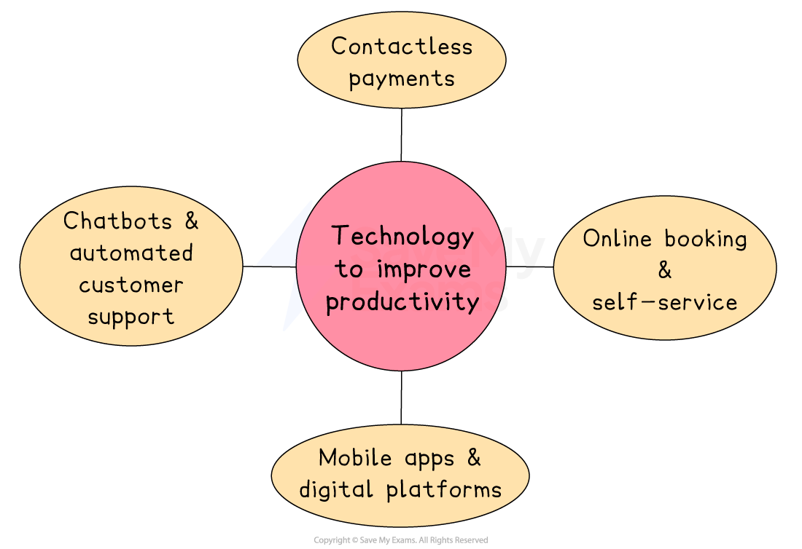

# Changing Technology & Productivity

## Technology is improving the service sector

> **Spec point** — `spcpt_7HsBj5mW7wVhcDSv`

## Technology is improving the service sector

- Technology is helping s**ervice-based businesses **work more efficiently, serve customers faster, and reduce operating costs

*Contactless payments, online booking, self-service, chatbots and mobile apps can all improve productivity in the service sector*

### Technology to improve productivity

#### Contactless payments

- Contactless payment systems allow customers to pay quickly by tapping a card, phone or smartwatch on a payment terminal
- This speeds up the *transaction* process and reduces waiting times in shops, cafés and other service businesses

#### Online booking and self-service

- Many service businesses now allow customers to book appointments, check-in or place orders online without needing help from staff
- Self-service kiosks and websites reduce pressure on *frontline workers*
- Fewer staff are needed at reception or check-in desks, and customers can be processed quickly and  accurately

  - For example, **Formule 1** hotels offer online check-in and key collection kiosks, allowing guests to go straight to their rooms without waiting at reception

#### Chatbots and automated customer support

- Chatbots are software programs that can answer customer queries automatically through websites, apps or messaging services
- They are available 24/7 and can handle common requests like opening hours, order updates or booking changes
- Staff are freed up to deal with more complex issues, while routine queries are handled automatically, reducing workload

#### Mobile apps and digital platforms

- Mobile apps allow customers to access services quickly and give businesses *real-time* information about demand, location and performance
- Apps are widely used in transport, food delivery and entertainment services
- Businesses can manage orders, staff and customers more efficiently using real-time data, improving speed and reducing delays

  - For example, **Deliveroo **uses its app to connect customers with nearby restaurants and delivery riders, ensuring fast service and better route planning

## Changes in technology and employees

> **Spec point** — `spcpt_3Bt5xfptHXRJGR9g` · "advantages and disadvantages of changes in technology for businesses and employees
"

## The impact of changes in technology

- Technology brings** many benefits **to businesses and employees, but it also **creates challenges**, especially in the way people work and the skills they need

### Impact on the business

| Advantages | Disadvantages |
|---|---|
| - **Improved efficiency and productivity**    - Technology allows staff to complete tasks faster, often with fewer errors, which increases overall output - **Reduced labour costs**    - Automation and software can replace some manual tasks, meaning fewer employees may be needed - **Easier recruitment and remote working**    - Online platforms help businesses attract applicants from wider areas.   - Technology also supports flexible working through remote systems - **Better employee monitoring and performance tracking**    - Digital systems can track hours worked, tasks completed, and productivity, helping managers make informed decisions | - **High training costs**    - Staff may need regular training to learn how to use new technology effectively. - **Job losses and lower morale**    - Automation can lead to *redundancies*, which may reduce motivation among remaining staff - **Resistance to change**    - Some employees may be unwilling or slow to adapt to new systems, which can affect business performance - **Dependence on IT specialists**    - Businesses may need to hire more technical staff to manage new systems and solve problems |

### Impact on employees

| Advantages | Disadvantages |
|---|---|
| - **Faster and easier ways to complete tasks**    - Technology simplifies *routine* jobs and reduces physical effort - **New opportunities for flexible working**    - Employees can work from home  using remote tools - **Improved communication**    - Tools like email, video calls and instant messaging help teams stay connected | - **Job insecurity**    - Automation and *AI* may reduce the number of available jobs, especially in low-skilled roles - **Need for constant *****upskilling***    - Workers must learn new systems regularly, which can be stressful or time-consuming - **Less human interaction**    - Working with machines or remotely may reduce *team bonding* and face-to-face support |

## How changes in technology improves business performance

> **Spec point** — `spcpt_YtRF6DjfmZTsphmJ`

## How changes in technology improves business performance

- Technology **directly affects how well a business performs** by improving processes, reducing costs and helping the business meet customer needs more effectively

### Profitability

- Technology helps businesses increase profits by **lowering production and operating costs**
- Automation reduces the need for large numbers of employees, and digital systems can reduce waste and errors
- Lower costs and higher output can lead to **higher***** profit margins**** *and **better overall financial performance** over time

### Efficiency and productivity

- Digital tools and machines allow businesses to **produce more in less time** and with fewer mistakes
- Technology can also help manage tasks such as *inventory control*, scheduling and communication
- **I**mproved efficiency leads to **quicker delivery times**, **lower labour costs** and **higher overall output**, all of which help improve business performance

### Customer satisfaction

- Technology can improve the **customer experience** by making it easier, faster, and more convenient to buy and use products or services
- It also allows businesses to respond to customers more effectively
- Higher customer satisfaction can lead to **repeat purchases**, **positive reviews** and **stronger customer loyalty**, helping the business grow

### Quality

- Technology increases quality by **reducing human error** and allowing businesses to follow exact specifications
- Quality control systems can detect problems early in the production process.
- Better quality leads to **fewer *****returns ***or **complaints**, which protects the business’s reputation and saves money

### Innovation and competitiveness

- Technology enables businesses to **develop new ideas** more easily and **respond quickly to market change**
- Digital tools help businesses research trends, test products and improve designs.
- Innovation helps businesses stay **competitive**, attract new customers and **enter new markets**

> **Exam Hint**
> In evaluation questions, show balance by noting both gains (like efficiency and output) and possible downsides (such as training costs or redundancies).
