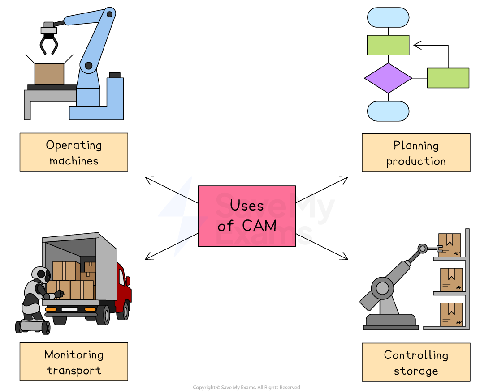

# The Use of Technology in the Production of Goods & Services

## The impact of technology on production methods

> **Spec point** — `spcpt_YNmkSRDZBPc3XVhs` · how technology is improving productivity in the service sector, e.g. contactless payments

## The impact of technology on production methods

- Technology has changed how businesses produce goods and services
- It can make production faster, cheaper and more accurate, but also comes with some challenges

#### Advantages and disadvantages of technology in production

| Advantages | Disadvantages |
|---|---|
| - **Increased speed and efficiency**    - Machines and automation can produce goods faster than humans, especially in **flow production** - **Lower labour costs**    - Automation reduces the need for large numbers of workers, especially unskilled labour - **Greater accuracy and consistency**    - Technology improves product quality by reducing human error - **Greater flexibility**    - Modern technology allows quick changes between batches or designs | - **High initial costs**    - Buying and installing new machinery or software can be expensive for small businesses - **Training required**    - Workers may need new skills to operate machines or software, which takes time and money - **Risk of unemployment**    - Replacing workers with machines may lead to job losses, especially in *labour-intensive* industries. - **Dependence on technology**    - A breakdown in machines or systems can stop production entirely and cause delays |

## Computer-aided manufacture (CAM)

> **Spec point** — `spcpt_hH84gYHx5kfXfTG3`

## Computer-aided manufacture (CAM)

- Computer-Aided Manufacture (CAM) is the use of computers to control and assist with production activities

*CAM can be used to operate machines, plan production, monitor transport and control storage*

### Uses of computer-aided manufacture

#### Operating machines

- CAM controls machinery such as cutters, drills or robotic arms, ensuring tasks are completed quickly, accurately, and with consistent quality

#### Planning production schedules

- CAM software helps plan when and how products will be made, reducing delays and making sure resources are used efficiently

#### Monitoring transport

- CAM systems can track the movement of materials and products, helping ensure they reach the right stage of production on time

#### Controlling storage

- CAM helps manage inventory by tracking how much stock is available, where it is stored, and when new materials need to be ordered

## 3D printing

> **Spec point** — `spcpt_tPMhpmP3nTyNSBft`

## 3D printing

- Digital designs are uploaded and the 3D printer produces the product **with minimal labour costs**
- Digital printers have been used to print car engines, houses, food and replacement limbs

#### The impact of 3D printing on production

| **Impact** | **Explanation** |
|---|---|
| **Cost** | - Traditional methods need expensive tooling and machinery, which is a high upfront cost for small businesses - 3D printing reduces costs as no special tools are required |
| **Productivity** | - Traditional production has long lead times due to set-up and tooling, causing delays - 3D printing is faster with minimal lead times, allowing quicker response to customer demand and faster product launches |
| **Quality** | - 3D printing produces detailed, high-quality items with greater accuracy - Traditional methods may struggle with complex designs |
| **Flexibility** | - 3D printing allows small, low-cost production runs tailored to specific customer needs - Traditional production is less suited to customisation |

> **Exam Hint**
> Examiners value awareness that technology is **constantly evolving** – mention that businesses must keep up with new developments to stay competitive and avoid falling behind rivals
