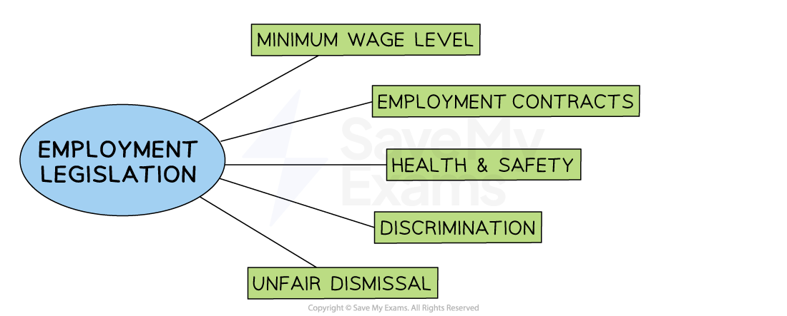
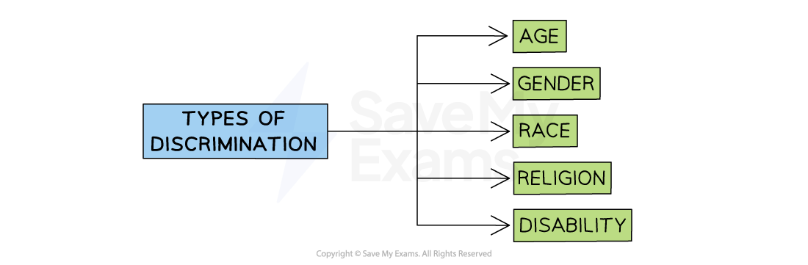

# Legal Controls Over Employment Issues

## Introduction to legal controls

> **Spec point** — `spcpt_6WBf9h4TgC4qFbb6` · "legal controls over employment issues: unfair dismissal, discrimination, health and safety, legal
minimum wage"

## Introduction to legal controls

- Legislation refers to **laws and regulations **passed by governments that require businesses to conduct their behaviour in a particular manner
- Many countries have **passed laws **that determine the required behaviour of employers towards their workers

#### Legal controls over business

*Employment legislation helps to reduce worker exploitation and unfair dismissal from the workplace*

## Unfair dismissal

> **Spec point** — `spcpt_fkbcjV4RQrFW2WqM`

## Unfair dismissal

- **Dismissal **takes place when an employer **ends an employee’s contract of employment with the business**
- **Dismissal can be fair **for a number of reasons

  - The job no longer exists, which means the employee is made **redundant**
  - An employee cannot do the job properly, e.g., they may **lack the right skills**
  - Long-term** illness**
  - *Gross ****misconduct*****,** such as theft or violence at work
  - For other “substantial” reasons, such as the employee has been sent to prison
- **Unfair dismissal **is when an employee of a business has their **employment terminated without a valid reason **or against **government legislation**

  - Reasons for unfair dismissal include** discrimination** or avoidance of paying compensation for ***redundancies***
- In cases where there is unfair dismissal, the worker may take his/her **complaint** to a court called an ***industrial tribunal*** to decide whether there is a case to answer

  - If the independent tribunal finds that the worker was **wrongfully dismissed, **then the worker receives **compensation** and their job is offered back to them

## Discrimination

> **Spec point** — `spcpt_zSRXxxxsZ4M3Bp3P`

## Discrimination

- **Discrimination** at work occurs when the employer treats employees with protected characteristics such as gender or race less favourably than one without these characteristics

  - In many countries, **discrimination **based on these characteristics is** illegal**

#### The main forms of discrimination

*Laws are in place to protect workers from discrimination based on gender, age, race, disability and religion*

- Employees who are victims of discrimination in the workplace can take **legal action against the employer**

  - ***Trade unions*** often support employees with legal claims against employers and **provide legal advice and support **
- Businesses can **miss out on recruiting the best applicant **if recruitment policies are discriminatory
- **Reputational damage** may result if a business is found to have discriminated against employees

## Health & safety

> **Spec point** — `spcpt_4vWt8v2PPvxr46xm`

## Health and safety

- Health and safety legislation requires businesses to operate in a way that protects the **physical and mental well-being** of its employees, *contractors *and customers
- Health and safety legislation covers areas including

  - The provision of **adequate breaks and rest periods**
  - Temperature and noise levels
  - The provision of safety equipment
  - Hygienic, safe and sanitary conditions
  - **Preventing stress**
- Implementation of procedures and equipment required to maintain healthy working conditions are likely to **incur financial and time costs, such as**

  - Staff **training** and supervision
  - Changes to **working hours** and rest provisions
  - Arrangement of *manuals*, signage and safety **documentation**
  - Purchase and maintenance of safety **equipment**
  - Drawing up and implementing a ***code of practice***
- Serious health and safety breaches can lead to **fines** or** investigations by the Health and Safety Executive** and, in some cases,** prison sentences**

## Legal minimum wage

> **Spec point** — `spcpt_H3wNKqxNqpmjcvXB`

## Legal minimum wage

- A **national minimum wage (NMW) **is a **legally imposed wage level** that employers must pay their workers

  - It is set **above** the market rate of pay
  - In some countries, the minimum wage **varies by age**
  - A minimum wage makes it illegal for an employer to pay an hourly rate below the minimum wage set

#### The impact of a legal minimum wage

| **On employers** | **On employees** |
|---|---|
| - **I**mplementation and periodic increases of a minimum wage increase ***variable costs ***as all workers must be paid the minimum legal limit - Employers may **invest more in training unskilled workers** as they are being paid a higher wage - Skilled workers who are receiving slightly more than the NMW may **demand higher pay **to maintain their ***wage differential*** | - Low-paid workers' earnings are increased and their** living standards** are likely to improve as a result - **Reduces exploitation of workers, **as without a minimum wage powerful businesses can legally pay their workers very poorly - Acts as an** incentive to enter the workforce** due to the attractiveness of higher pay |

- Businesses in some countries are free to** pay their workers very low wages, **leading to much **lower business costs**
- Businesses are often questioned about this decision, as it compromises** *****business ethics***

## Effects of legal controls over employment issues on employers and employees

> **Spec point** — `spcpt_GV8t7rYtWvsWWJ3G`

## Effects of legal controls over employment issues on employers and employees

- Employers need to understand the impact of employment laws to stay legal, avoid *fines *and manage their staff fairly and effectively
- For employees, understanding their legal rights can help them feel more confident and supported in their jobs

### Impact on employers

- **Increased responsibilities**

  - Employers must follow legal rules when hiring, managing and dismissing staff
  - This includes giving written contracts, fair pay and safe working conditions.
- **Extra costs**

  - Legal controls may lead to higher costs, such as paying minimum wage, providing *sick leave* or making workplaces safe
- **Avoiding legal trouble**

  - By following the law, employers reduce the risk of being taken to court by employees, which could damage their reputation and finances
- **Improved staff relations**

  - Fair treatment and clear policies can lead to better motivation and lower *staff turnover*, saving money in the long term

### Impact on employees

- **Greater protection**

  - Employees are protected from unfair treatment, such as being dismissed without reason or being underpaid
- **Safer working environment**

  - Legal controls help ensure that workplaces are safe and that employees are properly trained to avoid accidents
- **More job security**

  - Employees are less likely to lose their jobs unfairly or face discrimination, which gives them more confidence at work
- **Better working conditions**

  - Laws encourage fair pay, rest breaks, equal treatment and protection from bullying or *harassment*

> **Exam Hint**
> Always link legal controls (like unfair dismissal or minimum wage) to their **impact on both employers and employees** – examiners look for this two-sided analysis
