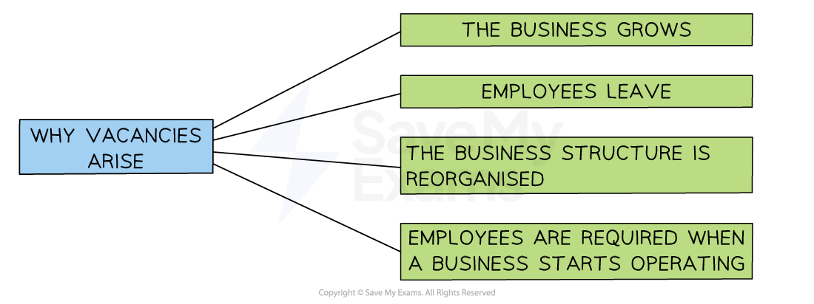

# Recruiting & Selecting Employees

## The recruitment process

> **Spec point** — `spcpt_8969kSsGncJzQGP6` · "stages in the recruitment process: job descriptions, person specifications, job advertisements
(including employment agencies and online recruitment)"

## The recruitment process

- **Recruitment **is the process of **attracting and identifying potential job candidates** who are suitable for a vacant role

  - Recruitment activities include **job advertising, job fairs, social media outreach and referrals** from current employees

#### Reasons why vacancies arise

*Vacancies can arise for reasons including business growth, employees leaving and reorganisation*

- **During periods of business growth**, more employees are needed as the business expands its operations
- When an employee **leaves their job** and needs replacing
- Businesses often reorganise their ***organisational structure*****,** which may result in the need for additional staff
- A **new business start-up** needs to recruit workers for the first time
- Businesses can choose to use a ***recruitment agency*** to carry out the recruitment and selection process on their behalf

  - New employees may be found **quickly** from its pool of available talent
  - Management **time **can be saved
  - Recruitment agencies usually charge a **finding fee** for their specialist services
- Online recruitment has become increasingly popular, with sites such as** LinkedIn **and **Indeed** helping businesses to share vacancy details and compare applicants

### Stages in the recruitment process

*The recruitment process starts by defining the role for which a vacancy exists*

#### Step 1: Define the role

- Businesses should determine exactly what is required and part of that is developing a job description and a person/job specification

  - **A job specification** (sometimes known as a **person specification**) outlines the qualifications, skills, experience, and personal qualities required **from a candidate** for a specific job e.g. problem solver, good communicator, able to code in Java etc.
  - **A job description **outlines the duties, responsibilities, and requirements of a particular job

#### Comparing a person specification with a job description

| **Job specification ** | **Job description** |
|---|---|
| - Details the essential and desirable characteristics of the **person** suitable for the job including    - Qualifications   - Experience   - Skills such as the ability to drive or IT capabilities   - Personal characteristics and attributes | - Details the features of the **job** including    - Duties   - Hours and location of the job   - Managerial or supervisory responsibilities   - Pay and conditions |

#### Step 2: Determine the source of employees

- **Internal recruitment** involves a business promoting or ***redeploying*** workers that already work for them

#### Advantages and disadvantages of internal recruitment

| **Advantages** | **Disadvantages** |
|---|---|
| - Internal recruitment saves time and money because there is no need for advertising or basic training | - It can create jealousy or tension among employees who are not chosen for the role |
| - It improves staff *morale* as employees see opportunities for promotion and career growth | - It limits the number of applicants, which may reduce the chance of finding new ideas or skills |
| - The employee already understands how the business works, which means they can start the new role more quickly | - Promoting someone internally can leave a gap in their old position that still needs to be filled |

- **External recruitment **involves bringing in new workers from outside of the business

  - External recruitment can bring fresh ideas, experiences and perspectives to the organisation

#### Advantages and disadvantages of external recruitment

| **Advantages** | **Disadvantages** |
|---|---|
| - External recruitment brings in new ideas, skills and experience that may help improve the business | - It is often more expensive because of costs related to advertising, recruitment agencies, and training |
| - The business has a wider choice of applicants, which increases the chances of finding the best person for the job | - It takes more time to recruit and train someone who is new to the business |
| - It can help increase *diversity* by bringing in people from different backgrounds | - New employees may take time to adjust or may not fit well with the existing team or business *culture* |

#### Step 3: Advertise the role

- Roles may be **advertised internally **or** externally**

  - If the business is seeking an **internal candidate**, business newsletters, staff noticeboards or internal email can be used to display job advertisements
  
    - ***Line managers*** may be asked to **recommend suitable candidates **following ***appraisals***
  - **External candidates** can be targeted with advertisements in newspapers, industry magazines, specialist recruitment websites, agencies and government-run agencies such as Job Centres
  
    - **Existing employees** may be asked to **nominate people they know** for roles , sometimes receiving a reward if their nominee is successfully recruited
    - ***Headhunting*** can be used to fill high-level roles
    - Businesses with a strong social media presence can use these platforms to advertise cost effectively e.g. Facebook, LinkedIn, TikTok
    - **Specialist recruitment portals** may be used to advertise, such as The Times Educational Supplement, one of the main publications and websites in the UK used to recruit teaching staff

> **Exam Hint**
> Avoid mixing up a **job description** and a **person specification** – one explains the role, the other describes the qualities and skills of the applicant

## Selection methods

> **Spec point** — `spcpt_c3gfFjqsmHwZFbT6` · "selection methods, e.g. curriculum vitae (CV)/resumé, application forms, references,
testing/assessment centres, interviews"

## Selection methods

- The selection process involves receiving applications, shortlisting candidates and choosing the most appropriate person(s) for the role

### Receiving applications

- The business may **accept applications from candidates** via ***Curriculum Vitae*** (CV) and **covering letter** or **application form**
- Once applications have been received, the business **shortlists **suitable candidates

  - Candidates  who best meet the essential and desirable criteria for the job opening in question are invited to the next stage of the recruitment process

#### Comparing application methods

| **Application form** | **Curriculum vitae (CV)** | **Covering letter** |
|---|---|---|
| - A **standardised **form **designed by the recruiter** to collect the same details from each candidate - Responses are collected in a **consistent format**and comparison is straightforward - A large volume of candidates can be **narrowed down** for interview | - A **professional document** **compiled by the applicant** - Details **career experience**, key **skills**and **strengths** - Includes **qualifications**and character/professional **referees** - Provides **contact details** for the recruiter to get in touch with the applicant | - A letter that **accompanies the candidate's application** form or CV - Gives **reasons for submitting** an application - Draws attention to the **applicant's particular suitability** for the role - Allows recruiters to **sift applications **without having to compare detailed application forms/CVs |

### Selection methods

- A variety of methods can be used to **select the right worker** for the role

#### Interviews

- Interviews are commonly used to meet with candidates

- They usually include a face to face, telephone or online **discussion between a manager and the candidate **about their **suitability** for the role

  - It is important to prepare a **set of relevant questions** to ask all candidates and to ensure that the interview is conducted in a fair and consistent manner
  - Interview questions may focus on
  
    - **Skills and experiences** that are relevant to the job
    - **Successes and failures** - and how these were overcome
    - Personal** interests and experiences**

#### Selection tests

- Candidates may be asked to **undergo a test **to demonstrate their skills and suitability for the job
- **Candidates may be asked to complete **tests individually or within groups to assess how they may work as part of a team
- The different types of tests may include:

  - **Skills **tests (e.g. numeracy)** **show the ability of candidates to carry out certain tasks
  - **Aptitude** tests show the candidate’s potential to improve or increase their skills
  - **Intelligence** tests are used to assess the candidate’s ability to work at a desired level
  - **Personality** tests are used to identify desired characteristics or traits such as the ability to work effectively in a team

#### Assessment centres

- Assessment centres bring together a **group of candidates** to take part in a range of activities over a day or more
- Candidates may be observed completing tasks such as

  - Group discussions
  - Problem-solving exercises
  - Presentations
  - *Role-plays*
- This method allows employers to assess a range of skills like** communication**, **teamwork**, **leadership **and **decision-making**
- Assessment centres are especially useful when selecting for senior or important roles

#### References

- This involve **contacting people who have worked with the candidate before**, such as previous employers or teachers
- References provide information about the candidate’s past **performance**, **attitude**, **reliability **and **behaviour**
- They help to check that the candidate is honest about their experience and suitable for the role
- They are usually **collected after interviews** but before making a final job offer

## Choosing who to employ

> **Spec point** — `spcpt_hSG33dqzrZxF4Qrd` · recommend and justify who to employ in a given situation

## Choosing who to employ

- The final decision of which applicant to employ depends on several factors
- Even when a suitable candidate is identified, the business will need to think about **whether it can finalise their appointment **

  - Can the business fulfil the applicant's **pay and conditions demands**?
  - Can appropriate** fringe benefits **be offered?
  - Are attractive **development opportunities **available to the applicant?

#### Factors used to select the best applicant

| **Factor** | **Explanation** |
|---|---|
| **Experience** | - Which applicant has the most relevant work experience? - How might broader experiences help an applicant succeed in a specific role? |
| **Qualifications** | - Are formal qualifications **essential **for filling the post?    - E.g. A teacher may require a degree in their specialist subject, whilst a retail store manager's experience is likely to be more relevant than formal qualifications |
| **Internal or external candidate** | - How important is it that the **applicant already has a good understanding** of how the business operates? - Time may be saved on induction training and ***productivity*** may reach expected levels sooner than with an external candidate - How important is it that the new worker has **experience and skills gained from outside **the business? - New ideas, insights into competitor activities and different ways of working could contribute towards a business's competitive advantage |
| **Gut feeling** | - Will the worker 'fit' in with the business's culture and values? |

> **Case Study**
> **Recruiting For A Children's Bookshop**
> 
> - A small children's bookshop business has received two applications for its advertised **sales assistant **role
> - The shop owner is keen to select a **knowledgeable** candidate who is capable of delivering **good customer service**, **communicating effectively** with its (often young) customers and being willing to **support administrative tasks** such as banking cash
> - Which of these two applicants would likely be appointed?
> 
> 
> 
> #### Applicant analysis
> 
> - Amira scored better in the assessment tests. She was nearly 20% better in communication
> - Amira has had two weeks experience of working with kids, which will suit this role nicely
> - Amira also has a first aid qualification, which is a useful skill when working with kids
> - Overall, Amira is a better fit for the role advertised
