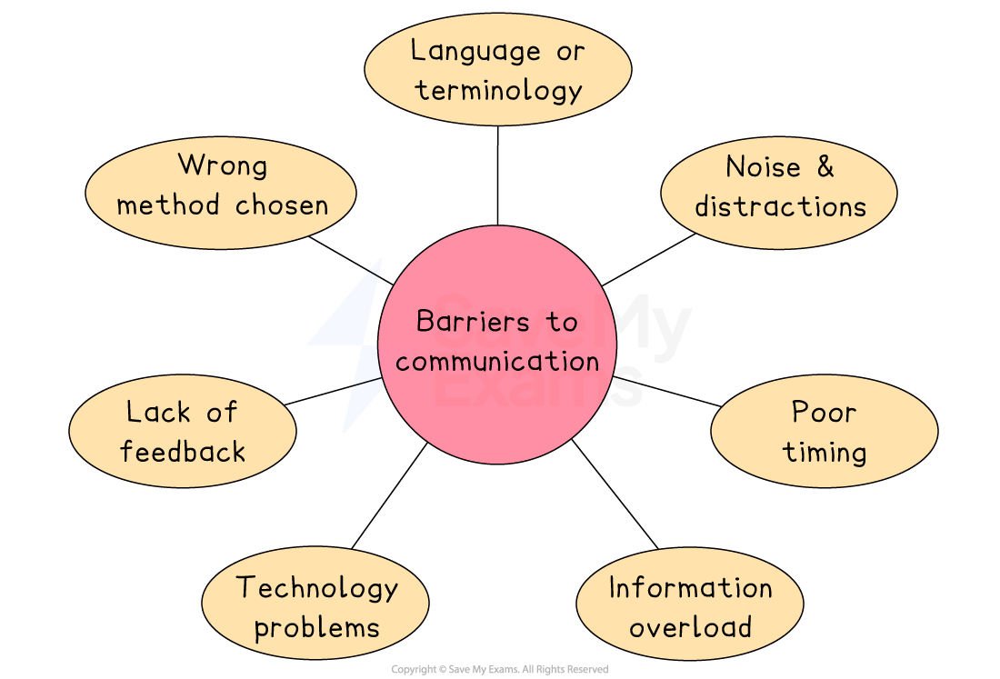

# Communication Barriers

## Introducing communication barriers

> **Spec point** — `spcpt_RbCbVVP2K2rSmWFn` · "examples of communication barriers
reasons for communication barriers"

## Introducing communication barriers

- Barriers to communication **hinder the flow of information,** leading to potential misunderstandings, conflicts and inefficiency

#### Main barriers to communication

*Barriers to communication include noise and distraction, technology problems and information overload*

## Problems caused by communication barriers

> **Spec point** — `spcpt_vStH6QqXcgZTZQfc`

## Problems caused by communication barriers

### Language or terminology

- When employees use complex or technical language that others do not understand, the message can be misunderstood or ignored

  - For example, a manager sends an email with financial jargon that non-finance staff cannot follow, leading to confusion about budget limits

### Poor timing

- Messages sent at the wrong time can be missed or cause stress

  - For example, telling employees about a major change at the end of a busy shift may lead to frustration or lack of attention

### Information overload

- If people are given too many messages at once, they may ignore or forget important details

  - For example, a long email covering ten topics may result in staff missing a key update about health and safety

### Noise and distractions

- Background noise or interruptions make it difficult to focus on the message

  - For example,  announcements made in a loud factory might not be heard clearly by workers.

### Technology problems

- Delays or failures in communication systems can stop messages from being delivered or received

  - For example, an important video meeting is missed because the link didn’t work or the internet connection failed

### Lack of feedback

- If no feedback is given, the sender cannot be sure the message was understood correctly

  - For example, a team leader sends a task by email but receives no reply, leading to delays in completing the work

### Wrong method chosen

- Using the wrong communication method for the message or audience can cause misunderstandings

  - For example, posting a notice about a sudden meeting change may not reach all employees in time

## How communication barriers can be reduced or removed

> **Spec point** — `spcpt_M4tf87GDgxpXyxtn`

## How can communication barriers be reduced or removed?

| **Barrier** | **Solution** |
|---|---|
| Language or terminology | - Use simple, clear language and avoid jargon unless everyone understands it |
| Poor timing | - Send messages at suitable times when people are more likely to focus |
| Information overload | - Break messages into smaller parts or prioritise the most important points |
| Noise and distractions | - Choose a quiet time or location to communicate, or repeat key messages |
| Technology problems | - Use backup methods (e.g. phone call if video fails) and test systems in advance |
| Lack of feedback | - Encourage two-way communication by asking questions or confirming receipt |
| Wrong method chosen | - Match the method to the message and audience (e.g. email for updates, meetings for discussion) |

> **Exam Hint**
> When writing about barriers, don’t stop at identifying them – stronger answers **explain how they can be reduced or removed**, linking solutions directly to the problem given in the question
