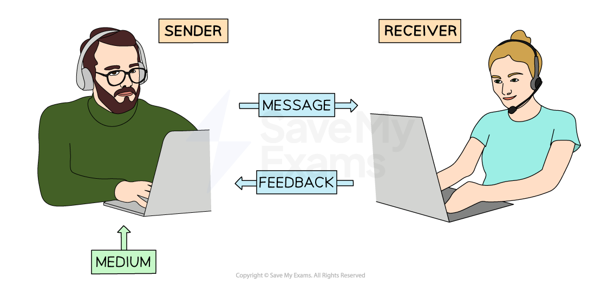
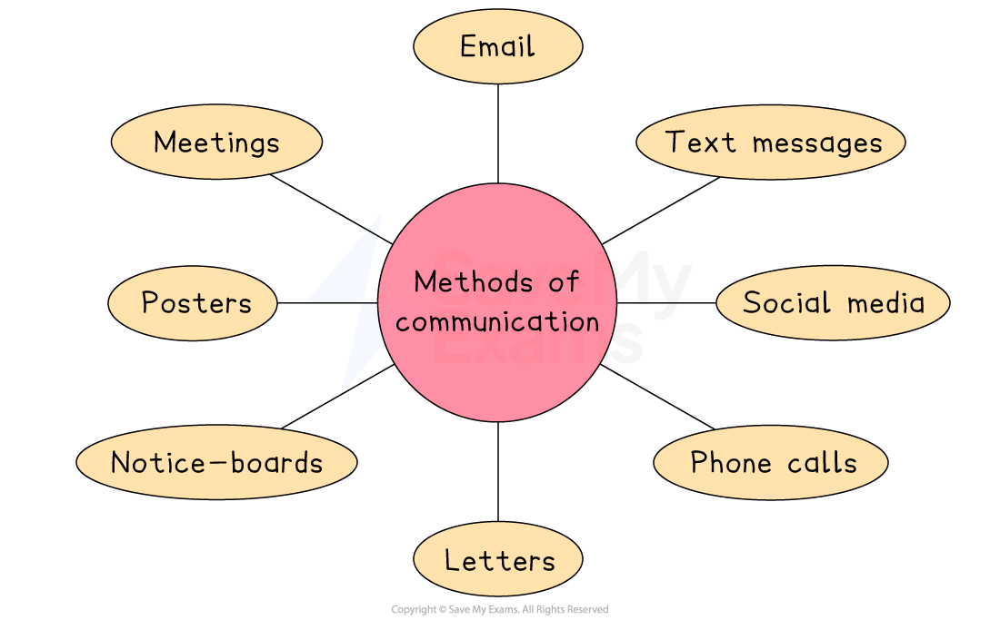

# Why Communication is Important

## The importance of communication

> **Spec point** — `spcpt_htXxfZXFpgNMSs8n`

## The importance of communication

- **Communication **is the successful transfer of messages between sender(s) and receiver(s)

#### The communication process

*A sender passes the information to the receiver using a medium of communication such as email*

- **Effective communication should be**

  - Clear and unambiguous
  - Appropriate to the context and to the sender
  - Sent to the correct receiver in an accessible format
  - Timely and contain only the required amount of detail
- **Managers **should make sure that communication is **organised** and **controlled** to ensure that a suitable level of communication exists **between key stakeholders**

  - A 2021 survey of US workers found that more than one-third reported email overload that might lead them to resign from their jobs

### Benefits of effective communication

- Helps managers and employees to **minimise mistakes**
- Supports everyone involved in a business to **understand their role** and know **what is expected **of them
- Ensures that the business's **values and objectives are clear**
- Provides customers with the **information** they need to **understand goods and services**
- Minimises business costs
- Helps businesses to effectively exploit new opportunities

## Methods of communication

> **Spec point** — `spcpt_6gTPGCPWTyZmMQJz` · "methods of communication, e.g. meetings (face-to-face or virtual), email, text messages, social
media, phone calls (including mobile calls), letters, posters and noticeboards
advantages and disadvantages of different methods of communication"

## Methods of communication

- Businesses have a range of ways to organise communication, both within the organisation and with external stakeholders

*Methods of communication include meetings, text messages and phone calls*

### 1. Meetings

- Meetings are discussions that take place either in person or through video calls
- They are useful when detailed conversations are needed or when team *collaboration* is important

  - For example, a manager might hold a virtual meeting with department heads to plan for a product launch

#### Advantages and disadvantages of meetings

| **Advantages** | **Disadvantages** |
|---|---|
| - Meetings are effective for discussing complex issues where feedback is needed quickly | - Meetings can take a lot of time to organise and attend, reducing productivity |
| - Face-to-face or virtual meetings allow *body language* and tone to be observed for clearer communication | - Virtual meetings may be affected by poor internet connection or technical issues |

### 2. Email

- Emails are written messages sent electronically over the internet to one or more people
- They are useful for sharing documents, giving instructions or contacting *external stakeholders* like suppliers or customers

  - For example, a sales manager may email a customer with an *invoice* and delivery confirmation

#### Advantages and disadvantages of email

| **Advantages** | **Disadvantages** |
|---|---|
| - Emails are fast and inexpensive to send to one or many recipients | - Some people may ignore emails or miss them if they go to a *junk folder* |
| - They provide a written record of communication that can be referred to later | - Messages can be misunderstood due to lack of tone or body language |

### 3. Text messages

- Text messages are short, written communications sent by mobile phone
- They are useful for urgent reminders or updates where a quick response is needed

  - For example, a supervisor might text an employee to remind them about a last-minute shift change

#### Advantages and disadvantages of text messages

| **Advantages** | **Disadvantages** |
|---|---|
| - Text messages are quick to send and receive, especially for urgent communication | - Text messages are limited in length and not suitable for detailed or formal messages |
| - They are useful when internet access is not available | - Some people may view texts as unprofessional in a business setting |

### 4. Social media

- Social media platforms like Facebook, Instagram, and X allow businesses to communicate with the public or with specific groups
- They are useful for marketing, brand updates, and responding to customer questions and feedback

  - For example, a clothing brand might post product updates and special offers on Instagram to attract customers

#### Advantages and disadvantages of social media

| **Advantages** | **Disadvantages** |
|---|---|
| - Social media allows businesses to reach a large audience quickly and interact with followers | - Negative comments or public complaints can damage the brand’s reputation |
| - It encourages *two-way communication* and can build strong customer relationships | - Not all stakeholders use social media or check it regularly |

### 5. Phone calls

- Phone calls allow two or more people to speak directly using a landline or mobile phone
- They are useful for quick decision-making or when immediate clarification is needed

  - For example, a supplier may call the purchasing manager to confirm an urgent order

#### Advantages and disadvantages of phone calls

| **Advantages** | **Disadvantages** |
|---|---|
| - Phone calls allow fast, two-way communication that can clear up confusion quickly | - There is no written record unless the conversation is written down afterwards |
| - Speaking directly can help build stronger relationships and reduce misunderstandings | - Phone calls can interrupt the receiver and may not always be convenient |

### 6. Letters

- Letters are written documents usually printed and delivered by post or hand
- They are used for formal communication or when a permanent, signed record is needed

  - For example, a company may send a job offer or *contract* to a new employee by letter

#### Advantages and disadvantages of letters

| **Advantages** | **Disadvantages** |
|---|---|
| - Letters are formal and professional, which helps when dealing with serious or legal matters | - Letters are slower to send and receive compared to electronic communication |
| - They provide a physical copy that can be kept as proof | - Printing and postage costs make letters more expensive than emails or texts |

### 7. Posters

- Posters are printed signs or notices placed in visible areas such as staff rooms, canteens or shop floors
- They are best for sharing key messages that need to be seen often, like health and safety reminders

  - For example, a poster in a factory might remind workers to wear safety goggles

#### Advantages and disadvantages of posters

| **Advantages** | **Disadvantages** |
|---|---|
| - Posters are eye-catching and placed where many people can easily see them | - People may ignore posters if they see them every day or if the message is unclear |
| - They are useful for sharing basic or repeated messages like reminders | - Posters are not suitable for private or complex information |

### 8. Noticeboards

- Noticeboards are boards found in workplaces where printed messages, *rotas* or announcements can be pinned up
- They are useful for displaying long-term or regularly updated information such as shift timetables or company news

  - For example, a restaurant might use a noticeboard to show the weekly staff schedule

#### Advantages and disadvantages of noticeboards

| **Advantages** | **Disadvantages** |
|---|---|
| - Noticeboards are a good way to display shared information in one central place | - Employees may forget to check them regularly, so messages can be missed |
| - They are useful for displaying updates that people can return to as needed | - Only workers who are physically at the location can view the information posted |

## Internal and external communication

> **Spec point** — `spcpt_ZBKJSbRS7Twzwm8J`

## Internal and external communication

- **Internal communication** is the exchange of message(s) between two or more members of the same organisation

  - For example, telephone call between a sales manager and a finance team member
- **External communication** is the exchange of message(s) between an organisation and external stakeholders such as customers, suppliers or investors

  - For example, sending an online order form to a supplier

## Recommending communication methods

> **Spec point** — `spcpt_5g2gV7Kvp6x5B4tg` · recommend and justify which method of communication to use in a given situation

## Recommending communication methods

- Businesses are likely to develop their communication methods and style over time

  - **Smaller business** may only be able to afford to communicate with customers through posters, leaflets and social media
  - **Larger businesses **are likely to have greater budgets, which allow for the use of television and billboard promotional campaigns

#### Factors that influence the choice of communication method

| **Factor** | **Explanation** | **Example** |
|---|---|---|
| **Cost** | - Some methods are low-cost, while others are expensive but may reach more people | - A product recall could be shared through social media (cheap) or newspapers (expensive but wider reach) |
| **Speed** | - Urgent messages require fast delivery | - A cancelled meeting is best communicated by phone, not letter |
| **Receiver** | - Depends on the number and type of people receiving the message | - A group email can reach all 300 staff, unlike a noticeboard that may be ignored |
| **Leadership style** | - Communication style depends on how the leader involves staff | - A democratic leader may hold a meeting, while an autocratic one may send written notices |
| **Message details** | - Technical or detailed messages may need written formats | - Revenue figures can be emailed or added to a shared folder for staff to view |
| **Need for a record** | - Formal or important messages may need to be stored | - An order form creates a permanent record, unlike a phone call |
| **Feedback** | - Two-way communication is needed for quick decisions | - Verbal discussion helps colleagues act fast, unlike a delayed text message |

> **Case Study**
> **Communicating Effectively at Fresh Bite Foods**
> 
> 
> 
> Fresh Bite Foods is a Canadian healthy snack manufacturer with around 100 employees. The business sells its products through retailers and its own online store.
> 
> **Communication problems**
> 
> - Fresh Bite used to rely on noticeboards to share updates like shift changes and health and safety rules
> - However, many employees missed important messages
> - Additionally, customer complaints and questions were handled only by email, which led to delays and frustration
> 
> **Solutions**
> 
> - The business introduced email and a staff messaging app to send updates directly to employees’ phones
> - For urgent issues like machinery problems, managers use face-to-face conversations or phone calls
> - This helped reduce lateness and confusion on the shop floor
> - Fresh Bite also added a live chat feature on its website and trained customer service staff to respond quickly and clearly
> - This made it easier for customers to ask questions and get fast support
> - As a result, customer satisfaction and reviews improved

> **Exam Hint**
> Don’t just say “communication is important” – show the **consequences of poor communication**, such as mistakes, delays, or demotivated employees. Examiners look for this cause-and-effect link
