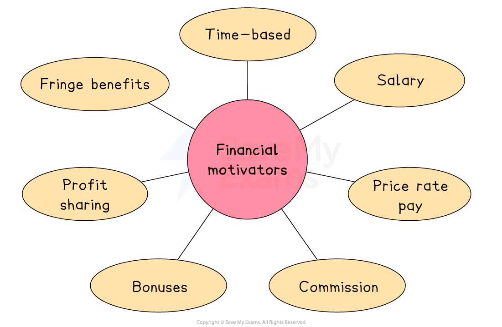

# Methods of Motivation

## Financial methods of motivation

> **Spec point** — `spcpt_jcKqTFY7WGYKZzhf` · "e.g. time-based, piece-rate, salary, bonus, commission, profit
sharing, fringe benefits"

## Financial methods of motivation

- Financial incentives are **rewards or payments** given to employees in return for their labour or improved performance
- The different theories of human motivation offer varying perspectives on the **role of money in motivating staff**

  - **Herzberg's theory** says that money is not generally a motivator, but the lack of it leads to dissatisfaction
  - **Maslow's theory** suggests people move through levels of needs that motivate them
  
    - Lower-order needs are closely linked to financial rewards, whilst higher-order needs are rarely linked to pay
    - **Physiological** and **safety **needs can be partially met by providing adequate pay
    - **Love and Belonging** needs are often met by encouraging aspects such as teamwork

#### Financial methods of motivation

*Financial incentives motivate some employees, depending upon the importance that they place on monetary items/money as a reward*

| **Incentive type** | **Explanation** |
|---|---|
| **Time based** | - This refers to the **basic wage **or** *****salary**** *that a worker receives for their labour - Employees who work on an hourly rate are paid **wages** and *accrue *benefits such as annual leave according to the hours they work |
| Salary | - Salaries are paid to full-time staff and usually accompanied by benefits such as a fixed number of days of annual leave |
| **Piece rate** pay | - Some workers may be paid a** piece rate** according to how many items they produce or sell |
| **Commission** | - A percentage of **sales revenue **is paid to workers who sell products or services - Commonly used in sales roles and motivates staff to sell more and ***upsell*** |
| **Bonus** | - An additional payment given to staff awarded for achieving specific goals, completing projects on time or **exceeding performance targets** - The opportunity to **earn more money** may motivate staff to work harder and achieve better results |
| Profit sharing | - A financial reward where employees receive a share of the business’s profits, often given as an annual payment in addition to their regular salary - Knowing they will benefit directly from the business’s success may encourage staff to work harder, improve performance and stay loyal to the firm |
| **Fringe benefits** | - These are **additional benefits** usually offered to salaried employees    - Fringe benefits could include the use of a company car, private healthcare or gym membership   - Employees can be **motivated to work hard** in order to keep their job and the associated fringe benefits |

> **Exam Hint**
> Be careful not to confuse **fringe benefits** (like company cars or health insurance) with direct pay methods – they are still financial incentives, but given in non-cash form

## Non-financial methods of motivation

> **Spec point** — `spcpt_3Fps6hgVGRK8Xdm2` · "e.g. job enrichment, job rotation, training, opportunities for
promotion, praise, employee of the month"

## Non-financial methods of motivation

- Non-financial incentives are **rewards **that are **not directly related to money**
- These incentives may be ***intangible*** and include **methods that lead to** recognition, praise, job satisfaction or improved work-life balance

### Types of non-financial Incentives

1. **Praise/employee of the month**

  - Many workers respond well to praise or to recognition programs inside the workplace.
  - Meaningful praise can increase productivity
2. **Job enrichment**

  - Involves adding more **challenging or meaningful tasks** to a job
  - Staff feel more motivated and engaged, leading to improved productivity
3. **Job rotation**

  - Involves moving staff between** broadly similar but varied roles** in the business
  - Exposes staff to **new challenges and experiences**,** **which can increase motivation, understanding and skill
4. **Teamworking**

  - Teamwork may involve workers **completing tasks together**
  - Teamwork can increase motivation in the workplace, as each member of staff has a role and a shared goal
5. **Training**

  - Involves staff **improving or learning new skills** and abilities
  - This can make employees feel valued, more productive and likely to remain with the business
6. **Promotion opportunities**

  - Employees offered promotion will feel recognised, have a **higher status** and will be given more challenging tasks/responsibilities to perform
  - These benefits are closely linked to the views of both Maslow and Herzberg

## Recommending motivation methods

> **Spec point** — `spcpt_RryQBbhPyvyFhfz5` · recommend and justify an appropriate method of motivation for a given situation

## Recommending motivation methods

- When recommending a method of motivation for employees in a business, managers must recognise that **individuals are motivated in different ways**

### Factors affecting the choice of motivation method

- **The context of the business**

  - What type of business is it? E.g. manufacturing or sales
  - The **budget available**
  - How many workers does the organisation have?
  - Does the business currently use any methods of motivation?
  - What is the nature of the work carried out by employees on a daily basis?
- **The balance of the compensation package**

  - Ideally it should include **both financial and non-financial **
  - It should be **adaptable **and reflect the changing needs of staff

#### Recommending a method of motivation

> **Case Study**
> **Boosting Morale at ChocoBitz**
> 
> 
> 
> ChocoBitz is a chocolate biscuit factory where employees worked long shifts on a fast-moving production line
> 
> Managers were concerned about poor motivation for several reasons
> 
> - The work was repetitive and routine, and employees felt they were not learning new skills or progressing
> - Staff regularly complained about low rates of pay
> - This made workers feel bored and less engaged in their jobs
> - Staff turnover was high and increasing year on year
> 
> **Solutions**
> 
> - To improve motivation, managers introduced **job rotation**
> 
>   - This allowed workers to switch between different tasks on the production line
>   - This helped them build new skills, stay focused and feel valued
> - In addition, the business introduced a **small performance-based bonus scheme**
> 
>   - Workers who met or exceeded daily production targets received a cash bonus
>   - This **financial reward** encouraged employees to stay productive and gave them an extra reason to remain with the company
