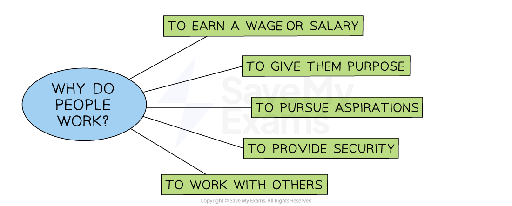

# The Importance of a Motivated Workforce

## Why people work

> **Spec point** — `spcpt_TgnQb4brnpr6QKp9`

## Motivation and work

- Motivation is the **inner desire or willingness** that drives a person to take action and **achieve a specific goal or outcome**

  - Motivation can be **intrinsic**, coming from within a person (values, beliefs etc)
  - Motivation can be **extrinsic**, coming from external factors (rewards or punishments)

### Why do people work?

- **People work for many different reasons**

  - They **need to earn money** to fund their lifestyle and ensure they have the necessities required
  - For some, **work is voluntary** or low-paid and done to give them a purpose
  - Some people work for the opportunity to **mix with other people**
  - For many, employment allows them to** fulfil their *****aspirations***

#### Why people work

*Individuals go to work for a variety of reasons, including earning a wage or salary and to give them a purpose*

## Benefits of a motivated workforce

> **Spec point** — `spcpt_PCg4jDrvhjPCxgPx` · "improved labour productivity, reduced absenteeism,
lower labour turnover and greater willingness to accept change/new methods of working"

## Benefits of a motivated workforce

- A motivated workforce brings a range of important benefits that can improve performance, reduce costs and give a business a *competitive advantage*

| **Benefit** | **Explanation** |
|---|---|
| **Increased productivity and efficiency** | - Motivated employees are more productive, meaning they can produce more in less time    - This often results in higher output and better quality, improving **customer satisfaction**   - Greater productivity allows the business to increase profits without increasing labour costs |
| **Lower labour turnover** | - Motivated employees feel valued and are more likely to stay with the company    - This leads to lower *labour turnover*, reducing the need for frequent recruitment and training   - It also saves time and money while keeping experienced staff who help maintain consistent quality |
| **Higher reliability and loyalty** | - Motivated workers are more reliable    - They arrive on time, meet deadlines and take fewer sick days   - Their loyalty builds trust with the business and creates a more positive *workplace culture* |

> **Exam Hint**
> Don’t just say motivation is “good for the business” – examiners want specific outcomes such as **higher productivity, lower absenteeism, and reduced labour turnover**
