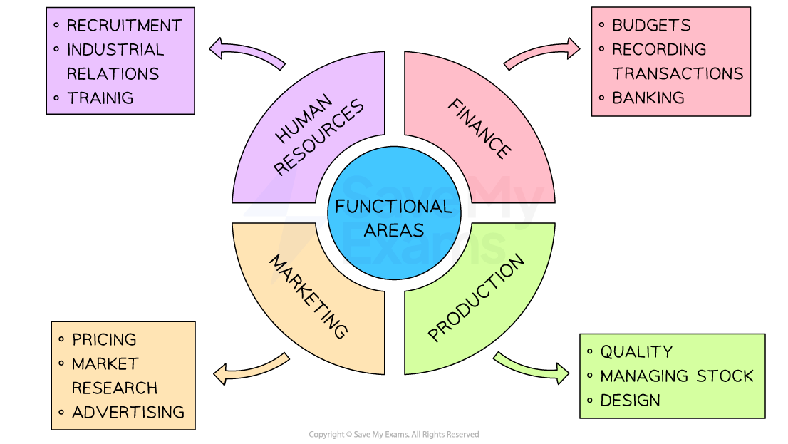

# Functional Areas

## Introduction to functional areas

> **Spec point** — `spcpt_9kWz8kWW8GjpdVXY`

## Introduction to the functional areas

- A functional area is a group of workers with similar skills and expertise who carries out a **specific organisational role**

  - The four most common functional areas include human resources, finance, marketing, and production
- Businesses often split their work in this way to improve efficiency with **specialists** capable of working at a high standard on specific tasks
- These business functions are sometimes ***outsourced*** to **specialist service providers**

  - This can **reduce costs** and ensure access to **advice from specialists** who may be expensive to employ directly

#### Functional areas

*The four main functional areas carry out key specialist tasks in a business*

## Operations

> **Spec point** — `spcpt_943Vc7JDRgBb6DvH`

## Operations

- The operations function is centred on creating the product or delivering the service that the business offers to customers, including

  - Ensuring the *quality *of output
  - Sourcing and purchasing *raw materials* and *components*
  - Managing the design and testing of new products
  - *Inventory* management

## Marketing

> **Spec point** — `spcpt_w6JwnJbfZGKbMGkf`

## Marketing

- Marketing focuses on understanding the needs and wants of both existing and potential customers, including

  - Researching the market to plan products that meet consumer *demand*
  - Organising their *distribution*
  - Persuading customers to purchase a company’s goods or services
  - Determining *pricing tactics* that attract and retain customers

## Finance

> **Spec point** — `spcpt_3bJ2gZssrdY2bybt`

## Finance

- The finance department is tasked with managing the organisation’s money, including

  - Recording all incoming and outgoing financial transactions
  - Collecting *debts *owed to the business
  - Ensuring that bills and *salaries *are paid on time
  - Setting and maintaining *budgets*
  - Conducting financial forecasting
  - Managing banking operations
  - Preparing the *annual financial report*

## Human resources

> **Spec point** — `spcpt_nCTwfgypT6jhgws8`

## Human resources

- The human resources (HR) function is responsible for managing the workforce within an organisation and ensuring employee welfare, including

  - *Recruitment *and *selection*
  - Training and development
  - Maintaining healthy *industrial relations*
  - Ensuring compliance with health and safety regulations

> **Exam Hint**
> Don’t just name the main functional areas (marketing, finance, HR, operations) – explain how they **interrelate**. For example, marketing decisions affect operations and finance
