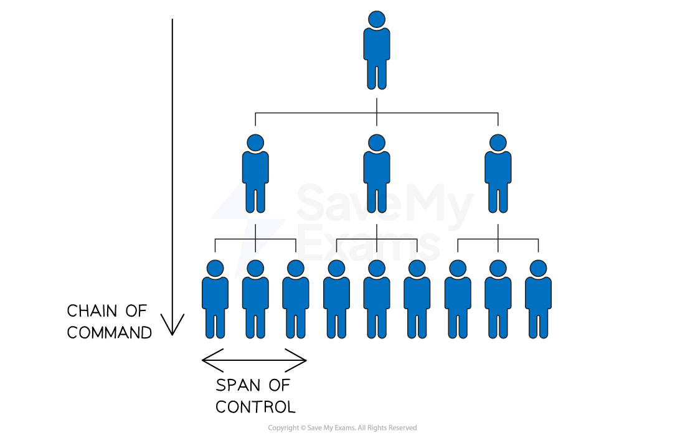
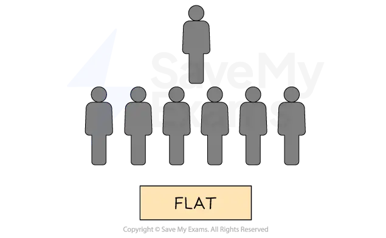

# Hierarchical Structures

## Organisational charts

> **Spec point** — `spcpt_hft4KzzKRmFNYGGq`

## Organisational charts

- An organisational chart is a visual representation of the** *****reporting relationships*****, roles **and **responsibilities of employees** in an organisation

  - Businesses must determine what the best structure is for them so as to **effectively implement** **ideas** and **achieve their *****objectives***
  
    - They should consider how the structure may affect the **management and effectiveness of operations** and **communications**
    - A well-designed organisational structure helps to **promote clarity, efficiency **and ***accountability***

#### An organisational chart

*This organisation chart shows a traditional hierarchy where workers are answerable to the supervisor or manager who has authority over them in the structure*

## Chain of command

> **Spec point** — `spcpt_XKZVjJzJMBh3bJcw`

## Chain of command

- The chain of command is the **formal line of *****authority**** *that flows downward from the top management to lower-level employees

  - It defines who reports to whom and who is responsible for making decisions
  - The chain of command helps to establish a **clear *****communication channel*** and helps to maintain accountability within the organisation

## Span of control

> **Spec point** — `spcpt_JS28DFnzRScZF2PQ`

## Span of control

- Span of control refers to the number of employees that a **manager **or ***supervisor *****can effectively manage**
- It is based on the principle that a manager can only effectively manage a limited number of employees

  - A **narrower span of control** means that there are more layers of management
  - A **wider span of control** means that there are fewer layers of management

## Tall and flat structures

> **Spec point** — `spcpt_CQPvBZBTnjcwSQgJ` · interpret simple organisational charts

## Tall and flat structures

- The chain of command and span of control are closely linked

  - A long chain of command usually results in a narrow span of control
  
    - This is known as a **tall** organisational structure
  - A short chain of command usually results in a wide span of control
  
    - This is known as a **flat** organisational structure

### Characteristics of tall structures

- Multiple levels of management
- A **long** chain of command and **narrow **span of control
- Common in large organisations with complex operations

  - E.g. government agencies and universities

#### A tall structure

*A tall structure has a long chain of command and narrow span of control*

#### Evaluating tall structures

| **Advantages** | **Disadvantages** |
|---|---|
| - Provides a **clear *****hierarchy**** *of authority and defined roles and responsibilities - **Promotes *****specialisation**** *and expertise within each department or function | - Can create ***communication barriers*** between upper and lower levels of the hierarchy - **Decision-making can be slow** as information must pass through multiple layers of management |

### Characteristics of flat structures

- Fewer levels of management
- A **short** chain of command and **wide **span of control
- Common in small organisations or start-ups

  - E.g. technology start-ups and small businesses

#### A flat structure

*A flat structure has a short chain of command and wide span of control*

#### Evaluating flat structures

| **Advantages** | **Disadvantages** |
|---|---|
| - Promotes a **culture of *****collaboration**** *and open communication - Decision-making can be **faster and more efficient** | - Can lead to a lack of clear hierarchy - May require employees to take on **multiple roles** and responsibilities l**eading to *****burnout**** *and feeling overwhelmed |

> **Exam Hint**
> Be clear on the difference between a **tall** and a **flat** structure – exam questions often test this through their impact on communication, control, and decision-making
