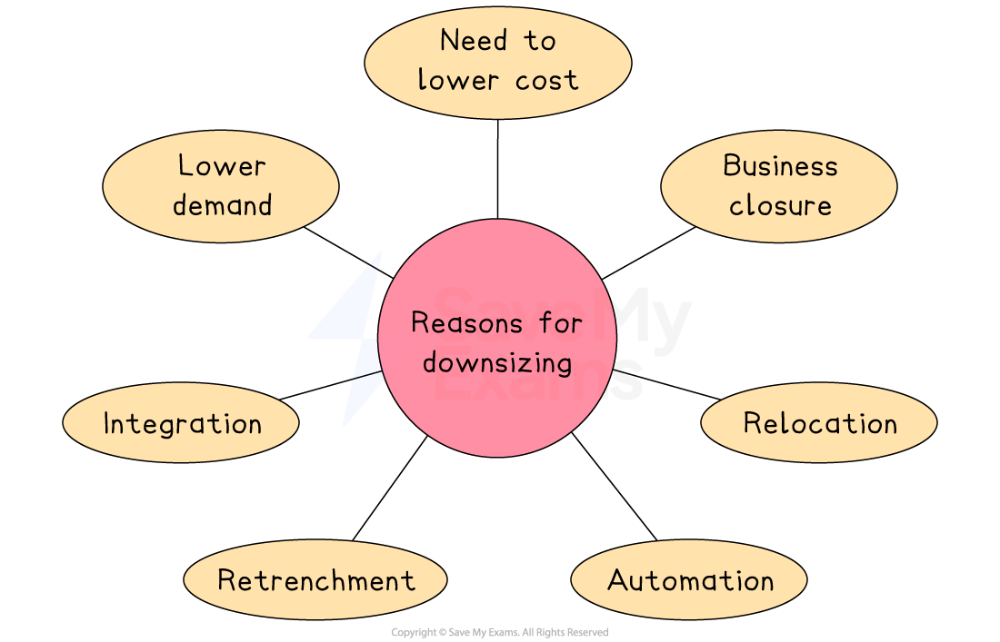

# Reducing the Size of the Workforce

## Reasons for downsizing

> **Spec point** — `spcpt_yN8dB99hz4cPpcTk` · "e.g. automation, reduced demand for products,
need to lower costs"

## Reasons for downsizing

- **Workforce planning** is the process of determining the human resource needs for the foreseeable future, in terms of the **number and skills of employees required**

  - When expanding, a business often requires more employees
  - However, on some occasions they need to **downsize** the workforce (**reduce the number of employees)**

#### Reasons for downsizing

*Reducing business size can be caused by a range of factors including business relocation, falling demand and automation through the introduction of technology*

1. **Lower demand**

  - Is likely to reduce the volume of output a business needs to produce
  - Fewer workers are required to produce a reduced level of output
2. **Integration with other businesses **

  - ***Mergers*** or ***takeovers*** could mean that some workers' roles are duplicated so some staff will no longer be required
3. **The need to lower costs**

  - Businesses that are struggling to survive look to reduce their most significant costs which, in many cases, is *salaries* and wages
4. **Business closure**

  - Will mean that only a few workers will be required to legally ***dissolve*** the organisation
5. **Automation**

  - involves more machinery being used in the business
  - Workers' jobs are replaced, with remaining workers focused on operating machinery
6. ***Retrenchment***

  - Is likely to mean that fewer resources of all types are required, including employees
7. **Business relocation **

  - may allow a business to reorganise its operations, requiring fewer employees

## Redundancy

> **Spec point** — `spcpt_7j2SmvFTxYDdKDcP`

## Redundancy

- **Redundancy **is where a job role is no longer needed by a business and a worker is dismissed, usually with *compensation*

  - The legal process for selecting workers for redundancy must be very clear and fair

#### The factors used to determine who is made redundant

| **Worker productivity** | **Lateness or absence data** | **Length of time employed** | **Workers with essential skills** |
|---|---|---|---|
| - Productive workers are most likely to remain employed | - Reliable workers are less likely to be made redundant | - Long-standing employees are usually more expensive to replace | - Skilled workers could be transferred to other roles |

- Some workers are **happy** to be made redundant

  - This may be because they have another job they can go to, they want to retire early or they want to start their own business
  - Some businesses offer a good redundancy 'pay out' which is attractive to workers

> **Exam Hint**
> Don’t confuse **redundancy** with **dismissal** – redundancy happens when a job no longer exists, not because of poor performance. Mixing these up is a common error

## Recommending redundancies

> **Spec point** — `spcpt_D4WH7YZjxt45nQ7G` · "recommend and justify which employee(s) to make redundant in a given situation

"

## Recommending redundancies

- HR managers often have to make difficult decisions about who should be made redundant

> **Case Study**
> **Redundancy at EcoGlow Ltd**
> 
> EcoGlow Ltd is a small Finnish business that makes and sells eco-friendly lighting products. Due to rising costs and falling sales, the manager has decided that **one worker must be made redundant** to save money
> 
> The manager is considering **three employees** from the assembly department
> 
> Each worker will be assessed based on their **productivity, attendance, time at the business** and **whether they have skills useful for other roles** in the company
> 
> 
> 
> ### Who is most suitable for redundancy?
> 
> - Based on these factors, **Lena** is the most suitable for redundancy
> 
>   - She has fewer years at the company than Ravi and lacks the specialist skills that Tomas has
>   - Her attendance has also been less reliable, and her productivity is not strong enough to justify keeping her over the others
