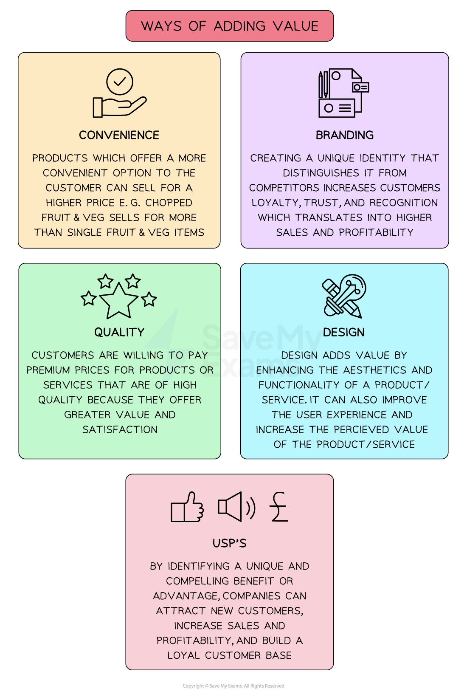

# The Nature of Business Activity

## Factors of production

> **Spec point** — `spcpt_N3Mtr9HTrfW6rqFg` · Land, labour, capital and enterprise

## Factors of production

- **Factors of production** are the resources used to produce goods and services

  - They include land, labour, capital and enterprise

*The four factors of production are land, capital, labour and enterprise*

- The production of any good or service requires the use of **a combination of all four factors of production**

  - Goods are physical objects that can be touched **(tangible)**, e.g., a mobile phone
  - Services are actions or activities that one person performs for another **(intangible)**, e.g., a manicure or car wash

#### Explanation of the four factors of production

| **Land** | **Capital** |
|---|---|
| - **Non-man-made natural resources** available for production - Some countries have a vast amount of a particular natural resource, so are able to specialise in its production    - For example, ** Kuwait** specialises in the product of oil which accounts for 95% of its ***exports*** | - Capital is any **man-made** **resource **that is used to produce goods and services - Examples include tools, buildings, machines and computers |
| **Labour** | **Enterprise** |
| - The **human input** into the production process, labour involves mental or physical effort - Not all labour is of the same quality    - It can be **skilled or unskilled**   - Some workers are more productive than others because of their education, training and experience | - Enterprise involves **taking risks** in setting up or running a firm - An entrepreneur decides on the combination of the **factors of production** necessary to produce goods and services with the aim of generating profit |

## Adding value

> **Spec point** — `spcpt_8FjP6D4Dmrh9D8G2` · concept of adding value and how added value can be increased

## Adding value

- Adding value is the process of **taking *****raw materials***** **and using them in such a way that the end product created is** worth more than the cost to make it**
- It is therefore the **difference between the price charged to the customer and the cost of inputs** required to create the product or service

  - For example, customers are prepared to pay more for potatoes when they are packaged as oven chips than they would be willing to pay for a bag of potatoes
- The greater the added value, the more successful the business is likely to be and the higher their ***profits***
- **Product **and **marketing teams **explore ways to increase added value

*Some of the methods of adding value allow for product differentiation, which allows the business to charge a higher selling price*

#### Examples of added value

| **Method** | **Example** |
|---|---|
| **Branding** | - Apple has built a brand that many customers believe is **superior to other brands**    - They have achieved this through the use of quality materials, innovative design and good marketing   - This branding allows the firm to **charge a higher price** for its products, thus increasing the added value |
| **Convenience** | - Persil initially provided a bottle of **dishwashing liquid** for dishwashing machine use    - This resulted in spillage as customers added the liquid to their machines, so Persil then created tablets   - The **tablets** offered a much more convenient option and Persil was able to charge a higher selling price for them |
| **Quality** | - **Jo Malone** perfume products are well known for their **beautiful packaging,** which creates an exciting opening experience for the customer    - This allows the firm to charge a higher price for its products, thus increasing the added value |
| **Unique selling points (USPs)** | - MoonPig birthday cards can be **completely customised **(size, colour, design etc.)** **and the level of customisation has helped them gain a competitive advantage    - This customisation allows the firm to charge a higher price for its cards, thus increasing the added value |
| **Design** | - **Samsung Galaxy Watch 5** has robust health tracking tools built into it, along with an amazing screen, which has helped it gain a competitive advantage    - These features allow the firm to **charge a higher price** for its products, thus increasing the added value |

> **Exam Hint**
> Don’t confuse adding value with profit – adding value is the difference between cost of inputs and selling price

## Opportunity cost

> **Spec point** — `spcpt_mVx9b3vKCfVpsvHZ` · concept of opportunity cost

## Opportunity cost

- **Opportunity cost **is the loss of the next best alternative when making a decision
- Businesses thrive when they are able to **meet customer needs and wants**

  - Needs are **essential, **e.g. shelter or food
  - Wants are desires which are **not essential** e.g Nike trainers
- Due to the problem of **scarcity**, there is a **basic economic problem**

  - **Choices have to be made** by producers, consumers, workers and governments about the most** efficient use of resources**
- There is an **opportunity cost** in the allocation of resources

  - When a **consumer **chooses to purchase a **new phone**, they may be **unable to purchase new jeans**
  
    - The jeans represent the loss of the next best alternative **(the opportunity cost)**
  - When a **producer** decides to allocate all of their resources to **producing electric vehicles**, they may be **unable to produce petrol vehicles**
  
    - The petrol vehicles represent the** **loss of the next best alternative (the **opportunity cost**)
  - When a **government** decides to **provide free school meals** to all primary students in the country, they may be **unable to fund rural libraries**, which may have to close
  
    - The libraries represent the loss of the next best alternative **(opportunity cost)**
