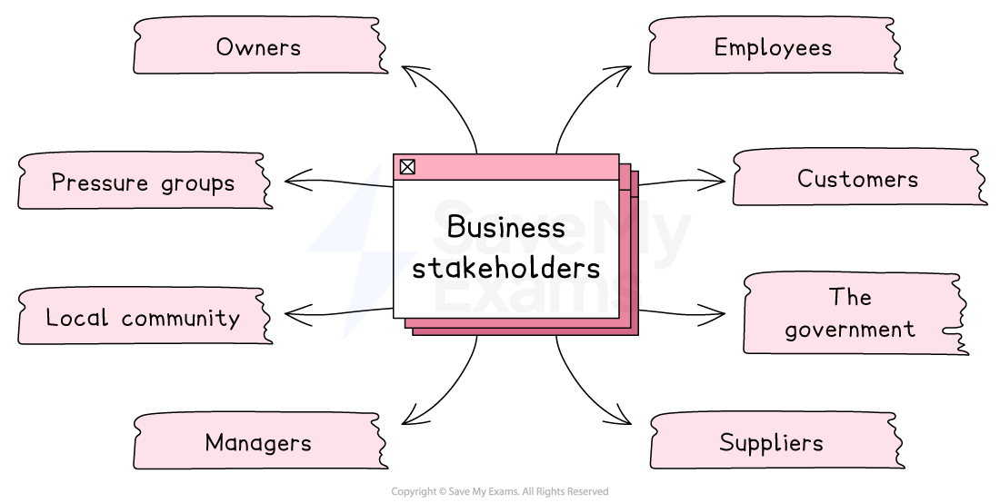

# The Role of Stakeholder Groups

## Internal stakeholders

> **Spec point** — `spcpt_79tdGrJPTcwyYPZw` · "objectives of different stakeholder groups; owners (sole traders, partnerships, shareholders), managers,
employees"

## Internal stakeholders

- **Business stakeholders are individuals or groups that affect or are affected by the actions of a business**

  - **External stakeholders** are people and organisations that are **outside of the business** and include suppliers, governments, customers, lenders, such as banks, and the local community
  - **Internal stakeholders **include anyone **within the organisation, **such as** **employees, owners, shareholders, and managers

*Business stakeholders include customers, employees, suppliers and the government*

### Typical internal stakeholder objectives

#### Owners (sole trader, partners and shareholders)

- Owners of small sole trader businesses often want to be able to **earn a living**, achieve a certain **lifestyle** or **gain recognition** for their work
- Partners often look to offer a range of services and may be focused on achieving *organic growth*
- Shareholders are individuals or entities who **own a portion of a company's stock**

  - They invest in the company to make a *profit*
  - Their **primary objective** is to **maximise their returns** on their investment
  
    - E.g. A shareholder of Apple may want the company to release new products and increase sales **to increase the value of their shares**

#### Employees

- Employees are individuals who **work for a company**
- Their primary objective is to **earn a living**, have ***job security***, **be paid fairly** for their work and have a **safe **working environment

  - E.g. Google employees in California have some of the **best working conditions in the world**, with sleeping pods, games rooms and free speciality coffee all-day

#### Managers

- Managers are responsible for the day-to-day operations of a company
- Their primary objective is to **meet the company's goals and objectives**
- They want to **maximise profits **and **minimise costs** while ensuring that the company operates efficiently

  - E.g. A manager of McDonald's may want the restaurant to **increase sales and reduce costs** by improving ***efficiency***

## Objectives of external stakeholders

> **Spec point** — `spcpt_k2hWR83M586bwRft` · objectives of different stakeholder groups; customers, suppliers, lenders/banks, government, local community

## Objectives of external stakeholders

### Suppliers

- Suppliers are individuals or businesses that **provide goods or services to a business**
- Their primary objective is to sell products or services and **make a profit**
- Suppliers want to be paid on time and have a **long-term relationship** with the company

  - For example, **Busco Sugar Milling **supplies **Coca-Cola** with 84% of the sugar used in the manufacture of its soft drinks. It wants the company to continue buying their sugar and to pay bills on time

### Customers

- Customers are individuals or businesses who purchase goods/services from a business
- Their primary objective is to **receive high-quality **products at a **fair price**
- Customers also want good customer service, clear communication and a positive buying experience

### The local community

- The local community includes individuals and organisations that live or operate in the area where a business operates
- Their primary objective is **for the business to have a positive impact **on the community
- This may include  the business being environmentally responsible, providing jobs, and **contributing to local causes**

  - For example, **Burnley Savings & Loans Ltd **donates all of their profits to local charities and good causes

### Government

- The government is responsible for creating and enforcing laws and regulations that affect businesses
- Their primary objective is to **promote the public good and protect the interests of citizens**
- The government wants companies to operate within the law and contribute to the economy

### Lenders

- Lenders are individuals or financial institutions (like banks) that provide loans or credit to a business
- Their primary objective is to be repaid on time with interest, so they can make a return on the money they lend
- Lenders also want the business to be financially stable and low-risk, so they feel confident their money is safe

  - For example, International bank **HSBC **expects regular repayments on loans and may want to see business accounts or cash flow forecasts to check a business can afford repayments before it grants a loan

## Stakeholder conflict

> **Spec point** — `spcpt_gSC6pskYBHjc6mkx` · how stakeholder objectives may conflict with each other

## Stakeholder conflict

- Stakeholder groups can have **conflicting interests and objectives**, which can lead to tensions and conflicts

  - **Shareholders** may prioritise *profit maximisation*, while **employees** may prioritise fair treatment and high wages
  - **Customers **may prioritise low prices, while the **local community** may prioritise *environmental sustainability* which raises costs and prices
- These conflicts can create challenges for businesses to **balance the competing demands of different stakeholder groups**

  - For example, a company may need to invest in costly environmental technology to meet the demands of the local community, but this may reduce *profitability* and upset shareholders
- Conflicts can also arise when stakeholders have **different levels of power and influence**

  - For example, *pressure groups* with strong public support may be able to influence business activity more than individual shareholders
- **Managing stakeholder conflicts** requires careful communication, *transparency* and **compromise**

#### Examples of stakeholder conflicts

| **Stakeholders** | **Conflict** |
|---|---|
| **Employees vs employers** | - In 2020, British Airways planned to cut 12,000 jobs and reduce pay due to COVID-19’s impact - Employees and *trade unions* protested, claiming the cuts were unfair and challenged them legally |
| **Pressure groups vs government** | - In 2019, Extinction Rebellion held UK-wide protests demanding climate action - While many supported them, some politicians criticised the disruption and economic impact |
| **Local communities vs developers** | - In 2019, residents opposed the HS2 rail project, saying it would harm the environment, disrupt communities  and cost too much - Environmental groups also criticised the project’s priorities |

> **Exam Hint**
> Be ready to explain **conflicts between stakeholder objectives** – for example, shareholders may want higher profits while employees seek higher wages. Showing this tension demonstrates strong understanding
