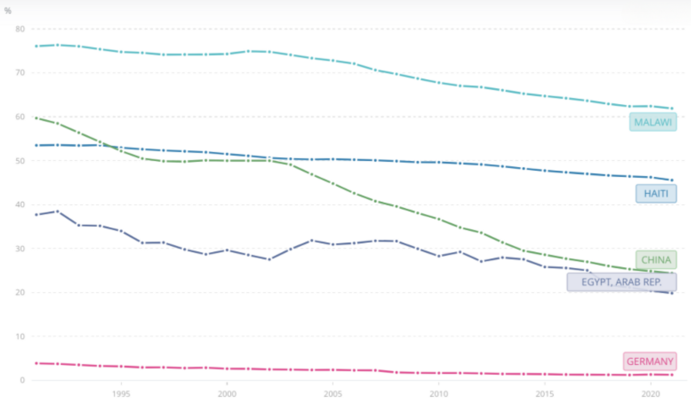
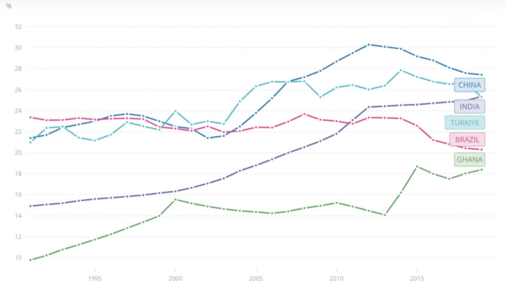
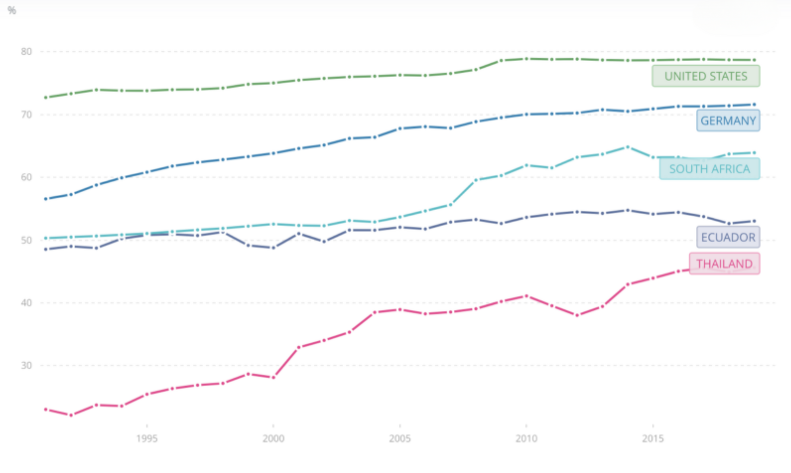

# Types of Economic Sector

## Primary sector

> **Spec point** — `spcpt_sKs33c8wbdfMjkCK`

## Primary sector

- Businesses can be classified according to the **type of business sector** in which they operate
- This helps provide a means of making **comparisons** between firms in the same sector

*Farming in the primary sector, manufacturing in the secondary sector and hairdressing in the service sector*

- The **primary** sector is concerned with the **extraction** of raw materials from land, sea or air

  - Examples include farming, mining or fishing
- **Less developed economies **are primarily focused on the **primary sector,** with most people employed in *agriculture* and the production of food

  - This is partly as a result of** lower participation rates in education **and a **lack of *****infrastructure**** *to support manufacturing or service provision
- Some **developed economies,** such as Australia (*viticulture*) and Norway (forestry and oil extraction), continue to have significant primary sectors

#### Employment in primary industries in some countries since 1991

*Employment in primary sector industries in Malawi, Haiti, China, Egypt and Germany since 1991 (Source: WorldBank)*

- Malawi has the highest proportion of employment in the primary sector
- China has seen a significant decrease in primary sector activity since 1991
- Germany has a small primary sector with an economy that focused on manufacturing and services well before 1991

## Secondary sector

> **Spec point** — `spcpt_27yx55T4pyBRChN4`

## Secondary sector

- The **secondary** sector is concerned with the **processing** of raw materials and *components*

  - Examples include oil refinement and the **manufacture** of goods such as vehicles
- In **emerging economies,** improved technology enables less labour to be needed in the primary sector and more workers to be employed in the secondary sector

  - The proportion of workers employed in manufacturing has risen over the last few decades
  - Many businesses have relocated production facilities to take advantage of the **lower average wage rates** in these economies

#### Employment in secondary industries in some countries since 1991

*Employment in secondary sector industries in China, India, Turkey, Brazil and Ghana since 1991 (Source: WorldBank)*

- China has the highest proportion of employment in the secondary sector, though it is declining
- Ghana and India saw a significant increases in secondary sector activity since 1991
- Brazil and Turkey's secondary sectors remained relatively stable between 1991 and 2019

## Tertiary sector

> **Spec point** — `spcpt_FZV43HFFbM59y3hZ`

## Tertiary sector

- The **tertiary** sector is concerned with the provision of a wide range **services** for consumers and other businesses such as leisure, banking or ***hospitality***

  - It includes a sub-sector called the ***quaternary**** sector*
- **Emerging economies **have experienced growth in the tertiary sector in recent years, with many businesses now focused on the provision of *consumer services*
- The **most developed economies **have a very high proportion of the workforce employed in the provision of services in the quaternary sector

  - Developed economies use their wealth to fund advanced **education** and **higher-level skills training,** which further supports the growth of these industries

#### Employment in tertiary industries in some countries since 1991

*Employment in tertiary sector industries in the USA, Germany, South Africa, Ecuador and Thailand since 1991 (Source: WorldBank)*

- The US and Germany have the highest proportion of their workforces employed in the service industry
- Thailand's service sector employs twice as many employees in 2019 as it did in 1991
- Around half of Ecuador's workforce is now employed in service delivery

## Private sector

> **Spec point** — `spcpt_sNm8bkTNyvBSPHTk`

## Private sector

- **Private sector firms** are owned and controlled by other firms and private individuals (*entrepreneurs* and *shareholders*)
- The main objective of many private sector firms is** *****profit maximisation***

  - This often causes the private sector to be more efficient than the public sector with higher levels of ***productivity***
- Types of private sector businesses include *sole traders*, *partnerships* and *companies*

## Public sector

> **Spec point** — `spcpt_pJkVJXkR5bh82bvp`

## Public sector

- **Public sector firms** are owned and controlled by the government
- Public firms exist to

  - Ensure **public service provision** of goods and services that are not profitable enough to be provided in the private sector
  - Protect ***strategic industries*** and national security, such as energy production or water supply
  - Create **jobs**
  - Encourage** *****economic growth***
- Public sector firms can operate on a local, regional or national government level

  - E.g. Transport for London (local);  Agricultural State Service in India (regional); Caribbean Airlines (national)
- Some government-owned firms have been ***privatised***

  - The government retains a share in them so they can influence decision-making and receive a share of the profits
  - For example, **Singapore Airlines** shares are 55% government-owned and 45% privately-owned

> **Exam Hint**
> Don’t mix up **primary, secondary **and **tertiary sectors** with **public **and **private sectors** – one refers to *types of production*, the other to *ownership*. Keep these distinctions clear in your answers to avoid losing easy marks
