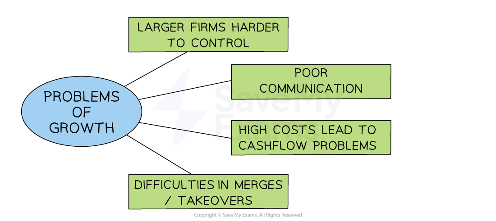

# Business Growth

## Why grow a business

> **Spec point** — `spcpt_J3MRC3j8HkC9rMVP`

## Why grow a business?

- Many firms start small and will grow into large companies or even **multi-national corporations**

  - For example, **Amazon **and **Dell **both started in entrepreneurs' garages

#### Reasons why businesses grow

- The owner's or manager's desire to **run a large business** & continually seek to grow it
- The owner's desire for **higher** levels of ***market share*** and **profitability**
- The desire for **stronger market power** (monopoly) over its customers and suppliers
- The desire to** reduce costs by benefiting from lower *****unit costs***** **as output increases
- Growth provides opportunities for ***product diversification***
- Larger firms often have **easier access** to finance

## Internal business growth

> **Spec point** — `spcpt_nVxyw9rFdSbdH4J5` · how and why businesses can grow internally, e.g. develop new products, develop new markets

## Internal business growth

- Internal growth that is **driven by *****organic***** expansion** using *reinvested profits* or loans
- It is usually achieved by:

  - Gaining a greater ***market share***
  - Product or market ***diversification***
  - Opening new outlets
  - International expansion (new markets)
  - Investing in** new technology** or production machinery

#### Examples of internal growth

| **Business** | **Explanation** |
|---|---|
| **Apple** | - **International expansion (new markets): **Apple expanded into new markets by opening its stores in new countries, such as China and India, and by partnering with telecom providers to sell its products. |
| **Google** | - **Product innovation: **Google introduced new products, such as Google Drive and Google Maps, to complement its search engine and advertising businesses |
| **Disney** | - **Product diversification: **Disney has diversified into several areas, such as theme parks, cruise lines, television networks and movie studios. |

- **Product diversification** opens up new ***revenue streams*** for a business

  - Firms may spend money on **research and development** or ***innovation**** *to existing products to help create a new revenue stream
- Firms often **grow internally **to the point where they are in a financial position to** integrate **(merge or buy) with others

#### Evaluating internal growth

| **Advantages** | **Disadvantages** |
|---|---|
| - The **pace of growth** is manageable - **Less risky**,** **as growth is financed by profits and there is existing business expertise in the industry - The management knows and understands every part of the business | - The pace of growth can be slow and frustrating - Not necessarily able to benefit from lower *unit costs* (e.g. *bulk purchasing discounts* from suppliers) as larger firms would be able to - Access to **finance** may be limited |

## External business growth

> **Spec point** — `spcpt_FG6KjmTfxyQqJpGk` · how and why businesses can grow internally, e.g. develop new products, develop new markets

## External business growth

- External business growth is when a business expands by joining with or buying other businesses rather than growing on its own

  - **A merger **occurs when two or more companies combine **to form a new company**
  
    - The original companies cease to exist and their *assets *and *liabilities *are transferred to the newly created entity
  - **A takeover **occurs when **one company purchases another company**, often against its will
  
    - The acquiring company **buys a controlling stake in the target company's *****shares *****(>50%)** and gains control of its operations

### Vertical integration

- Vertical integration refers to the merger or takeover of **another firm in the *****supply chain*** or different stage of the production process

  - **Forward** **vertical integration** involves a **merger** with or **takeover** of a firm further forward in the supply chain
  
    - For example, a dairy farmer merges with an ice cream manufacturer
  - **Backward vertical integration** involves a merger with or takeover of a firm further backwards in the supply chain
  
    - For example, an ice cream retailer takes over an ice cream manufacturer

*A firm can grow through forward or backward vertical integration, merging with or taking over another business in the supply chain*

#### Evaluating vertical integration

| **Advantages** | **Disadvantages** |
|---|---|
| - Cuts production costs by removing middlemen - Lower costs increase competitiveness - Greater *supply chain* control and more reliable access to raw materials - Better control over raw material quality - Forward integration increases profit and brand visibility | - *Diseconomies of scale* (e.g. duplicate management roles) - Culture clash between merged firms - Lack of experience in new business area may reduce efficiency - High acquisition cost may take time to recover |

### Horizontal integration

- Horizontal integration is the merger or takeover of a firm at the same stage of the production process

  - For example, an ice cream manufacturer merges with another ice cream manufacturer

#### Evaluating horizontal integration

| **Advantages** | **Disadvantages** |
|---|---|
| - Rapid market share growth - Lower unit costs from *economies of scale* - Less competition - Shared industry knowledge improves success chances - May gain new expertise | - Diseconomies of scale (e.g. duplicate roles) - Culture clash between merged firms |

> **Exam Hint**
> Don’t just state methods of growth (internal or external) – make sure you can explain their **advantages and disadvantages**, as questions often test your ability to judge which method is most suitable in a given situation

## Problems of business growth

> **Spec point** — `spcpt_YPsgXy4bwJ57ngNh`

## Problems of business growth

- In some cases, growing the size of a business can fail to improve its ***profitability*** and can lead to ***cash flow*** and coordination problems

### Problems and solutions of business growth

*Businesses are often faced with a range of challenges when they grow*

### Poor communication

- Longer ***chains of command*** and wider ***spans of control*** for managers may lead to **slower decision-making times** and inefficiency

#### Solution

- **Use the latest communication technologies, **such as instant video calls,** **to improve communication between managers and workers
- ***Decentralisation*** may help to delegate decision-making

### Larger firms are often harder to control

- As a business grows in size, it can experience ***diseconomies of scale*** such as poor co-ordination of resources

#### Solution

- Operate as a series of **smaller units** which allows local or ***functional area*** managers to have more control
- Increase ***delegation*** in order to ***empower*** workers and get jobs done more quickly

### High costs and cashflow problems

- Expansion can be **very expensive** as it may involve developing a new product range or buying a new factory

  - **High costs in the short/medium term **means the business may need additional finance to avoid cashflow problems

#### Solution

- **Grow slowly** using profits rather than loans to fund gradual and less risky expansion
- **Manage cash flow** carefully, making use of retained profits and short-term borrowing to counter cash flow shortfalls

### Difficulties of mergers and acquisitions

- A ***culture clash*** may occur if a merger or acquisition  takes place between two different firms due to different management styles

#### Solution

- Ensure good communication so employees are less likely to be resistant to change
- Take time to carefully negotiate and plan mergers/acquisitions to reduce 'teething problems'
