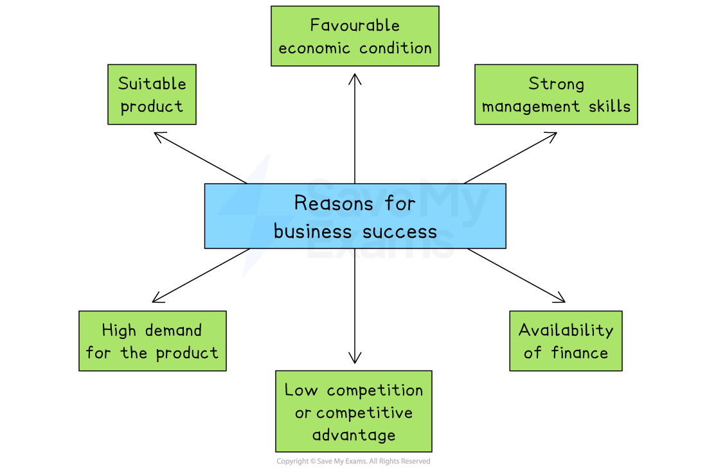

# Business Success & Failure

## Why businesses succeed

> **Spec point** — `spcpt_2s4kQT8zsHWwtkhf` · "reasons why businesses succeed or fail, e.g. management skills, availability of finance, suitability
of product, demand for products, changes in the economy, level of competition"

## Why businesses succeed

- Successful businesses often share similar strengths, such as good management, strong products and enough finance
- These factors help them grow, stay *competitive*, and meet customer needs in changing markets

*Key reasons for business success include strong management skills, the availability of finance and favourable economic conditions*

### Strong management skills

- Good managers make **effective decisions**, **organise resources** well and **motivate** employees
- They **plan** ahead, **solve problems** quickly, and **lead **the business towards its goals

  - For example, Steve Jobs helped Apple succeed by making bold decisions and focusing on design and innovation

### Availability of finance

- Having enough money (capital) allows a business to **invest **in equipment, marketing, staff and product development

  - For example,  Amazon used early investment to grow its operations and dominate online shopping

### Suitable product

- A successful business offers a product that solves a problem, meets customer needs or has unique features
- Products must be **high quality** and **appealing **to the *target market*

  - For example,  Dyson vacuum cleaners became popular by fixing problems like loss of suction

### High demand for the product

- When many people want the product, sales rise and the business earns more profit
- Demand can increase due to trends, changes in lifestyle or special events

  - For example,  Zoom became a global success during the COVID-19 pandemic as remote working increased

### Favourable economic conditions

- In a strong economy, people have more money to spend, which increases sales
- Low *interest rates* and low *inflation *can also help businesses grow

  - For example,  during economic growth periods, car manufacturers often see rising sales

### Low competition or competitive advantage

- Businesses succeed when they offer something better than their rivals

  - For example,  lower prices, better quality or a strong brand
- Having few competitors also gives more control over pricing and customers

  - For example,  Nike stays successful by constantly *innovating *and using powerful *branding*

## Why businesses fail

> **Spec point** — `spcpt_Rpbj2wBmDZgPFN2w`

## Why businesses fail

- Business failure is a risk to **both new and established businesses**

  - In 2021, an average of 8% of businesses in EU countries failed
  
    - In Estonia, almost one in four businesses failed
    - However, in **Greece**, just over 2% of businesses failed
- **New businesses are often more at risk of failure **than well-established businesses

  - This is often due to **lack of management skills, limited experience **or** *****cashflow***** problems** during the initial start-up phase
  - The **volume and variety of tasks **required of new business owners can be **overwhelming**
  - ***Market research*** is unlikely to be detailed, as small business owners may lack the skills to understand findings and make effective decisions

#### The main reasons why some businesses fail

| **Financial factors** | **Poor management** |
|---|---|
| - A business may be **unable to** **generate enough revenue **to sustain its operations - **Costs may rise** sharply and eliminate ***profit margins*** - **Cash shortages** mean that ***creditors*** cannot be paid what they are owed - **Limited access to finance, **such as loans or trade*** credit*** can be particularly problematic for start-ups | - **Lack of experience** can lead to poor decisions related to product range, pricing or promotional activity - Making decisions based on ***hunches*** rather than market research - **Ineffective coordination** and **planning **of business operations, such as stock purchasing or staffing, can increase costs |
| **External factors** | Overtrading |
| - Ineffective or **delayed response** to new technology, powerful new competitors and major economic change - Changes in **laws** or ***taxation**** *can increase pressure on businesses to make difficult choices | - This occurs when a** business expands too quickly** - **Poor coordination and planning** of growth can lead to ***diseconomies of scale***, which increases costs |

> **Exam Hint**
> Don’t give vague answers like “the business failed because it was bad” – use specific factors such as poor management, lack of finance, or falling demand, and always link them to the impact on the business
