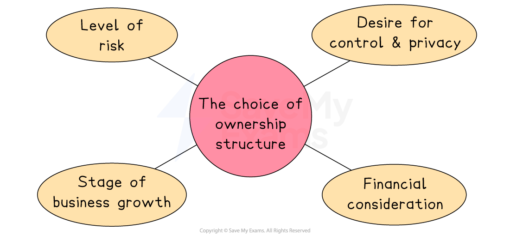

# Choosing a Suitable Type of Business Organisation

## Determining a suitable ownership type

> **Spec point** — `spcpt_kgj58p2wXVDXdrrY`

## Determining a suitable ownership type

- An entrepreneur must choose the ownership structure **that suits the business needs**, **circumstances **and the** level of personal liability involved**

*The choice of business ownership depends on a range of factors, including the level of personal risk owners are willing to accept and their desire for control and privacy*

### Factors affecting the choice of ownership structure

#### Level of risk

- Entrepreneurs who want to **protect their personal assets** may choose a company structure with **limited liability**
- If the business is small and the owner is willing to take personal financial risk, a **sole trader** structure may be enough.

  - For example, a builder setting up alone may accept the risk of unlimited liability, but a software company seeking funding might choose the security of limited liability

#### Desire for control and privacy

- Sole traders have full control and can make quick decisions
- Partnerships share decision-making but may have disagreements
- Companies are run by *directors*, decisions may be slower or involve more people and accounts need to be published

  - For example, a *freelance *designer may prefer to be a sole trader for full independence

#### Financial considerations

- Larger businesses often need more capital, which may not be possible as a sole trader or partnership
- Companies can raise money by selling shares

  - For example, a technology start-up needing finance may choose to become a private limited company to attract investors

#### Stage of business growth

- Businesses planning to grow quickly or expand internationally may choose a company structure to attract shareholders and funding
- Those aiming to stay small and local might prefer a simpler ownership type.

  - EFor example, a café wanting to open branches across the country may change from a partnership to a private limited company

## Business organisation for small firms

> **Spec point** — `spcpt_WgZJYRXMmbzBKwcJ` · "recommend and justify a suitable type of business organisation to owners/management for a
given situation"

## Business organisation for small firms

- When starting a business, entrepreneurs often choose **simple and flexible ownership structures** that match their goals, resources and attitude to risk

#### Comparison of ownership types for small firms

| **Ownership type** | **Why it’s a good choice** | **Best for** |
|---|---|---|
| **Sole trader** | - Easy and cheap to set up (minimal paperwork) - Full control over decisions - Keeps all profits - No need to publish accounts | - Freelancers, tradespeople, tutors, small shop owners |
| **Partnership** | - More capital from multiple owners - Shared skills and responsibilities - Simple to set up - Flexible division of profits and work | - Professionals (e.g. accountants, lawyers), family or joint start-ups |
| **Private limited company ** | - Limited liability protects personal assets - Can raise finance by selling shares - More professional image - Separate legal identity (company owns assets and signs contracts) | - Technology start-ups, online businesses, growth-focused enterprises |

> **Case Study**
> **Pizzazz Pizzeria**
> 
> 
> 
> Sarah is considering setting up a new **pizza** **restaurant **called **Pizzazz**. She has 3 different options
> 
> - Start small as a sole trader
> - Seek a partner willing to invest in the business
> - Start small but register as a private limited company
> 
> **Key considerations**
> 
> - Sarah does not have much money
> - Her sister, a chef, is looking to invest in a business
> - The business plan identifies significant start-up costs, including fitting out a pizza restaurant premises
> 
> **Recommendation**
> 
> - A **private limited company** may be a good option, as it is relatively inexpensive to set up, provides Sarah with legal protection and may be more attractive for lenders such as banks
> - However, the **partnership **option is also attractive, as Sarah knows her sister well and relevant skills could be brought into the business as well as finance
> - As the business plan has identified significant costs, setting up as a **sole trader** is the least suitable option, as it involves personal financial risk for Sarah

## Business organisation for growing firms

> **Spec point** — `spcpt_jm54JPrsHHFhSyky`

## Business organisation for growing firms

- As a business grows, its needs become more complex, and choosing the right ownership structure becomes even more important
- Growing businesses often require more finance, better risk management, and stronger organisational structures to support expansion

#### Comparison of ownership types for growing firms

| **Ownership type** | **Why it’s a good choice** | **Example** |
|---|---|---|
| **Partnership** | - Brings in **new skills or capital** by adding partners - Growth is shared, reducing pressure on one person - Still flexible and less complex than a company | - A successful accounting firm adds new partners to open offices in other cities |
| **Private limited company** | - **Limited liability** encourages investors and protects owners - Can raise finance by selling shares privately - **Separate legal identity** supports long-term growth | - A fashion brand expands into national retail by attracting private investment through share sales |
| **Public limited company** | - Can raise **large amounts of capital** by selling shares to the public - Shares can be traded on a stock exchange - Suitable for **large-scale expansion** and global operations | - A supermarket chain becomes a PLC to raise funds for global expansion and opening new branches |

> **Case Study**
> **AMF Cleaning and Maintenance Ltd**
> 
> - AMF is a large, fast-growing private limited company that specialises in commercial cleaning and maintenance services
> - AMF is seeking to raise finance to continue their expansion. They can either
> 
>   - Become a public limited company
>   - Seek venture capital investment but remain as a private limited company
> 
> 
> 
> **Key considerations**
> 
> - If AMF **sells shares to the public**, its current owners **lose some control** of the company but gain access to a **large pool of capital**
> - Money raised through share sales **does not need to be repaid**, unlike loans
> - New shareholders will have **high expectations** and may pressure the business for strong short-term performance
> - Becoming a PLC involves **legal and administrative costs**, including publishing financial accounts and meeting stock exchange requirements
> 
> **Recommendation**
> 
> - If AMF aims for **rapid national or international expansion** and needs **substantial long-term funding**, becoming a **public limited company** may be the most suitable option
> 
>   - This would allow them to raise large amounts of capital by selling shares to the public
> - However, if AMF prefers to **keep tighter control** over decision-making and avoid the pressures of public shareholders, seeking **venture capital** while remaining a private limited company could be a better solution
> 
>   - This would still provide significant funding but from fewer, more specialised investors

> **Exam Hint**
> Don’t simply describe each business type – exam questions expect you to **recommend and justify** the most appropriate option for the scenario, considering factors like liability, finance, and control
