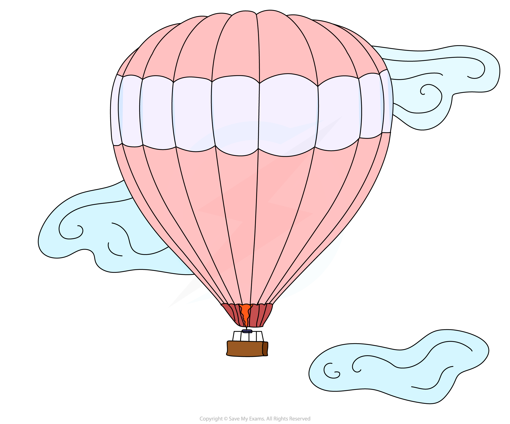
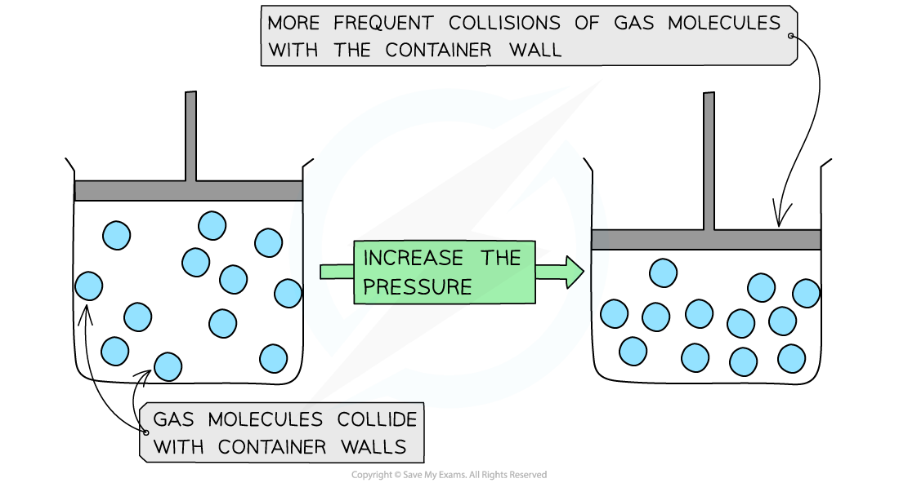

# Pressure & Temperature in Gases

## Pressure & Temperature in Gases

> **Spec point** — `spcpt_vtQ4pz5y7XcWdd4h` · Describe the effects of temperature and pressure on the volume of a gas

## Pressure & temperature in gases

- A change in temperature or pressure affects the volume of gases
- As the air inside a hot air balloon is heated up, it expands and the balloon gets bigger
- This is because the volume of a gas increases as temperature increases

***As temperature increases gas volume increases. The density decreases as the volume increases so the balloon rises.***

- If you have a gas stored inside a container that is squeezed, the pressure increases as you decrease the volume
- This is what happens in a bicycle pump

***Pressure increases as volume decreases in a bicycle pump***

- As you compress the bicycle pump, the high pressure allows you to inflate a tyre
- You can feel the force of the high pressure if you put your finger on the end of the pump

## Gases & Kinetic Theory

> **Spec point** — `spcpt_hxYSxyTtV3ZcxWwj` · Explain, in terms of kinetic particle theory, the effects of temperature and pressure on the volume of a gas

## Gases & kinetic theory

#### Extended tier only

- Gaseous particles are in constant and **random** **motion**
- The pressure that a gas creates inside a closed container is produced by the gaseous particles hitting the inside walls of the container:

***Moving particles of gas colliding with each other and the container walls***

### How does temperature affect the volume of a gas?

- Increasing the temperature increases the **kinetic** energy of each particle

  - **Remember: **The thermal energy from increasing the temperature is converted to kinetic energy in the particles
- As the temperature increases, the particles in the gas **move faster **and **spread out more**
- If the gas particles are inside a container, they will collide with the container walls more** frequently**

  - If the container walls are flexible and stretchy then the container will get bigger and bigger, just like the hot air balloon!

> **Exam Hint**
> If you are talking about the particles, then make sure that you talk about them spreading out.
> 
> If you are talking about the material, then you can use the word expand.
> 
> You will lose a mark in an exam if you talk about particles expanding!

### How does pressure affect the volume of a gas?

- Pressure is about the number of particles in a given volume
- Increasing the pressure means that there are the same number of particles but in a smaller volume

  - Conversely, decreasing the pressure means that there are the same number of particles but in a larger volume

***When the pressure increases, the volume decreases. This means that the molecules collide with the container walls more frequently ***

- Since the volume is decreased, the gas particles hit the container walls more frequently

  - If the pressure is too high, this can result in the container leaking gas or exploding
