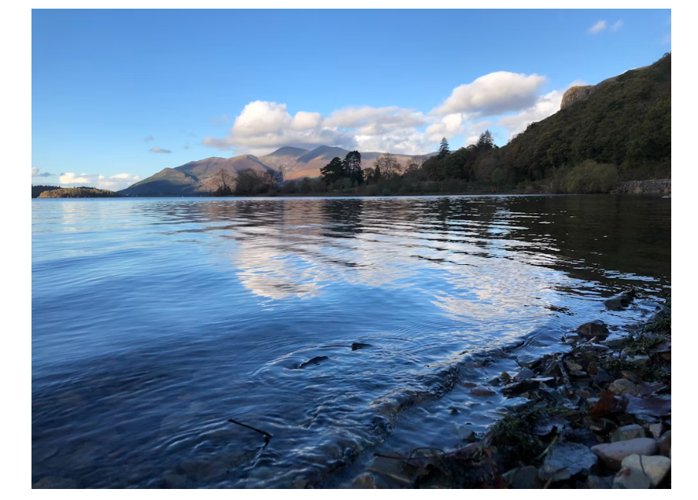

# Substances in Water from Natural Sources

## Substances in water from natural sources

> **Spec point** — `spcpt_tzbWXb8sDTn5jH5c` · State that water from natural sources may contain substances, including: 
dissolved oxygen 
metal compounds 
plastics 
sewage 
harmful microbes 
nitrates from fertilisers 
phosphates from fertilisers and detergents

## Substances in water from natural sources

- We use water in many aspects of our everyday life:

  - Domestic uses: for drinking, cooking, gardening and general sanitation
  - Agricultural uses: as a drink for animals and watering crops
  - Industrial uses: as a solvent, as a coolant and heated to make steam used to generate electricity
- Water is found in natural sources such as lakes, rivers and underground water sources (groundwater)
- A rock that stores water is known as an** aquifer**
- Water from natural sources may contain a variety of different substances including:

  - Dissolved oxygen
  - Metal ions (E.g. Ca2+, K+, Na+, Mg2+)
  - Plastics
  - Sewage
  - Harmful microbes
  - Nitrates from fertilisers
  - Phosphates from fertilisers and detergents
- Many of these substances enter water sources when rain falls and washes them into lakes, rivers or groundwater
- Some of these substances are naturally occurring but many are a direct result of human activities

Photo by [Ben Clayton on Unsplash ](https://unsplash.com/@binaryben)

> **Exam Hint**
> Despite the term 'natural source’, water from these sources may contain lots of impurities and harmful substances and should not be confused with water which is clean and ready for use.

## Beneficial & harmful substances in water

> **Spec point** — `spcpt_nNdy3B2CqQ8P6XZB` · State that some of these substances are beneficial, including: 
dissolved oxygen for aquatic life 
some metal  compounds provide essential minerals for life 
State that some of these substances are potentially harmful, including:
some metal compounds are toxic 
some plastics harm aquatic life  
sewage contains harmful microbes which cause disease 
nitrates and  phosphates lead to deoxygenation of water and damage to aquatic life 
Details of the eutrophication process are not required

## Beneficial & harmful substances in water

- Some of the substances which may be found in natural water sources are beneficial and others may have harmful effects
- **Beneficial substances** include:

  - Dissolved oxygen
  
    - Essential for aquatic life
  - Metal compounds
  
    - Some provide essential minerals which are necessary for life, such as calcium and magnesium
- Potentially **harmful substances** include:

  - Metal compounds
  
    - Some are toxic like aluminium and lead
  - Some plastics
  
    - These may be harmful to aquatic life in many ways, e.g. getting trapped in plastic waste, dying of starvation as their stomach is filled with plastic
  - Sewage
  
    - Contains harmful microbes which can cause disease
  - Nitrate & phosphates from fertilisers
  
    - These can promote the growth of aquatic plant life which leads to deoxygenation of water.
    - Ultimately, this can cause damage to aquatic life in a process called eutrophication (you do not need to know the details of this process)

> **Exam Hint**
> Metal compounds can be both beneficial and harmful, it depends on the metal within the compound, e.g. calcium, magnesium, potassium and sodium are all metals which are essential for life.
> 
> Harmful metals include lead, arsenic and mercury.
