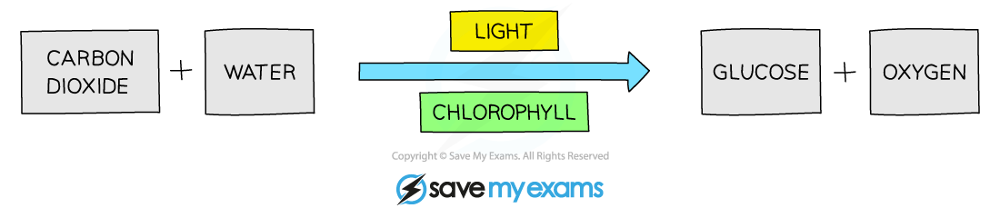
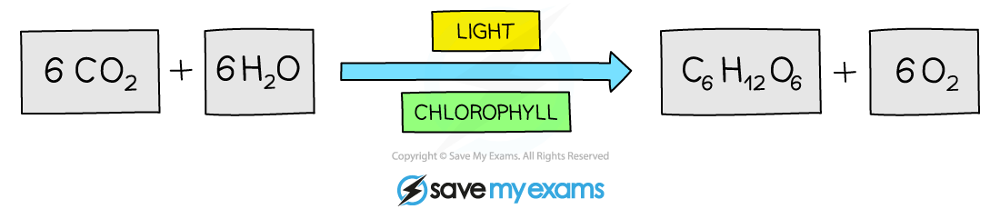

# Photosynthesis

## Photosynthesis

> **Spec point** — `spcpt_tYWjkWkWSpM2vWZH` · Describe photosynthesis as the reaction between carbon dioxide and water to produce glucose and oxygen in the  presence of chlorophyll and using energy from light
State the word equation for photosynthesis, carbon dioxide + water → glucose + oxygen

## Photosynthesis

- Photosynthesis is an endothermic reaction

  - Energy is taken in from the environment by chloroplasts / chlorophyll
- The reactants for photosynthesis are carbon dioxide and water
- They are converted into glucose and oxygen
- Chlorophyll (found in chloroplasts) and energy from light are required for this reaction to occur
- The **word equation for photosynthesis** is:

***Carbon dioxide and water producing glucose and oxygen during photosynthesis***

## Symbol equation for photosynthesis

> **Spec point** — `spcpt_Q3zXJgryKzH2XSgp` · State the symbol equation for photosynthesis, 6CO2 + 6H2O → C6H12O6 + 6O2

## Symbol equation for photosynthesis

**Extended tier only**

- The balanced symbol equation for photosynthesis is:

***Balanced symbol equation for photosynthesis***
