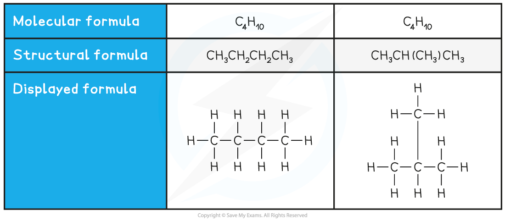
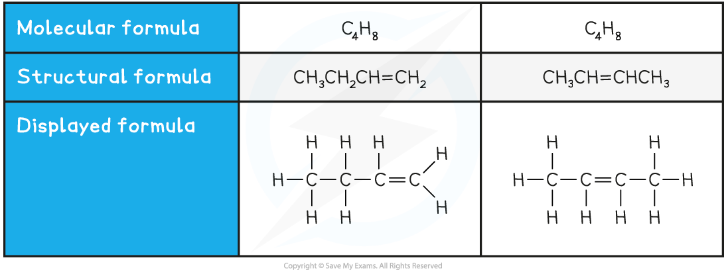

# Organic Formulae

## Displayed formulae

> **Spec point** — `spcpt_pNhC2gNnbwfcsp3h` · Draw and interpret the displayed formula of a molecule to show all the atoms and all the bonds

## Displayed formulae

- Organic Chemistry is the scientific study of the structure, properties, and reactions of organic compounds.
- Organic compounds are those which contain carbon
- For conventional reasons metal carbonates, carbon dioxide and carbon monoxide are **not** included in organic compounds
- Many of the structures you will be drawing are hydrocarbons
- A **hydrocarbon **is a compound that contains **only** hydrogen and carbon atoms
- Organic compounds can be represented in a number of ways:

  - Displayed Formulae
  - General Formulae
  - Structural Formulae

The **displayed formula** shows the spatial arrangement of all the atoms and bonds in a molecule

- For example: 

- This displayed formula tells us several things about the compound

  - It has 5 carbon atoms
  - It has 12 hydrogen atoms
  - It has only single bonds

## Structural formulae

> **Spec point** — `spcpt_j8JtMXpfnSVvY5hz` · State that a structural formula is an unambiguous description of the way the atoms in a molecule are arranged, including CH2=CH2, CH3CH2OH, CH3COOCH3
Define structural isomers as compounds with the same molecular formula, but different structural formulae, including C4H10 as CH3CH2CH2CH3 and CH3CH(CH3)CH3 and C4H8 as CH3CH2CH=CH2 and CH3CH=CHCH3

## Structural formulae

**Extended tier only **

- In structural formulae, enough information is shown to make the structure clear, but most of the actual covalent bonds are omitted
- Only important bonds are always shown, such as double and triple bonds
- Identical groups can be bracketed together
- Side groups are also shown using brackets
- Straight chain alkanes are shown as follows:

### Structural isomers

- Structural isomers are compounds that have the **same molecular **formula but **different structural** formulae
- The **molecular formula** is the **actual number** of atoms of each element in a compound
- Compounds with the same molecular formula can have different structural formulae due to the different arrangement of their atoms in space
- Two examples of structural isomers are shown below

#### Table showing structural isomerism in C4H10

#### Table showing structural isomerism in C4H8

> **Exam Hint**
> **Remember:** Only double and triple bonds are shown in structural formulae.
