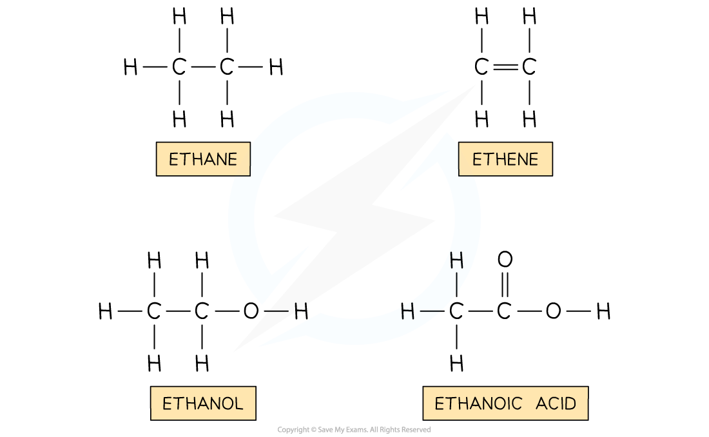
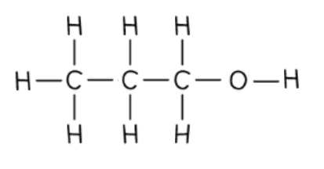
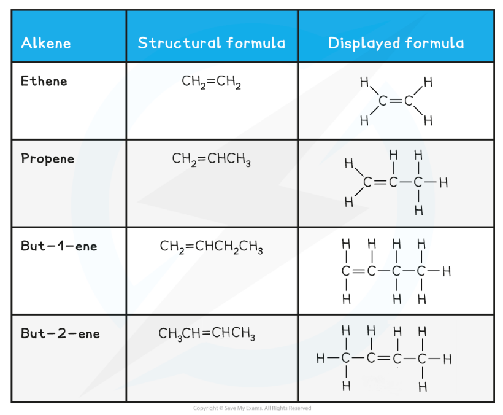
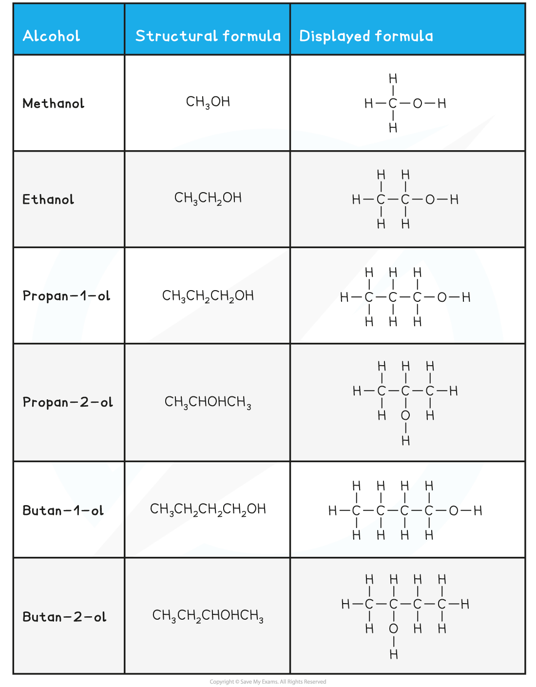
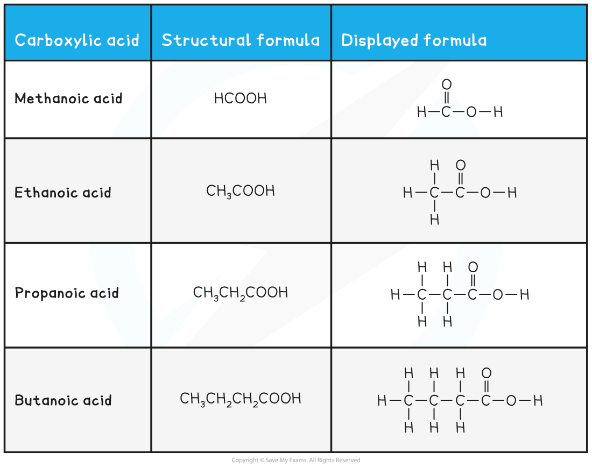
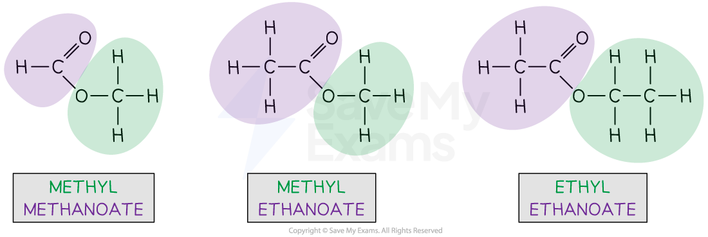

# Naming Organic Compounds

## Naming organic compounds

> **Spec point** — `spcpt_4FXDK5F56GFh2HnT` · Name and draw the displayed formulae of: 
methane and ethane 
(ethene 
ethanol 
ethanoic acid 
the products of the reactions stated in sections 11.4–11.7 
State the type of compound present, given a chemical name ending in -ane, -ene, -ol, or -oic acid or from a molecular  formula or displayed formula

## Naming organic compounds

- The names of organic compounds have two main parts:

  - the stem (sometimes called the prefix)
  - end part (or suffix)
- The stem indicates the number of carbon atoms present in the longest continuous chain of the compound

| **Number of carbon atoms in the longest chain** | **Part of the chemical's name** |
|---|---|
| 1 | meth |
| 2 | eth |
| 3 | prop |
| 4 | but |
| 5 | pent |
| 6 | hex |

- The end part of the name tells you what ***functional group*** is in the compound

| **End part of the name** | **Functional group** | **Organic family** |
|---|---|---|
| ane | none (contains only C-C bonds) | Alkane |
| ene | C=C bond | Alkene |
| anol | –OH | Alcohol |
| anoic acid | –COOH | Carboxylic acid |
| amine | –NH2 | Amine |
| -yl -anoate | –COO– | Ester |

#### Structures of organic compounds

> **Worked Example**
> Name the following organic compounds:
> 
> | **1**   | **2**   | **3**   |
> |---|---|---|
> 
> **Answers:**
> 
> 1. Propene
> 
>   - The longest carbon chain is 3 carbons, so the name contains **prop**
>   - The functional group is C=C, so the name contains **-ene**
> 2. Propanol
> 
>   1. The longest chain is 3 carbons, so the name is** prop**
>   2. The functional group is OH, so the name contains **-anol**
> 3. Pentanol
> 
>   - The longest carbon chain is 5 carbons, so the name contains **pent**
>   - The functional group is OH, so the name contains **-anol**

> **Exam Hint**
> Make sure you can draw and name the structures given above.

## Further naming of organic compounds

> **Spec point** — `spcpt_8xpHHNyCy8V8QNb6` · Name and draw the structural and displayed formulae of unbranched: 
alkanes 
alkenes, including but-1-ene  and but-2-ene 
alcohols, including propan-1-ol, propan-2-ol, butan-1-ol and butan-2-ol 
carboxylic acids containing up to four carbon atoms per molecule
Name and draw the displayed formulae of the unbranched esters which can be made from unbranched alcohols and  carboxylic acids, each containing up to four carbon atoms

## Further naming of organic compounds

**Extended tier only**

- When there is more than one carbon atom where a functional group can be located it is important to distinguish exactly **which carbon **the functional group is on
- Each carbon is numbered and these numbers are used to describe where the functional group is
- For example:

  - Propan-1-ol is an alcohol with an -OH functional group
  - The 1 in the name indicates that the -OH group is located on the first carbon atom
  - **Careful:** There are many times when the numbering should start from the right - this is to keep the numbers as low as possible in chemical names

***In propan-1-ol the -OH group is located on the first carbon atom***

### Alkanes

- As before, the number of carbon atoms gives the part of the compounds name
- Alkanes contain only **single carbon-carbon bonds**,** C–C**, which means that their name ends with **–ane**

  - Some compounds, like alcohols and carboxylic acids, have –an– in their name
  - This indicates that those compounds contain only single carbon-carbon bonds, C–C

### Alkenes

- As before, the number of carbon atoms gives the part of the compounds name
- Alkenes contain at least one **double carbon-carbon bond**,** C=C**, which means that their name ends with **–ene**

  - The first alkene is ethene because you must have two carbons to be able to form a double carbon-carbon bond, C=C
- After propene, you must state the number of the first carbon that is part of the double carbon-carbon bond, C=C

  - e.g. but-1-ene has a double carbon-carbon bond, C=C, on the first carbon in the chain
  - But-2-ene has a double carbon-carbon bond, C=C, on the second carbon in the chain

#### Alcohols

- As before, the number of carbon atoms gives the part of the compounds name
- Alcohols contain an **alcohol / hydroxyl group**, **–O–H**, which means that their name ends with **–anol**
- After ethanol, you must state the number of the carbon that has the alcohol / hydroxyl group, –O–H, attached

  - e.g. propan-1-ol has the alcohol / hydroxyl group, –O–H, on the first carbon in the chain
  Propan-2-ol has the alcohol / hydroxyl group, –O–H, on the second carbon in the chain

#### 

### Carboxylic acids

- As before, the number of carbon atoms gives the part of the compounds name
- Carboxylic acids contain a **carboxylic acid group**, **–COOH**, which means that their name ends with **–anoic acid**
- There is no need to number carboxylic acids because the carbon that is part of the carboxylic acid group is automatically the first carbon of the chain

#### 

### Esters

- Esters are one of the more challenging compounds to name
- Their name is based on the original alcohol and carboxylic acid that they were prepared from

- Ester names are confusing because the name is written backwards from the way the structure is drawn

- Methyl methanoate

  - The alcohol portion of the molecule contains the C–O single bond and is coloured green
  
    - There is one carbon, so this gives the methyl part of the name
  - The carboxylic acid portion contains the C=O double bond and is coloured purple
  
    - The is one carbon, so this gives the methanoate part of the name
- Methyl ethanoate

  - The alcohol portion of the molecule contains the C–O single bond and is coloured green
  
    - There is one carbon, so this gives the methyl part of the name
  - The carboxylic acid portion contains the C=O double bond and is coloured purple
  
    - The are two carbons, so this gives the ethanoate part of the name
- Ethyl ethanoate

  - The alcohol portion of the molecule contains the C–O single bond and is coloured green
  
    - There are two carbons, so this gives the ethyl part of the name
  - The carboxylic acid portion contains the C=O double bond and is coloured purple
  
    - The are two carbons, so this gives the ethanoate part of the name

> **Exam Hint**
> Extended tier students should be able to draw the structural and displayed formulae for all of the compounds written above.
