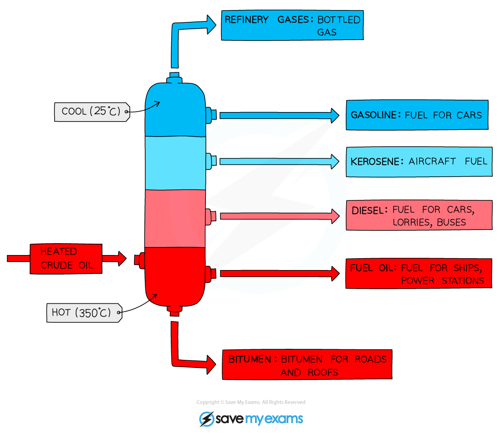

# Fossil Fuels

## Common fossil fuels

> **Spec point** — `spcpt_qVNQsWvvTRpWjhYh` · Name the fossil fuels: coal, natural gas and petroleum 
Name methane as the main constituent of natural gas
State that hydrocarbons are compounds that contain hydrogen and carbon only

## Common fossil fuels

- A fuel is a substance which when burned, releases heat energy
- This heat can be transferred into electricity, which we use in our daily lives
- Most common fossil fuels include **coal**, **natural gas** and **petroleum**
- **Methane, **CH4, is the main constituent of natural gas and is a hydrocarbon
- **Hydrocarbons **are made from hydrogen and carbon atoms only

## Fractional Distillation

> **Spec point** — `spcpt_GddVjVfG62RvgxmP` · nan

## Petroleum & fractional distillation

### Petroleum

- Petroleum is also called **crude oil **and is a mixture of hydrocarbons which also contains natural gas
- It is a thick, sticky, black liquid that is found under porous rock (under the ground and under the sea)

#### The location of crude oil

***Crude oil is located under the sea***

- Petroleum itself as a mixture isn't very useful but each component part of the mixture, called a ***fraction***, is useful and each fraction has different applications

### Fractional distillation

- Each fraction consists of groups of hydrocarbons of** similar** chain lengths
- The fractions in petroleum are separated from each other in a process called **fractional distillation**
- The molecules in each fraction have similar **properties** and **boiling points**, which depend on the number of carbon atoms in the chain
- The size of each molecule is directly related to how many carbon and hydrogen atoms the molecule contains
- Most fractions contain mainly **[alkanes](https://www.savemyexams.com/gcse/chemistry/wjec/18/revision-notes/2-chemical-bonding-application-of-chemical-reactions-and-organic-chemistry/2-5-crude-oil-fuels-and-organic-chemistry/naming-alkanes-and-alkenes/)**, which are compounds of carbon and hydrogen with only **single** bonds between them

#### Diagram to show fractional distillation

***The process separates the fractions according to their boiling point***

- Fractional distillation is carried out in a **fractionating column** which has a temperature gradient

  - It is very hot at the bottom of the column and cooler at the top
- During the process of fractional distillation:

  - The crude oil is heated and **vapourises**
  - The vapours of hydrocarbons enter the column which has a **temperature gradient**
  - The vapours of hydrocarbons with high boiling points **condense** at the bottom of the column
  - The vapours of hydrocarbons with lower boiling points rise up the column and condense at the top

### Properties of fractions

- **Viscosity**

  - This refers to the ease of flow of a liquid.
  - High viscosity liquids are thick and flow less easily.
  - As the number of carbon atoms increases, the attraction between the hydrocarbon molecules also increases which results in the liquid becoming more viscous with the increasing length of the hydrocarbon chain.
  - Going down the column, the viscosity of the fractions increases
- **Melting point/boiling point**

  - As the molecules get larger, the intermolecular attraction becomes greater.
  - More heat is needed to separate the molecules.
  - Going down the column, the boiling points of the fractions increases
- **Volatility**

  - Volatility refers to the tendency of a substance to vaporise.
  - As the size of the hydrocarbon increases, the attraction between the molecules increases
  - Going down the column, the volatility of the fractions therefore decreases

#### Uses of Fractions

- Refinery gas: heating and cooking
- Gasoline: fuel for cars (petrol)
- Naphtha: raw product for producing chemicals
- Kerosene: for making jet fuel (paraffin)
- Diesel: fuel for diesel engines (gas oil)
- Fuel oil: fuel for ships and for home heating
- Lubricating oil: for lubricants, polishes, waxes
- Bitumen: for surfacing roads

#### Table to show the trends in properties

| **Fraction** | **Number of carbon atoms** | **Boiling point range / ****o****C** | **Viscosity ** | **Volatility ** |
|---|---|---|---|---|
| Refinery gas | 1-4 | Below 25 | Viscosity increases going down the fractions | Volatility decreases going down the fractions |
| Gasoline / petrol | 4-12 | 40-100 |   |   |
| Naphtha | 7-14 | 90-150 |   |   |
| Kerosene / paraffin | 12-16 | 150-240 |   |   |
| Diesel / gas oil | 14-18 | 220-300 |   |   |
| Fuel oil | 19-25 | 250-320 |   |   |
| Lubricating oil | 20-40 | 300-350 |   |   |
| Bitumen | More than 70 | More than 350 |   |   |

> **Exam Hint**
> You **must **be able to recall a use for each fraction as well describe the trends in properties.
