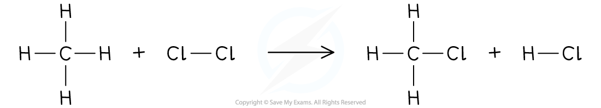

# Alkanes

## Alkanes

> **Spec point** — `spcpt_8kSCN2GwfnqgmTzQ` · nan

## Alkanes: properties & bonding

### What is an alkane?

- Alkanes are a group of **saturated** hydrocarbons
- The term saturated means that they only have single carbon-carbon bonds, there are no double bonds
- Alkanes have [covalent](https://www.savemyexams.com/igcse/chemistry/cie/23/revision-notes/2-atoms-elements-and-compounds/2-3-simple-molecules-and-covalent-bonds/2-3-1-covalent-bonds/) bonds as they consist of non-metal atoms
- The general formula of the alkanes is** C****n****H****2n+2**

#### Table of alkanes

| **Displayed formula** | **Name** | **Molecular formula** |
|---|---|---|
|  | methane | CH4 |
|  | ethane | C2H6 |
|  | propane | C3H8 |
|  | butane | C4H10 |
|  | pentane | C5H12 |

***The first five members of the alkane homologous series***

> **Exam Hint**
> Co-ordinated students only need to be able to name and draw the displayed formula for methane and ethane but extended students should know the whole table.

- Alkanes are colourless compounds which have a gradual change in their physical properties as the number of carbon atoms in the chain increases
- They are generally unreactive compounds but they:

  - Undergo **combustion**
  - Can be **cracked** into smaller molecules
  - React with **halogens** in the presence of light in substitution reactions

### Combustion of alkanes

- Alkanes undergo complete combustion to form carbon dioxide and water:

Alkane + oxygen → carbon dioxide + water

- Combustion of methane:

CH4 (g) + 2O2 (g) → CO2 (g) + 2H2O (l)

- Combustion of ethane:

C2H6 (g) + 3½O2 (g) → 2CO2 (g) + 3H2O (l)

- Combustion of propane:

C3H8 (g) + 5O2 (g) → 3CO2 (g) + 4H2O (l)

- Combustion of butane:

C4H10 (g) + 6½O2 (g) → 4CO2 (g) + 5H2O (l)

## Substitution reaction of alkanes with halogens

> **Spec point** — `spcpt_jFxmxcjbSWVF3CCs` · State that in a substitution reaction one atom or group of atoms is replaced by another atom or group of atoms
Describe the substitution reaction of alkanes with chlorine as a photochemical reaction, with ultraviolet light providing the activation energy, Ea, and draw the structural or displayed formulae of the  products, limited to monosubstitution

## Substitution reaction of alkanes with halogens

**Extended tier only**

- In a **substitution reaction**, one atom (or group of atoms) is swapped with another atom (or group of atoms)
- Alkanes undergo a substitution reaction with halogens in the presence of ultraviolet radiation (sunlight is a source of UV radiation)
- This is called a **photochemical** reaction
- The UV light provides the [activation energy](https://www.savemyexams.com/igcse/chemistry/cie/23/revision-notes/5-chemical-energetics/5-1-exothermic-and-endothermic-reactions/5-1-2-enthalpy-change-and-activation-energy/), Ea, for the reaction
- A hydrogen atom is replaced with the halogen atom
- More than one hydrogen atom can be substituted depending on the amount of ultraviolet radiation there is

***In the presence of ultraviolet (UV) radiation, methane reacts with chlorine to form chloromethane and hydrogen chloride***

** **

> **Exam Hint**
> You need to be able to draw the displayed and structural formulae of the products formed when chlorine replaces one hydrogen atom (also known as monosubstitution)
