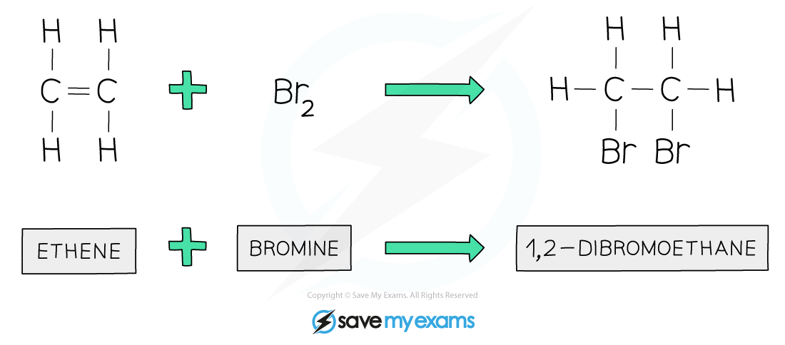
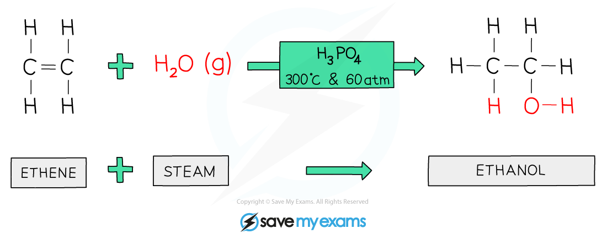

# Addition Reactions

## Addition reactions

> **Spec point** — `spcpt_TRFdDNQxfzyJwDFb` · State that in an addition reaction only one product is formed
Describe the properties of alkenes in terms of addition reactions with: 
bromine or aqueous bromine 
hydrogen in the presence of a nickel catalyst 
steam in the presence of an acid catalyst and draw the structural or displayed  formulae of the products

## Addition reactions

**Extended tier only**

- Alkenes undergo** addition reactions**, where atoms from a small molecule add across the C=C double bond
- In an addition reaction:

  - The C=C bond breaks
  - New single bonds form
  - Only one product is formed

### Alkenes and bromine

- The reaction between an alkene and bromine is an addition reaction.

  - Bromine atoms add across the C=C double bond
  - A **saturated compound** is formed
- Aqueous bromine is orange and is used as a test for alkenes.

  - When bromine water is added to an **alkene**, it is **decolourised** (orange → colourless)
  - This happens because bromine reacts with the C=C bond and is no longer in solution
- Example:

*Bromine atoms add across the C=C in the addition reaction of ethene and bromine*

### Alkenes and hydrogen

- When alkenes react with hydrogen, an **alkane** is formed

  - This is an addition reaction
  - A **nickel catalyst** is required
- Examples:

  - Ethene + hydrogen → ethane
  - Propene + hydrogen → propane

*Hydrogen atoms add across the C=C in the addition reaction of ethene and hydrogen*

### Alkenes and steam

- When alkenes react with steam, an **alcohol** is formed

  - This is an addition reaction
  - It is also called a **hydration reaction**
  - An **acid catalyst** is required
- Examples:

  - Ethene + steam → ethanol
  - Propene + steam → propanol

*A water molecule adds across the C=C in the addition reaction (hydration) of ethene with water to produce ethanol*

> **Exam Hint**
> You need to be able to draw the structural and displayed formulae of the products of alkenes with steam, hydrogen and bromine.
