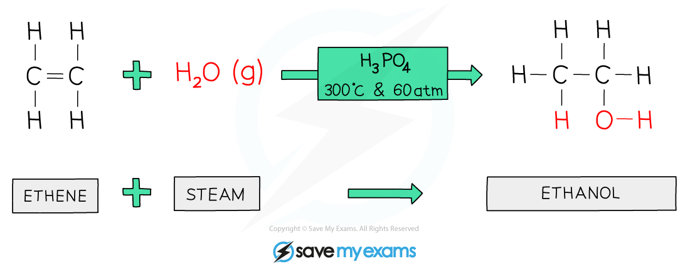

# Alcohols

## Alcohols

> **Spec point** — `spcpt_VcPXRNFPNFRYJtMh` · Describe the manufacture of ethanol by: 
fermentation of aqueous glucose at 25–35°C in the presence of yeast   and in the absence of oxygen 
catalytic addition of steam to ethene at 300°C and 6000kPa /60 atm in the presence of an acid catalyst
Describe the combustion of ethanol
State the uses of ethanol as: 
a solvent 
a fuel 

## Alcohols

- All alcohols contain the hydroxyl (**-OH**) functional group which is the part of alcohol molecules that is responsible for their characteristic reactions
- Alcohols are a homologous series of compounds that have the general formula **C****n****H****2n+1****OH**
- They differ by one -CH2 in the molecular formulae from one member to the next

**Table showing the first three alcohols**

| **Name** | **Formula** | **Displayed formula** |
|---|---|---|
| Methanol | CH3OH |  |
| Ethanol | C2H5OH |  |
| Propanol | C3H7OH |  |

- Ethanol (C2H5OH) is one of the most important alcohols

  - Ethanol can also be represented by its structural formula CH3CH2OH
- It is the type of alcohol found in **alcoholic drinks** such as wine and beer
- It is also used as **fuel **for cars and as a **solvent**
- Ethanol will undergo complete combustion and burn in excess oxygen to produce carbon dioxide and water

C2H5OH (l) + 3O2 (g) → 2CO2 (g) + 3H2O (l)

### The manufacture of ethanol

- There are two methods used to manufacture ethanol:

  - The **hydration** of **ethene** with steam
  - The **fermentation** of glucose
- Both methods have advantages and disadvantages which are considered

#### Hydration of ethene

- A mixture of ethene and steam is passed over a hot catalyst of **phosphoric acid **at a temperature of approximately** 300 °C**
- The pressure used is **60 atmospheres (6000kPa)**
- The gaseous ethanol is then condensed into a liquid for use

***A water molecule adds across the C=C in the hydration of ethene to produce ethanol***

#### Fermentation of glucose

- Sugar or starch is dissolved in water and yeast is added
- The mixture is then fermented between **25 **and **35 °C** with the **absence** **of oxygen** for a few days
- Yeast contains ***enzymes*** that catalyse the break down of starch or sugar to glucose
- If the temperature is too **low** the reaction rate will be too slow and if it is too **high** the enzymes will become ***denatured***
- The yeast respire anaerobically using the glucose to form ethanol and carbon dioxide:

C6H12O6 → 2CO2 + 2C2H5OH

- The yeast are killed off once the concentration of alcohol reaches around 15%, so the reaction vessel is emptied and the process is started again
- Ethanol production by fermentation is therefore a **batch** process

> **Exam Hint**
> Make sure you learn the conditions for both hydration and fermentation.

## Comparing methods of ethanol production

> **Spec point** — `spcpt_ggXs8vKGz2BvfVCd` · Describe the advantages and disadvantages of the manufacture of ethanol by: 
fermentation 
catalytic addition of steam to ethene

## Comparing methods of ethanol production

**Extended tier only**

|   | **Hydration of ethene** | **Fermentation** |
|---|---|---|
| **Equipment** | complex set up required | simple equipment needed |
| **Raw materials** | uses non- renewable resources (crude oil) | uses renewable resources (sugar cane) |
| **Type of process** | continuous process- a steam of reactants is constantly passed over a catalyst | batch process- everything is mixed together in a reaction vessel and left for several days and the process repeated again |
| **Rate of reaction** | fast | very slow (several days) |
| **Quality of product** | produces pure ethanol | produces a dilute solution requiring further processing |
| **Atmospheric effects** | no greenhouse gases produced but pollutants are formed from the burning of fossil fuels to maintain high temperatures | carbon dioxide produced which is a greenhouse gas |
| **Reaction conditions** | high temperatures and pressures required increasing the energy input and cost | low temperatures required |
