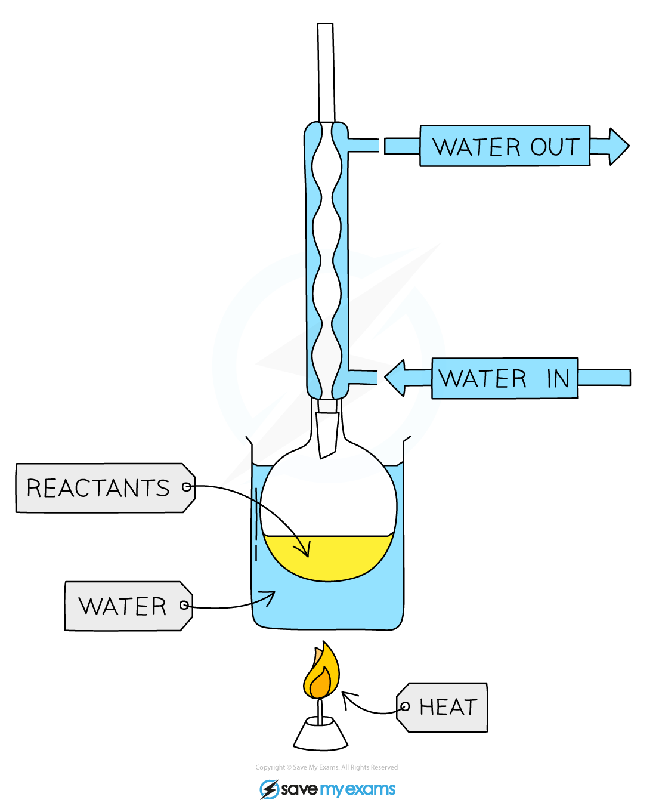
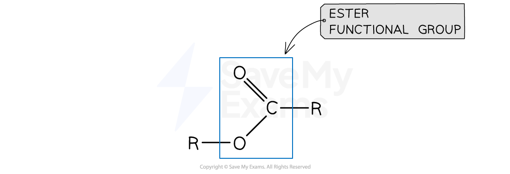
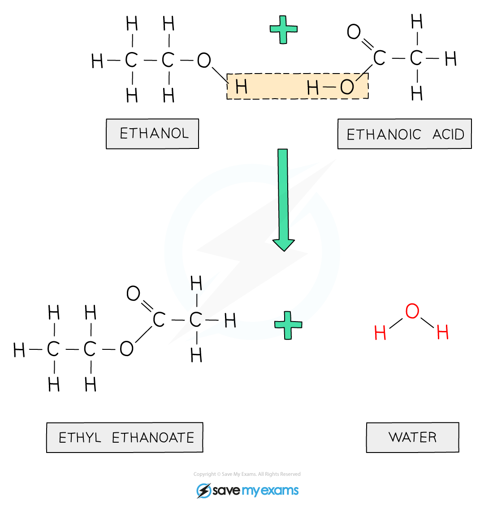
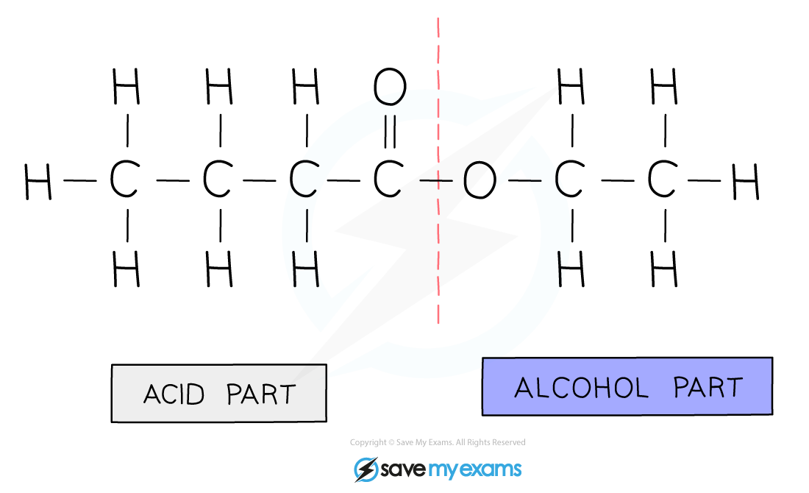

# Ethanoic Acid & Esterification Reactions

## Formation of ethanoic acid

> **Spec point** — `spcpt_cDfTFF6Wy2cyyhKn` · Describe the formation of ethanoic acid by the oxidation of ethanol: 
(a) with acidified aqueous potassium manganate(VII) 
(b) by bacterial oxidation during vinegar production

## Formation of ethanoic acid

**Extended tier only**

- Two methods used to make carboxylic acids are:

  - Oxidation by **fermentation**
  - Using **oxidising agents **
- The **microbial oxidation** (fermentation) of ethanol will produce a weak solution of vinegar (ethanoic acid)
- This occurs when a bottle of wine is opened as bacteria in the air (acetobacter) will use atmospheric oxygen from air to oxidise the ethanol in the wine

C2H5OH (aq) + O2 (g) → CH3COOH (aq)+ H2O (l)

- The acidic, vinegary taste of wine which has been left open for several days is due to the presence of ethanoic acid
- Alternatively, oxidising agent **potassium manganate(VII) **can be used
- This involves heating ethanol with **acidified potassium manganate(VII)** in the presence of an acid
- The heating is performed under ***reflux*** which involves heating the reaction mixture in a vessel with a condenser attached to the top
- The condenser prevents the volatile alcohol from escaping the reaction vessel as alcohols have low boiling points
- The equation for the reaction is:

CH3CH2OH (aq) + 2[O]  →  CH3COOH (aq) + H2O (l)

- The solution will change from purple to colourless
- The oxidising agent is represented by the symbol for oxygen in square brackets** **

#### Diagram showing the experimental setup for the oxidation with KMnO4 using reflux apparatus

***Ethanol is heated with acidified potassium manganate(VII)**** ****in the presence of an acid ***

## Esterification

> **Spec point** — `spcpt_WmryHNKGHBzfdg8V` · Describe the reaction of a carboxylic acid with an alcohol using an acid catalyst to form an ester

## Esterification

**Extended tier only**

- Alcohols and carboxylic acids react to make esters in **esterification** reactions
- Esters are compounds with the functional group R-COO-R

- Esters are sweet-smelling oily liquids used in** food flavourings** and **perfumes**
- An acid catalyst is required for an esterification reaction
- Ethanoic acid will react with ethanol in the presence of concentrated sulfuric acid (catalyst) to form ethyl ethanoate:

CH3COOH (aq) + C2H5OH (aq)  ⇌  CH3COOC2H5 (aq) + H2O (l)

#### Diagram showing the formation of ethyl ethanoate

***During this esterification reaction, a molecule of water is also produced***

#### Naming Esters

- An ester is made from an alcohol and carboxylic acid
- The first part of the name indicates the length of the carbon chain in the alcohol, and it ends with the letters ‘- yl’
- The second part of the name indicates the length of the carbon chain in the carboxylic acid, and it ends with the letters ‘- oate’

  - E.g. the ester formed from** pent**anol and **butan**oic acid is called **pent**yl **butan**oate

***Diagram showing the origin of each carbon chain in ester; this ester is ethyl butanoate***

**Summary table of some esters and the compounds they are formed from**

| **Name of ester ** | **Alcohol and carboxylic acid it is formed from** |
|---|---|
| propyl methanoate | propanol and methanoic acid |
| methyl butanoate | methanol and butanoic acid |
| ethyl propanoate | ethanol and propanoic acid |
