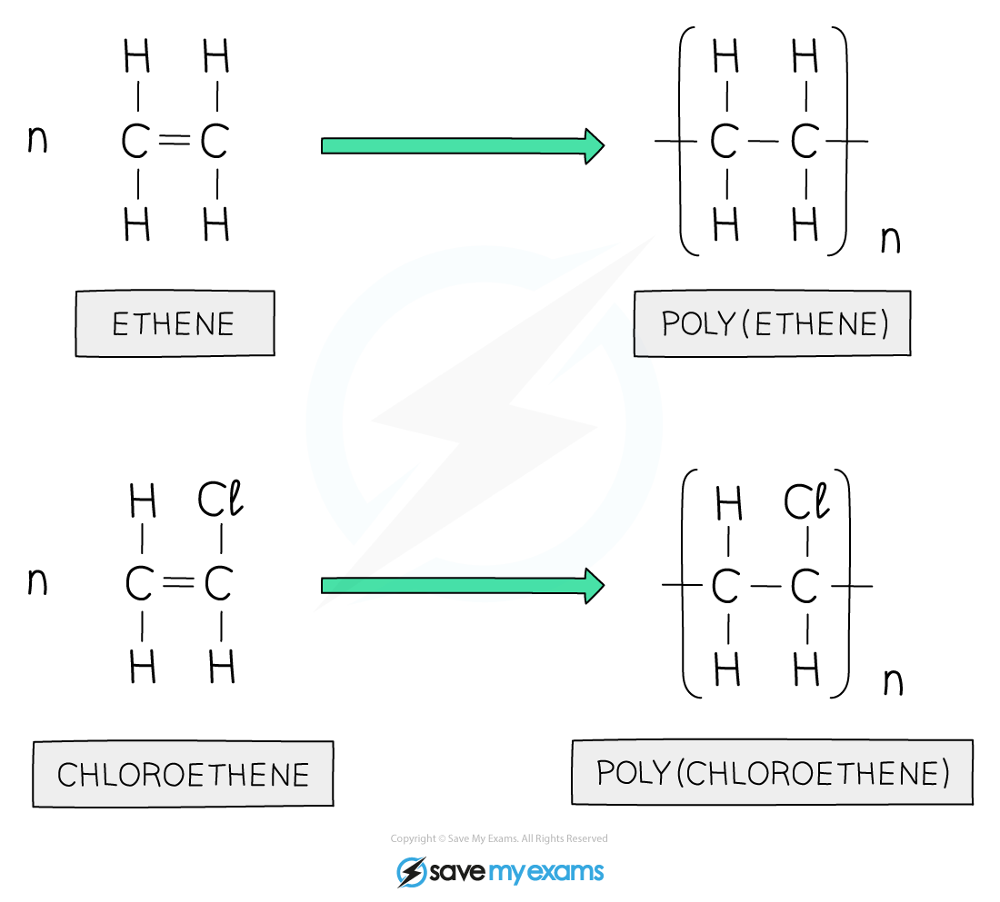
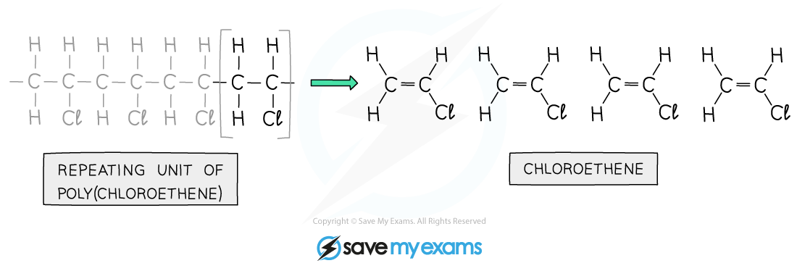
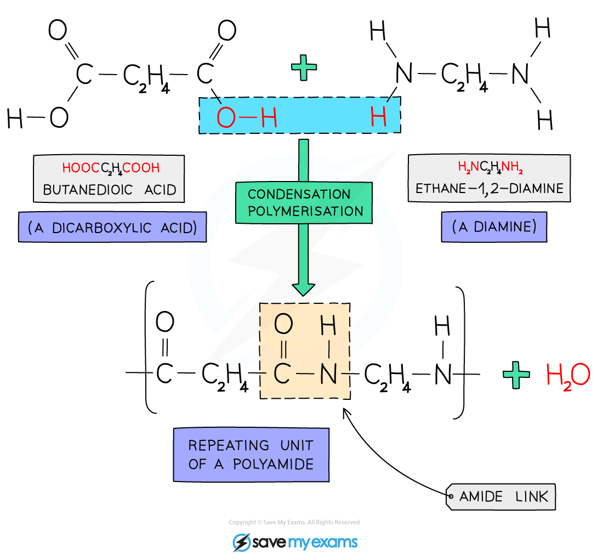
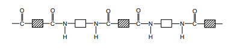
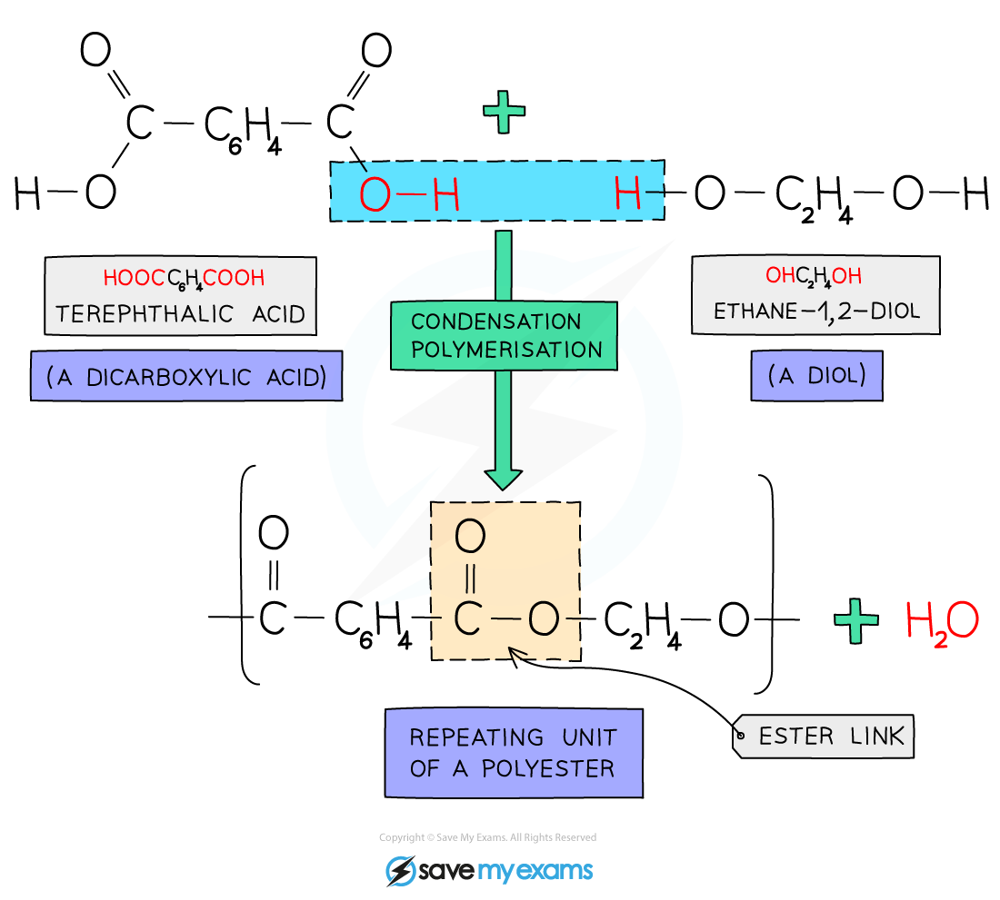
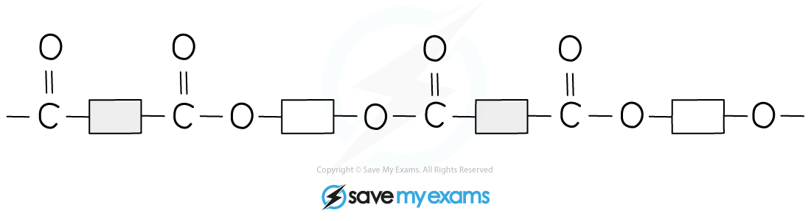

# Addition & Condensation Polymers

## Addition polymers

> **Spec point** — `spcpt_y6gGXXX3Cvm9YrGN` · Identify the repeat units and/or linkages in addition polymers
Deduce the structure or repeat unit of an addition polymer from a given alkene and vice versa

## Addition polymers

**Extended tier only**

- Addition polymers are formed by the joining up of many monomers and only occur in monomers that contain **C=C bonds**
- One of the bonds in each C=C bond breaks and forms a bond with the adjacent monomer
- The polymer formed will only contain single bonds
- Many polymers can be made by the addition of alkene monomers
- Others are made from alkene monomers with different atoms attached to the monomer such as chlorine or a hydroxyl group
- The name of the polymer is deduced by putting the name of the **monomer** in brackets and adding poly- as the** prefix**
- For example if propene is the alkene monomer used, then the name is **poly(propene)**
- Poly(ethene) is formed by the addition polymerisation of **ethene monomers**

### Deducing the polymer from the monomer

- Polymer molecules are very large compared with most other molecule
- **Repeat units** are used when displaying the formula
- To draw a repeat unit:

  - Change the double bond in the monomer to a **single bond** in the repeat unit
  - Add a continuation bond to each end of the repeat unit
  
    - The bonds on either side of the polymer must **extend** outside the brackets (these are called extension or continuation bonds)
  - A small **subscript** n is written on the bottom right hand side to indicate a large number of repeat units
  - Add on the rest of the groups in the **same order** that they surrounded the double bond in the monomer

#### Examples of some addition polymers

***The repeat unit for the polymer should have an n in the bottom right hand corner***

### Deducing the monomer from the polymer

- To deduce the monomer from the polymer:
- Identify the repeating unit in the polymer
- Change the single bond in the repeat unit to a **double bond** in the monomer
- Remove the bond from each end of the repeat unit

***Th monomer has been identified, a double bond added and the atoms drawn in***

> **Exam Hint**
> You could be asked to draw the repeat unit for any given monomer and vice versa.
> 
> You would only need to draw the structure of one monomer if you have been given the polymer.

## Condensation polymers

> **Spec point** — `spcpt_SFDygBdRgfTgv9z3` · Identify the repeat units and/or linkages in condensation polymers 
Deduce the structure or repeat unit of a condensation polymer from given monomers and vice versa, limited to: 
polyamides from a dicarboxylic acid  and a diamine 
polyesters from a dicarboxylic acid and a diol 
Describe and draw the structure of: 
nylon, a polyamide,  (see IMAGE in syllabus) 
PET, a polyester  (see IMAGE in syllabus).
The full name for PET, polyethylene terephthalate, is not required
Describe the differences between addition and condensation polymerisation 

## Condensation polymers

**Extended tier only**

- Condensation polymers are formed when two** different monomers** are linked together with the removal of a small molecule, usually water
- This is a key difference between condensation polymers and addition polymers:

  - Addition polymerisation forms the polymer molecule **only**
  - Condensation polymerisation forms the polymer molecule and one water molecule per linkage
- The monomers have** two** functional groups present, one on each end
- The functional groups at the ends of one monomer react with the functional group on the end of the other monomer, in so doing creating long chains of alternating monomers, forming the polymer

### Forming nylon

- Nylon is a ***polyamide*** made from **dicarboxylic acid **monomers (a carboxylic with a -COOH group at** **either end) and **diamines** (an amine with an -NH2 group at** **either end)
- Each -COOH group reacts with another -NH2 group on another monomer
- An ***amide linkage*** is formed with the subsequent loss of one** **water molecule per link

#### Forming nylon

***Nylon is a polyamide formed from a dicarboxylic acid and a diamine***

- The structure of nylon can be represented by drawing out the polymer using boxes to represent the carbon chains

***Diagram showing a section of nylon***

### Forming polyesters

- **PET** or polyethylene terephthalate to give its full name,** **is a **polyester** made from **dicarboxylic** acid monomers (a carboxylic with a -COOH group at either end) and **diols** (alcohol with an -OH group at either end)
- Each -COOH group reacts with another -OH group on another monomer
- An** ester linkage** is formed with the subsequent loss of one water molecule per link
- For every ester linkage formed in condensation polymerisation, one molecule of water is formed from the combination of a **proton** (H+) and a** hydroxyl** ion (OH–)
- **PET **is also used in synthetic fibres as is sold under the trade name of **terylene**

#### Forming PET

***PET is a polyester formed from a dicarboxylic acid and a diol***

- The structure of PET can be represented by drawing out the polymer using boxes to represent the carbon chains
- This can be done for all polyesters

***Diagram showing a section of PET***

> **Exam Hint**
> You don't need to know the detailed chemical structure of PET, just the symbolic drawing showing the alternating blocks and the linking ester group. Be careful not to exactly repeat the linking group in nylon or PET; the link alternates by reversing the order of the atoms, rather like a mirror image.
