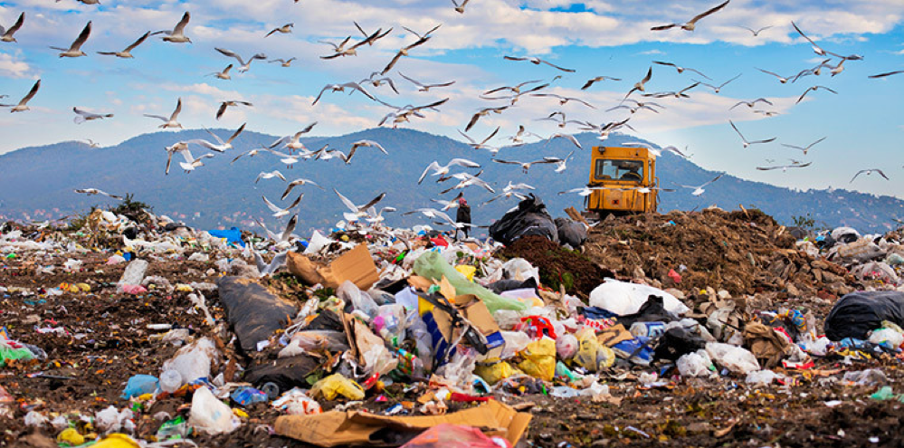
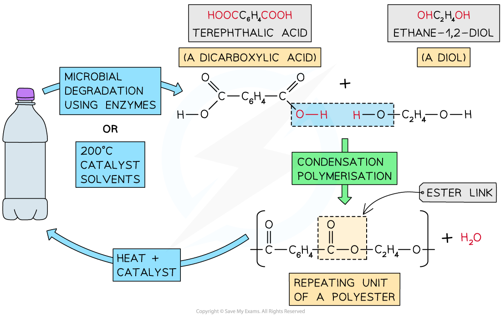

# Plastics & their Disposal

## Plastics & their disposal

> **Spec point** — `spcpt_DcK9SSZh3q6mC8CF` · State that plastics are made from polymers 
Describe how the properties of plastics have implications for their disposal 
Describe the environmental challenges caused by plastics, limited to: 
disposal in land fill sites 
accumulation in  oceans 
formation of toxic gases from burning

## Plastics & their disposal

- Plastics are made from polymers
- Many polymers are chemically unreactive, which means that they are **non-biodegradable**
- This means that the disposal of plastics can cause environmental issues

### Incineration

- Polymers release a lot of heat energy when they burn and produce carbon dioxide, which is a greenhouse gas that contributes to climate change
- Some polymers release **toxic fumes** when they burn

  - An example of this is poly(vinylchloride), which releases toxic hydrogen chloride gas when burned
- If incinerated by incomplete combustion, carbon monoxide will be produced which is a toxic gas

### Polluting oceans

- Plastic waste is **accumulating in oceans** and causing huge disruptions to marine life

### Landfills

- Waste polymers are disposed of in landfill sites

  - But, this takes up valuable land
- Most polymers are non-biodegradable

  - This means that micro-organisms, such as decomposers, cannot break them down
  - This causes sites to quickly fill up

*Disposal of polymers is an environmental problem*

## PET re-polymerisation

> **Spec point** — `spcpt_wdtjQV8VBhY5dPtR` · State that PET can be converted back into monomers and re-polymerised

## PET re-polymerisation

**Extended tier only**

- PET stands for polyethylene terephthalate

  - This is a common polymer used to make things like plastic bottles
- It is a [condensation polymer ](https://www.savemyexams.com/igcse/chemistry/cie/23/revision-notes/11-organic-chemistry/11-3-polymers/11-3-2-addition-and-condensation-polymers/)consisting of repeating ester units

  - So, PET is a type of polyester, like terylene
- One of the problems with recycling polymers is that the conditions needed to break them down, which are usually high temperatures and pressures, can degrade the monomers making them unusable for re-polymerisation
- PET is relatively easy to convert back into the monomers
- It can be depolymerised either using enzymes or by chemical methods
- Enzymes present in microbes breakdown the PET into the original monomers
- The same can be achieved using solvents a catalyst and mild heating
- The monomers are recovered and be** re-polymerised** into new PET
- This saves on resources and energy, reducing the carbon footprint of the production process

#### The re-polymerisation of PET

*The breakdown of PET into its two monomers takes place using enzymes or chemical catalysts and mild conditions*
