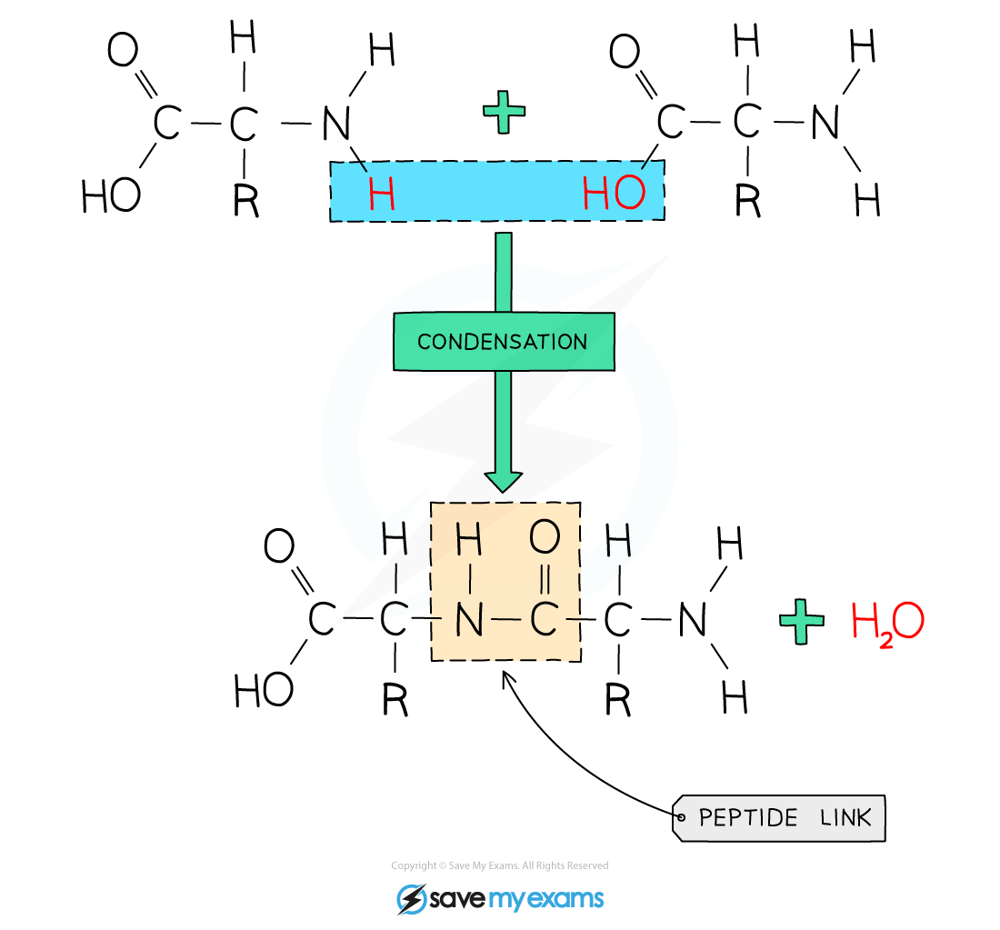

# Proteins

## Proteins

> **Spec point** — `spcpt_2bWg5KmwdcNnHDgc` · Describe proteins as natural polyamides and that they are formed from amino acid monomers with the general structure: where R represents different types of side chain
Describe and draw the structure of proteins as: (see IMAGE in syllabus)

## Proteins

**Extended tier only**

- Proteins are an example of **condensation** polymers
- They are formed from ***amino acid*** monomers joined together by **amide** links
- Amino acids are small molecules containing **NH****2** and **COOH** functional groups
- Due to containing amide links and being found in biological systems, proteins are known as** natural polyamides**
- In proteins, the amide links are known as peptide links
- There are **twenty **common amino acids, each differing by their side chain, represented by R

***General structure of an amino acid ***

- Proteins can contain between 60 and 600 of these amino acids in different orders
- These are the monomers which polymerise to form the protein

#### The formation of a protein

***A protein is produced by a condensation polymerisation reaction***

- The structure of proteins can be represented using the following diagram whereby the boxes represent the carbon chains

***Diagram showing a section of protein***

> **Exam Hint**
> For your exam, you are only required to draw proteins using the boxes representing the carbon chains.
